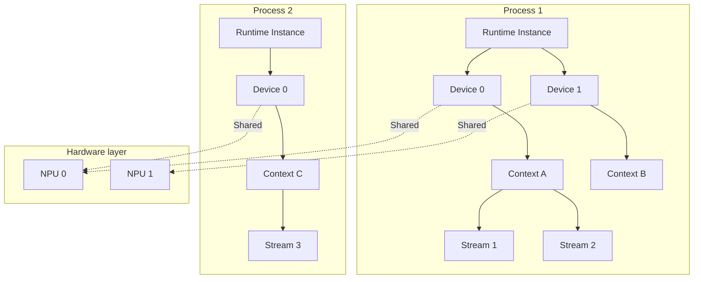
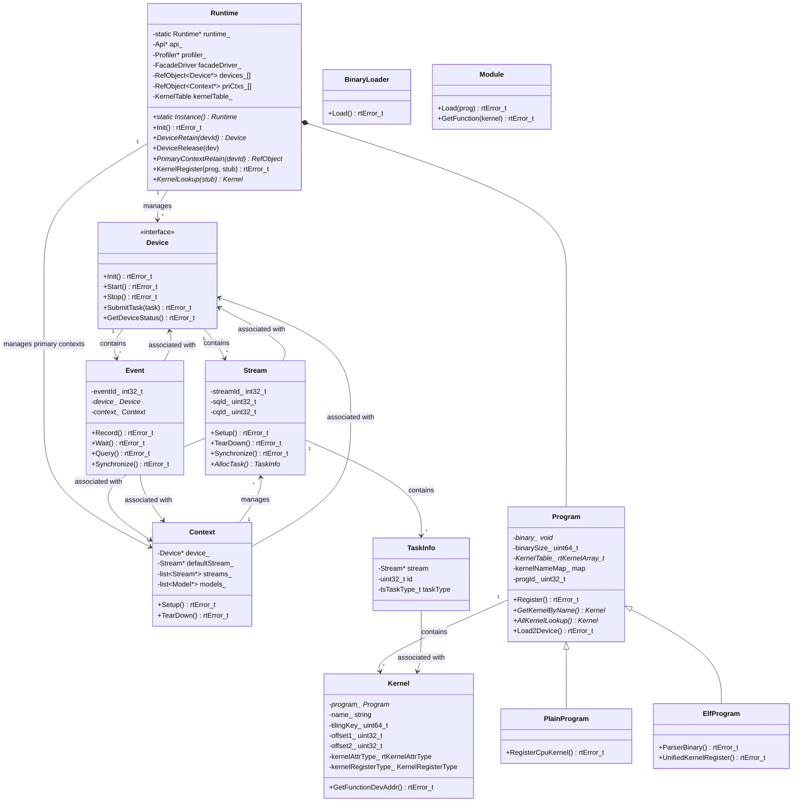

# Introduction to the Runtime Architecture

## 1 System Architecture Overview

**Function overview**: The CANN Runtime is the runtime component of Ascend AI processors. It provides core functions such as device management, task scheduling, memory management, and kernel execution. It serves as the bridge between upper-layer AI compute frameworks (such as PyTorch, MindSpore, and TensorFlow) and acceleration libraries (such as operator libraries, communication libraries, domain acceleration libraries, and graph engines) and the underlying driver.

### 1.1 Runtime Logical Architecture Diagram

* Runtime API layer: Provides C/C++ language APIs externally and encapsulates core implementations and feature functions. The APIs fall into three main categories: low-level runtime APIs prefixed with rt (such as rtSetDevice and rtMalloc), ACL runtime function APIs prefixed with aclrt (such as aclrtStreamCreate and aclrtLaunchKernel), and ACL Graph/Model feature APIs prefixed with aclmdlRI. The API layer uniformly handles parameter validation and error code conversion.
* Runtime feature layer: Builds pluggable feature functions based on core layer capabilities. The features include ACL Graph (stream capture and graph building), Model (model loading and execution), Fusion (operator fusion), and Snapshot (process snapshot and fault diagnosis).
* Runtime core layer: Provides core functions such as device management (Device), context management (Context/primary context), stream management (Stream/SQ-CQ asynchronous mechanism), task scheduling (Engine/TaskFactory), memory management (MemoryPool), kernel execution (Kernel/Program), event synchronization (Event), and the notification mechanism (Notify). This layer is the main body of the Runtime core implementation.
* Driver adaptation layer: The adaptation layer provides abstraction and adaptation for chips of different generations for the Runtime **core layer** and **feature layer**, and shields hardware and driver API differences. It supports chips of multiple generations through version directories such as driver/v100 and v200. It manages chip feature configurations through the config/ directory (such as 910, 310P, and BS9SX1A). It unifies the driver call entry through the HAL driver API (ascend_hal.h).

### 1.2 Runtime Deployment View

The Runtime is deployed as a dynamic library in the user-space process address space and serves as the bridge between upper-layer applications and the underlying driver. The following figure shows the deployment position and layer relationships of the Runtime in the system:

**Deployment layer description**:

| Layer | Component | Deployment Position | Description |
|------|------|----------|------|
| Application layer | AI frameworks, operator libraries, and communication libraries | User-space process | AI frameworks such as PyTorch, MindSpore, and TensorFlow, as well as the ACL operator library, HCCL communication library, and so on |
| Runtime layer | CANN Runtime | User-space dynamic library | Provides library files such as `libacl_rt.so`, `libruntime.so`, `libruntime_v100/v200.so`, and `libruntime_common.so`, which are loaded into the application process through dynamic linking |
| Driver layer | Ascend Driver | Kernel space | The driver module `ascend_km` runs in kernel space and interacts with user space through the `/dev/davinci*` device files |
| Hardware layer | Ascend NPU | Physical device | Ascend AI processors (such as 910, 310P, and 950), which provide compute units such as AI Core, AI CPU, and CCU |

**Process model**:

The Runtime runs in in-process singleton mode:

- **Multiple devices in a single process**: A process can manage multiple NPU devices (switch devices by using `aclrtSetDevice`)
- **Multiple contexts in a single process**: A process can create multiple Contexts (each Context is associated with one Device)
- **Multiple Streams in a single process**: One Context can create multiple Streams to implement task parallelism
- **Isolation between processes**: Runtime instances of different processes are completely isolated, and each instance maintains independent resource states

### 1.3 Introduction to Core Modules

#### 1.3.1 Runtime Global Management

**Component responsibilities**: The singleton manages global resources, including the creation, reference counting, and destruction of devices, contexts, programs, and kernels.

**Core flows**:

- Global resource initialization and deinitialization
- Device acquisition and release (DeviceRetain/DeviceRelease)
- Primary context management (PrimaryContextRetain/PrimaryContextRelease)
- Kernel registration and lookup (KernelRegister/KernelLookup)
- Profiler start and stop (ProfilerStart/ProfilerStop)

#### 1.3.2 Device Management

**Component responsibilities**: This component manages the device resources of Ascend AI processors and provides compute device setup, reset, query, and configuration functions externally. Internally, it covers device initialization, startup, stop, state management, task submission, and resource pool management.

**Core flows**:

- Device initialization: driver initialization → obtain device attributes → create resource pools → start the scheduling engine
- Task submission: check the device status → Engine.SubmitTask → Stream allocation → send to the SQ
- Error handling: detect errors → set the device status → stop the device → trigger callbacks

#### 1.3.3 Context Management

**Component responsibilities**: This component manages the execution context environment of compute devices. It provides context creation, destruction, attribute query, and configuration APIs externally. Internally, it is associated with Device and Stream, and manages program loading, kernel execution, and other operations.

**Core flows**:

- Context creation: associate with a Device → create the default Stream
- Program loading: BinaryLoad → load the kernel binary to the device
- Kernel execution: KernelLaunch → submit tasks to the Stream

#### 1.3.4 Memory Management

**Component responsibilities**: This component manages the allocation, operations, and release of device memory and host memory. It provides memory allocation and release, memory copy, and memory setting APIs externally. Internally, it supports management of multiple memory types, the memory pool mechanism, asynchronous memory operations, physical memory management, and inter-process memory sharing.

**Core flows**:

- Memory allocation: validate parameters → select a memory type → call the driver to allocate memory → return the address
- Memory copy: determine the copy direction → create a copy task → submit the task to the Stream → execute DMA
- Memory release: validate the address → call the driver to release memory → update the resource pool

#### 1.3.5 Stream Management

**Component responsibilities**: This component manages the logical task queues provided by Device. It provides Stream creation and destruction, attribute configuration, stream synchronization, and state management APIs externally. Internally, it interacts with hardware through the SQ/CQ mechanism to implement asynchronous task execution.

**Core flows**:

- Stream creation: allocate a streamId → bind SQ/CQ → initialize resources
- Task submission: AllocTask → fill in parameters → send to the SQ → wait for CQ completion
- Stream synchronization: Synchronize → wait for all tasks to complete → return results

#### 1.3.6 Kernel Management

**Component responsibilities**: This component manages the registration, lookup, and execution of operator binaries for AI Core (AI Cube, AI Vector), AICPU, and other compute units. It supports two lookup methods: by kernel function name and by kernel function identifier.

**Core flows**:

- Binary registration: aclrtBinaryLoadFromFile/FromData → BinaryLoader::Load → Program::Register → UnifiedKernelRegister (ElfProgram) or RegisterCpuKernel (PlainProgram)
- Kernel lookup: aclrtBinaryGetFunction → Program::GetKernelByName (by kernel function name) or aclrtBinaryGetFunctionByEntry → Program::AllKernelLookup (binary search by kernel function identifier)
- Device loading: Program::Load2Device → allocate device memory + 4K alignment + H2D copy
- Kernel execution: Kernel::GetFunctionDevAddr → return the device-side function address → load parameters with ArgLoader → dispatch the Task

#### 1.3.7 Task Management

**Component responsibilities**: This component manages the creation, execution, and reclamation of various tasks. It supports multiple task types, including compute tasks, memory copy tasks, event synchronization tasks, and so on.

**Core flows**:

- Task allocation: TaskFactory.AllocTask → fill in TaskInfo
- Task submission: fill in the SQE → send to the SQ → wait for the CQ
- Task reclamation: obtain the completion status from the CQ → RecycleTask → update the resource pool

#### 1.3.8 Event Synchronization

**Component responsibilities**: This component provides a synchronization mechanism (Event is used for synchronization of tasks across streams). It supports event record, event wait, state query, and event timestamp functions.

**Core flows**:

- Event record: EventRecord → record a position in the Stream
- Event wait: EventWait → wait for the event to complete
- State query: EventQuery → return the event status

### 1.4 Class Relationships of Core Modules

**Module class diagram**

**Core module relationships**

| Relationship            | Description                                                      |
| ------------------------ | ---------------------------------------------------------------- |
| Runtime → Device        | The Runtime manages all device instances and manages reference counts through DeviceRetain/Release |
| Runtime → Context       | The Runtime manages primary contexts, and each device corresponds to one primary context |
| Runtime → Program       | The Runtime maintains Programs and supports kernel binary management |
| Program → Kernel        | A Program contains multiple Kernels and supports registration and lookup by name and tilingKey through kernelNameMap_ and KernelTable_ |
| PlainProgram → Program  | PlainProgram inherits from Program and manages simple binaries of CPU operators |
| ElfProgram → Program    | ElfProgram inherits from Program and manages ELF kernel parsing and registration |
| BinaryLoader → Program  | BinaryLoader loads a binary to create a Program                  |
| Module → Program        | Module loads a Program binary into device-side memory            |
| Device → Stream      | A Device contains multiple Stream instances                      |
| Device → Event       | A Device contains multiple Event instances and manages event registration and destruction |
| Context → Stream        | A Context creates and manages Streams and acts as the container of Streams |
| Context → Device        | A Context is associated with a Device and holds the device reference |
| Stream → TaskInfo       | A Stream allocates and manages task information                  |
| Stream → Context        | A Stream is associated with a Context and holds the context reference |
| Stream → Device         | A Stream is associated with a Device and holds the device reference |
| Event → Device          | An Event is associated with a Device and holds the device reference |
| Event → Context         | An Event is associated with a Context and holds the context reference |
| TaskInfo → Kernel       | A TaskInfo is associated with a Kernel and points to the kernel function to be executed |

## 2 Feature Introduction

### 2.1 ACL Graph (Stream Capture)

**Feature description**: This feature supports stream capture. It allows you to capture the task sequence in a Stream as a reusable graph structure, sinks tasks to the Device for execution, and reduces the task dispatch overhead on the host side. The performance benefits are shown in the following figure:

**Design motivation**: In the eager mode adopted by mainstream frameworks (such as PyTorch), each operation or task is dispatched and executed immediately. This mode provides convenient debugging but also brings the dispatch overhead on the host. As performance optimization goes deeper, this host overhead gradually becomes the bottleneck. By capturing Stream tasks into a model and executing the model, you can sink the related tasks to the Device for execution, thereby reducing the host overhead.

**ACL Graph supports the following functions**:

- **Single-stream capture**: Captures the task sequence on a single Stream as a reusable graph structure. You can use the `aclmdlRICaptureBegin/End` API to temporarily store tasks in a model, and call `aclmdlRIExecuteAsync` multiple times for execution to reduce the repeated dispatch overhead on the host side. During capture, synchronization or query operations on Stream, Event, Device, and Context are prohibited.
- **Cross-stream capture**: Establishes dependencies between Streams through Events and captures tasks on multiple Streams into the same model. The main stream calls `aclmdlRICaptureBegin` to start capture. Other Streams depend on the main stream directly or indirectly through `aclrtRecordEvent/StreamWaitEvent` to enter the capture state. In the end, the dependencies must return to the main stream through Events, so that tasks across Streams are executed collaboratively.
- **Task update**: Supports updating the parameters of captured tasks or the tasks themselves at runtime. Two methods are provided: boundary capture (executes models separately before and after the tasks to be updated, which suits a large number of task updates) and task group marking update (marks the tasks to be updated through `aclmdlRICaptureTaskGrpBegin/End`, supports concurrent updates, and suits a small number of task updates). Both methods adapt to dynamic shape or parameter adjustment scenarios.

### 2.2 Snapshot (Process Snapshot)

**Feature description**: This feature provides the aclrtSnapShot* APIs externally. It supports the full-stack control information of Context/operator/Driver/device for process state backup and restore, which is used for fast fault recovery. It supports Device memory snapshots, and you can choose whether to include optional memory. This feature supports a callback mechanism, which allows the service layer to customize the logic for saving and restoring snapshot states, providing strong extensibility in architecture.

**Design motivation**: The fault recovery efficiency of large-scale AI clusters directly affects the availability and resource utilization of training jobs. The traditional fault recovery process involves multiple serial steps, including container scheduling, process rebuilding, connection setup between the host and device, operator compilation, and weight loading. A single recovery takes more than ten minutes, and the compute loss caused by training interruption at the scale of 10,000 cards is considerable. The snapshot mechanism persists key execution states in advance. After a fault occurs, the system skips the lengthy initialization process and restores directly from the snapshot point, which compresses the recovery time of a training job to within minutes. The cold start of inference services also achieves an order-of-magnitude improvement.

**Use scenarios and value of this feature**:

- Fast cold start of elastic inference jobs
- Fast switchover of NPU jobs
- Fault-tolerant long-running jobs

### 2.3 Fusion (Task Fusion)

**Feature description**: This feature provides the rtFusionLaunch API externally and supports the fused execution of multiple subtasks of different types (AI Core, AI CPU, CCU, and so on). It combines multiple operators or tasks into one fused task for submission, which reduces task scheduling overhead. More importantly, the scheduler adopts the gang-sched scheduling mode and initiates scheduling at the same time after it ensures that all compute units required by the fused operator are available.

**Design motivation**: In the traditional mode, to schedule multiple tasks of different types in parallel, you need to submit the tasks to different Streams separately. However, the scheduler is not aware of the correlations between tasks on different streams, so it does not ensure that these parallel tasks are scheduled at the same time after their resources are satisfied. As a result, the traditional scheduling method causes tasks scheduled earlier to wait for tasks scheduled later, wastes idle cores, or even causes task deadlocks. The task fusion scheduling function is developed to solve these problems.

**Fusion supports the following subtask types**:

- **AI Core task**: Executes AI Core operators and supports different compute units such as AI Core, AI Cube, and AI Vector.
- **AI CPU task**: Executes AI CPU operators, which run on the CPU.
- **CCU task**: CCU task (Collective Communication Unit, the collective communication processing unit).

**Typical fusion combination modes**:

- AI CPU + AI Core: Schedules and executes AI CPU operators and AI Core operators in a fused manner to implement compute parallelism between AI CPU and AI Core or communication-compute parallel services.
- CCU + AI Core: Schedules and executes CCU tasks and AI Core operators in a fused manner to implement communication-compute parallel services.

## 3 Design Principles

### 3.1 Architecture Design Principles

| Principle    | Description                                                           | Implementation                                                        |
| ------------ | --------------------------------------------------------------------- | --------------------------------------------------------------------- |
| Layered design | Adopts the four-layer API/Feature/Core/Driver architecture separation to ensure clear responsibilities and boundaries of each layer | Directories are organized by layer: api/, feature/, core/src/, and driver/ |
| Lean core layer | The core layer is the minimal function set of the Runtime and supports reuse by and dependencies from all forms | Defines the core function set and defines the capability boundaries of core objects based on the single responsibility principle |
| High feature cohesion | The feature layer implements end-to-end API definitions and function implementations to ensure module independence | Features are organized in independent directories: feature/aclgraph, feature/snapshot, and feature/model |
| Pluggable features | Features are managed in independent directories and support on-demand loading and flexible extension | You can perform selective compilation and dynamic loading by feature directory |
| Abstract APIs | Device adopts the abstract API design to decouple API definitions from implementations | Three-layer inheritance hierarchy: Device → GroupDevice → RawDevice |
| Hardware difference adaptation | Manages configuration differences of different chips uniformly through the config/ directory | Configurations are organized by chip model: config/as31xm1/, config/bs9sx1a/, and so on |

### 3.2 High-Performance Design Principles

The Runtime provides runtime functions with ultimate performance, and the code follows high-performance design principles.

| Principle      | Description                                  |
| -------------- | -------------------------------------------- |
| Task pre-allocation | TaskFactory pre-allocates task objects to reduce allocation overhead |
| Resource pool reuse | Memory, Event, and Notify pools are reused to avoid frequent creation and destruction |
| SQ/CQ pooling  | Multiple Streams share SQ/CQ resources       |
| Atomic states  | Key states use atomic operations to reduce lock overhead |
| Asynchronous task submission | Tasks are submitted asynchronously and do not block the calling thread |
| Fast kernel table lookup | KernelTable uses binary search to optimize lookup efficiency |

---

_This architecture document is based on analysis of the source code in `src/runtime/core/src/`._
