# ACL Graph Feature

## 1. Feature Overview

- **Feature introduction**: The ACL Graph (stream capture) feature supports capturing a task sequence on a single Stream into a reusable CaptureModel, enabling optimized execution and resource reuse of the task sequence. You can execute the captured graph multiple times to reduce scheduling overhead.
- **Background**: In single-operator execution mode, each operator execution requires a separate task submission, resulting in scheduling overhead. Building an optimized graph by capturing the operator sequence reduces scheduling overhead and enables reuse of the operator sequence.
- **Design objectives**:
  - Supports the stream capture mechanism (BeginCapture/EndCapture)
  - Supports multiple capture modes (GLOBAL/THREAD_LOCAL/RELAXED)
  - Supports cascaded capture and the stream expansion mechanism
  - Supports software SQ dynamic binding
  - Supports TaskGroup task group management
  - Supports graph update and multiple executions
  - Supports conditional control flow (Cond scenarios: IF/WHILE/SWITCH); the CondHandle manages condition values to implement dynamic branch execution

## 2. Use Scenarios and External APIs

### 2.1 Use Scenarios

- **Scenario 1**: Single-operator stream capture
  ```cpp
  // Begin capture.
  aclError ret = aclmdlRICaptureBegin(stream, ACL_MODEL_RI_CAPTURE_MODE_GLOBAL);
  
  // Execute the operator sequence (tasks are recorded instead of being executed immediately).
  aclrtKernelLaunch(stream, kernel1, ...);
  aclrtKernelLaunch(stream, kernel2, ...);
  
  // End capture and obtain the CaptureModel.
  aclmdlRI captureModel;
  ret = aclmdlRICaptureEnd(stream, &captureModel);
  
  // Execute the captured graph multiple times.
  ret = aclmdlRIExecuteAsync(captureModel, exeStream);
  ```

- **Scenario 2**: Multi-stream capture (cascaded capture)
  ```cpp
  // Begin capture on the original stream.
  aclmdlRICaptureBegin(stream1, ACL_MODEL_RI_CAPTURE_MODE_GLOBAL);
  
  // When the SQ depth is insufficient, a cascaded stream is automatically created to continue capture.
  // Alternatively, manually add other streams to the capture model.
  rtStreamAddToModel(stream2, captureModel);
  
  // End capture.
  aclmdlRICaptureEnd(stream1, &captureModel);
  ```

- **Scenario 3**: TaskGroup
  ```cpp
  // Begin the task group.
  aclmdlRICaptureTaskGrpBegin(stream);
  
  // Execute a series of tasks.
  aclrtKernelLaunch(stream, kernel1, ...);
  aclrtKernelLaunch(stream, kernel2, ...);
  
  // End the task group and obtain the TaskGroup handle.
  TaskGroup *handle;
  aclmdlRICaptureTaskGrpEnd(stream, &handle);
  
  // Tasks in the task group can be updated later.
  aclmdlRICaptureTaskUpdateBegin(stream, handle);
  aclmdlRICaptureTaskUpdateEnd(stream);
  ```

- **Scenario 4**: Model update
  ```cpp
  // Check whether the model supports update.
  aclError ret = aclmdlRICheckCaptureForUpdate(stream);
  
  // Update the model.
  ret = aclmdlRIUpdate(captureModel);
  ```

- **Scenario 5**: Conditional control flow (Cond scenario)
  ```cpp
  // 1. Begin parent graph capture.
  aclmdlRICaptureBegin(stream1, ACL_MODEL_RI_CAPTURE_MODE_GLOBAL);
  
  // 2. Obtain the parent graph (through aclmdlRICaptureGetInfo or at EndCapture).
  aclmdlRI parentModel;
  aclmdlRICaptureStatus status;
  aclmdlRICaptureGetInfo(stream1, &status, &parentModel);
  
  // 3. Create the CondHandle during parent graph capture (the parent graph must be in CAPTURE_ACTIVE state).
  aclmdlRICondHandle condHandle;
  aclmdlRICondHandleCreate(parentModel, 0U, ACL_MODEL_RI_COND_HANDLE_ASSIGN_DEFAULT, &condHandle);
  
  // 4. Obtain the device pointer of the condition value; you can modify the condition value using a custom operator.
  uint64_t *condDevPtr = nullptr;
  aclmdlRICondHandleGetCondPtr(condHandle, &condDevPtr);
  
  // 5. Submit the condition task to create condition subgraphs (the stream must be in capture state).
  aclmdlRI subModels[2];
  aclmdlRICondTaskParams params = {};
  params.handle = condHandle;
  params.type = ACL_MODEL_RI_COND_TYPE_IF;
  params.size = 2; // Number of IF branches.
  params.modelRIArray = subModels;
  aclmdlRIAddCondTask(params, stream1, 0U);
  
  // 6. Capture each condition subgraph (use a separate stream; bind the condition subgraph through aclmdlRICaptureToModelRIBegin).
  aclmdlRICaptureToModelRIBegin(stream2, subModels[0], ACL_MODEL_RI_CAPTURE_MODE_GLOBAL);
  aclrtKernelLaunch(stream2, kernel1, ...);
  aclmdlRICaptureEnd(stream2, nullptr); // End capture of condition subgraph 0.
  
  aclmdlRICaptureToModelRIBegin(stream3, subModels[1], ACL_MODEL_RI_CAPTURE_MODE_GLOBAL);
  aclrtKernelLaunch(stream3, kernel2, ...);
  aclmdlRICaptureEnd(stream3, nullptr); // End capture of condition subgraph 1.
  
  // 7. End parent graph capture (all condition subgraphs must have ended capture; otherwise, an error is returned).
  aclmdlRICaptureEnd(stream1, &parentModel);
  
  // 8. Execute the parent graph; the condition value determines which condition subgraph branch is executed.
  aclmdlRIExecuteAsync(parentModel, exeStream);
  ```

### 2.2 External APIs

| API | File Location | Description                       |
|------|----------|----------------------------|
| `aclmdlRICaptureBegin()` | `src/acl/aclrt_impl/model_ri.cpp` | Begins stream capture                 |
| `aclmdlRICaptureEnd()` | `src/acl/aclrt_impl/model_ri.cpp` | Ends stream capture                 |
| `aclmdlRICaptureGetInfo()` | `src/acl/aclrt_impl/model_ri.cpp` | Obtains capture status information           |
| `rtStreamAddToModel()` | `src/runtime/api/api_c_standard_soc.cc:665` | Adds a stream to the capture model |
| `aclmdlRICaptureTaskGrpBegin()` | `src/acl/aclrt_impl/model_ri.cpp` | Begins a task group                 |
| `aclmdlRICaptureTaskGrpEnd()` | `src/acl/aclrt_impl/model_ri.cpp` | Ends a task group                 |
| `aclmdlRICaptureTaskUpdateBegin()` | `src/acl/aclrt_impl/model_ri.cpp` | Begins task update               |
| `aclmdlRICaptureTaskUpdateEnd()` | `src/acl/aclrt_impl/model_ri.cpp` | Ends task update               |
| `aclmdlRIExecuteAsync()` | `src/acl/aclrt_impl/model_ri.cpp` | Executes the capture model asynchronously           |
| `aclmdlRIUpdate()` | `src/acl/aclrt_impl/model_ri.cpp` | Updates the capture model               |
| `aclmdlRICaptureThreadExchangeMode()` | `src/acl/aclrt_impl/model_ri.cpp` | Exchanges the thread capture mode           |
| `aclmdlRICondHandleCreate()` | `src/acl/aclrt_impl/model_ri.cpp` | Creates a condition handle               |
| `aclmdlRICondHandleGetCondPtr()` | `src/acl/aclrt_impl/model_ri.cpp` | Obtains the device pointer of the condition value     |
| `aclmdlRIAddCondTask()` | `src/acl/aclrt_impl/model_ri.cpp` | Submits a condition task to create condition subgraphs   |
| `aclmdlRICaptureToModelRIBegin()` | `src/acl/aclrt_impl/model_ri.cpp` | Begins condition subgraph capture |

### 2.3 Capture Mode Definitions

```cpp
// Capture modes: control the multi-thread capture behavior.
typedef enum {
    ACL_MODEL_RI_CAPTURE_MODE_GLOBAL = 0,      // Global mode: all threads share the capture state.
    ACL_MODEL_RI_CAPTURE_MODE_THREAD_LOCAL, // Thread-local mode: only the current thread can operate.
    ACL_MODEL_RI_CAPTURE_MODE_RELAXED,      // Relaxed mode: other threads are allowed to operate.
} aclmdlRICaptureMode;
```

### 2.4 Capture Status Definitions

```cpp
// Stream capture statuses.
typedef enum {
    ACL_MODEL_RI_CAPTURE_STATUS_NONE = 0,       // Not captured.
    ACL_MODEL_RI_CAPTURE_STATUS_ACTIVE,     // Capturing.
    ACL_MODEL_RI_CAPTURE_STATUS_INVALIDATED, // Capture invalidated.
} aclmdlRICaptureStatus;

// Model capture statuses.
enum class RtCaptureModelStatus {
    NONE = 0,            // Initial state.
    CAPTURE_ACTIVE,      // Capturing.
    CAPTURE_INVALIDATED, // Capture invalidated.
    UPDATING,            // Updating.
    FAULT,               // Fault state.
    READY,               // Ready state (executable).
};
```

### 2.5 Conditional Control Flow Data Type Definitions

```cpp
// Condition handle.
typedef void *aclmdlRICondHandle;

// Condition handle flags.
typedef enum {
    ACL_MODEL_RI_COND_HANDLE_ASSIGN_DEFAULT = 1, // During model execution, the condition value is initialized to defaultValue.
} aclmdlRICondHandleFlag;

// Condition task types.
typedef enum {
    ACL_MODEL_RI_COND_TYPE_IF = 0,      // IF condition: size is 1 or 2.
    ACL_MODEL_RI_COND_TYPE_WHILE = 1,   // WHILE condition: size is 1.
    ACL_MODEL_RI_COND_TYPE_SWITCH = 2,  // SWITCH condition: size > 0.
} aclmdlRICondTaskType;

// Condition task parameters.
typedef struct aclmdlRICondTaskParams {
    aclmdlRICondHandle handle;     // Condition handle.
    aclmdlRICondTaskType type;     // Condition type.
    uint32_t size;             // Number of branches.
    aclmdlRI *modelRIArray;   // Array of condition subgraphs.
} aclmdlRICondTaskParams;
```

## 3. Architecture Overview

### Overall Design Approach

ACL Graph manages the captured graph structure through **CaptureModel**, and **Stream** maintains the capture state (captureStatus). During capture, the task sequence is managed through **cascaded streams** and **TaskGroup**. During execution, dynamic binding of the **Software SQ** enables efficient scheduling.

### Architecture Layering Diagram

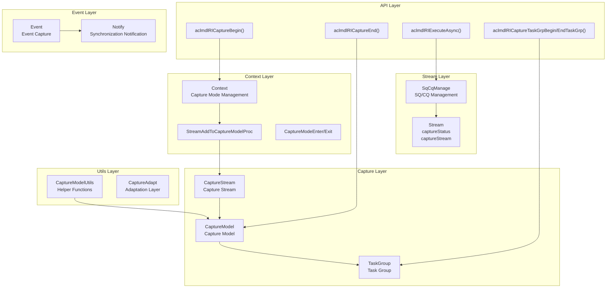

### Core Module Interaction Diagram

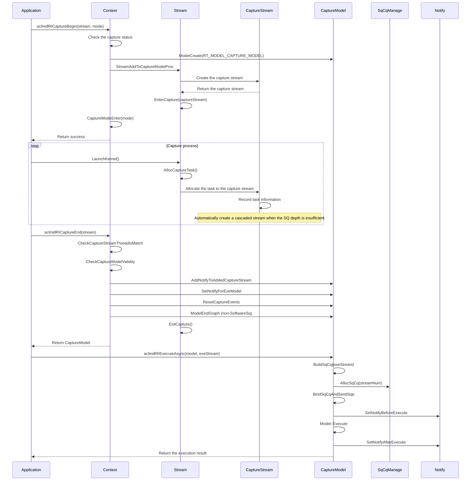

### Conditional Control Flow Interaction Diagram

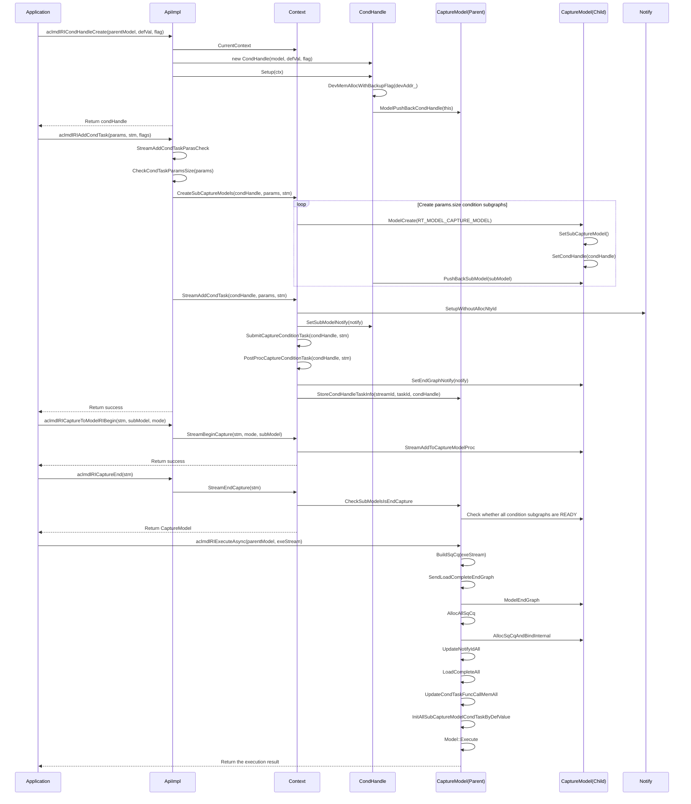

## 4. Detailed Design

### 4.1 Core Processes

#### Stream Capture Start Process

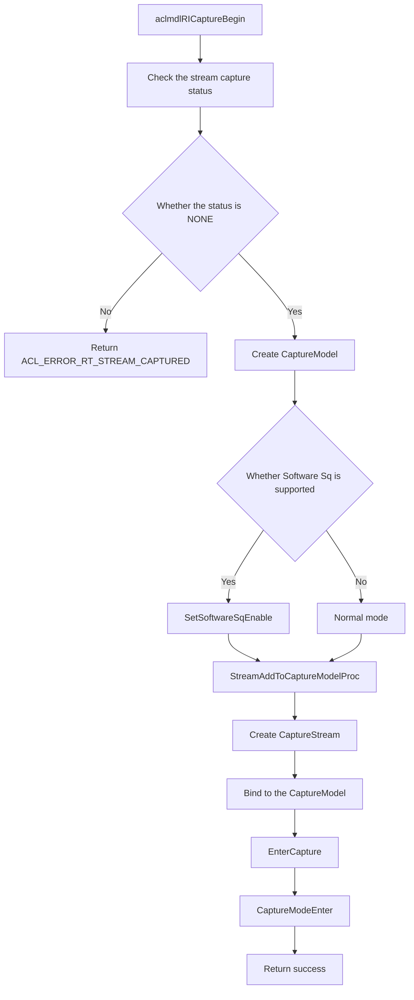

**Key code**:

```cpp
// File location: src/runtime/feature/aclgraph/context_aclgraph.cc:259-323.
rtError_t Context::StreamBeginCapture(Stream * const stm, const rtStreamCaptureMode mode, Model * const mdl)
{
    Model *captureModel = mdl;
    // ...
    const rtStreamCaptureStatus status = stm->GetCaptureStatus();
    const int32_t streamId = stm->Id_();

    // Check the capture status.
    if (status != RT_STREAM_CAPTURE_STATUS_NONE) {
        return RT_ERROR_STREAM_CAPTURED;
    }

    // Create the CaptureModel (a new model is created when mdl is nullptr; otherwise, the passed condition subgraph is used).
    if (captureModel == nullptr) {
        error = ModelCreate(&captureModel, RT_MODEL_CAPTURE_MODEL);
        // ...
    }

    // Check whether Software Sq is supported.
    if ((stm->Device_()->IsSupportFeature(RtOptionalFeatureType::RT_FEATURE_MODEL_ACL_GRAPH_SOFTWARE_ENABLE)) && 
        (stm->Device_()->CheckFeatureSupport(TS_FEATURE_SOFTWARE_SQ_ENABLE)) &&
        (NpuDriver::CheckIsSupportFeature(device_->Id_(), FEATURE_TRSDRV_SQ_SUPPORT_DYNAMIC_BIND))) {
        CaptureModel *captureModelTmp = dynamic_cast<CaptureModel *>(captureModel);
        captureModelTmp->SetSoftwareSqEnable();
    }

    std::unique_lock<std::mutex> taskLock(captureLock_);
    error = StreamAddToCaptureModelProc(stm, captureModel, true);
    // ...
    CaptureModeEnter(stm, mode);
    return RT_ERROR_NONE;
}
```

#### Task Capture and Allocation Process

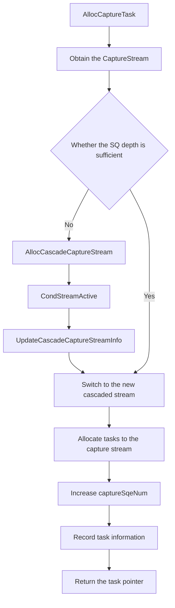

**Key code**:

```cpp
// File location: src/runtime/feature/aclgraph/stream_capture.cc:76-131.
rtError_t Stream::AllocCaptureTaskWithoutLock(tsTaskType_t taskType, uint32_t sqeNum, TaskInfo **task)
{
    Stream *curCaptureStream = GetCaptureStream();
    if (curCaptureStream == nullptr) {
        return RT_ERROR_STREAM_CAPTURE_EXIT;
    }

    // Check whether the SQ depth is sufficient.
    if ((curCaptureStream->GetCaptureSqeNum() + CAPTURE_TASK_RESERVED_NUM +
         device_->GetDevProperties().expandStreamRsvTaskNum) >=
         curCaptureStream->GetSqDepth()) {
        // The SQ depth is insufficient; create a cascaded stream.
        Stream *newCaptureStream = nullptr;
        Context * const ctx = Context_();
        rtError_t error = AllocCascadeCaptureStream(newCaptureStream, curCaptureStream);
        // ...
        error = CondStreamActive(newCaptureStream, curCaptureStream);
        // ...
        UpdateCascadeCaptureStreamInfo(newCaptureStream, curCaptureStream);
        curCaptureStream = newCaptureStream;
    }

    // Allocate the task.
    rtError_t errCode = RT_ERROR_TASK_NEW;
    if (curCaptureStream->taskResMang_ == nullptr) {
        *task = device_->GetTaskFactory()->Alloc(curCaptureStream, taskType, errCode);
    }
    if (*task != nullptr) {
        curCaptureStream->AddCaptureSqeNum(sqeNum);
        (*task)->stream = curCaptureStream;
        Runtime::Instance()->AllocTaskSn((*task)->taskSn);
        // ...
    }
    return RT_ERROR_NONE;
}
```

#### Condition Handle Creation Process

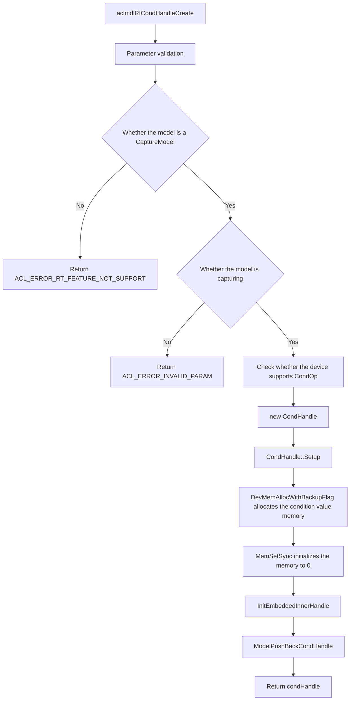

The condition value device memory is internal auxiliary memory of the runtime. `CondHandle::Setup` requests the memory through `DevMemAllocWithBackupFlag` and specifies the `SNAPSHOT_OPTIONAL_BACKUP` tag through the `type` input parameter of `DevMemAllocWithBackupFlag`.

**Key code**:

```cpp
// File location: src/runtime/feature/aclgraph/v100/api_impl_aclgraph.cc:178-203.
rtError_t ApiImpl::ModelCondHandleCreate(Model * const mdl, uint32_t defaultValue,
    rtCondHandleFlag_t flag, CondHandle ** const handle)
{
    CaptureModel *captureModel = dynamic_cast<CaptureModel *>(mdl);
    NULL_PTR_RETURN_MSG_OUTER(captureModel, RT_ERROR_INVALID_VALUE);
    COND_RETURN_AND_MSG_OUTER(!(captureModel->IsCaptureActive()),
        RT_ERROR_INVALID_VALUE, ErrorCode::EE1017, __func__, "mdl",
        "The ACL Graph has finished capturing.");
    Context * const curCtx = CurrentContext();
    CHECK_CONTEXT_VALID_WITH_RETURN(curCtx, RT_ERROR_CONTEXT_NULL);
    rtError_t error = CheckCaptureModelSupportCondOp(curCtx->Device_());
    COND_RETURN_WITH_NOLOG(error != RT_ERROR_NONE, error);

    CondHandle *condHandle = new (std::nothrow) CondHandle(mdl, defaultValue, flag);
    COND_RETURN_AND_MSG_OUTER((condHandle == nullptr), RT_ERROR_MEMORY_ALLOCATION, ...);

    error = condHandle->Setup(curCtx);
    if (error != RT_ERROR_NONE) {
        DELETE_O(condHandle);
        return error;
    }

    *handle = condHandle;
    return RT_ERROR_NONE;
}
```

#### Condition Task Submission Process

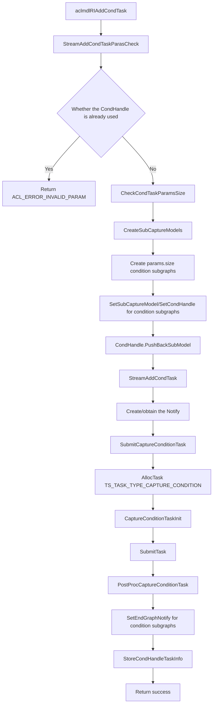

**Key code**:

```cpp
// File location: src/runtime/feature/aclgraph/context_aclgraph.cc:849-872.
rtError_t Context::CreateSubCaptureModels(CondHandle *condHandle, rtCondTaskParams params, Stream * const stm)
{
    for (uint32_t loop = 0; loop < params.size; loop++) {
        Model *subModel = nullptr;
        const rtError_t ret = ModelCreate(&subModel, RT_MODEL_CAPTURE_MODEL);
        // ...
        models_.remove(subModel); // Resource reclamation of condition subgraphs is not traversed; the parent graph completes it recursively.
        subModel->SetExeStream(stm->GetCaptureStream()); // The execution stream of a condition subgraph is fixed.
        CaptureModel *subCaptureModel = dynamic_cast<CaptureModel *>(subModel);
        subCaptureModel->SetSubCaptureModel();
        subCaptureModel->SetCondHandle(params.handle);
        condHandle->PushBackSubModel(subModel);
        params.modelRIArray[loop] = static_cast<rtModel_t>(subModel);
    }
    return RT_ERROR_NONE;
}
```

#### Condition Subgraph Capture Process

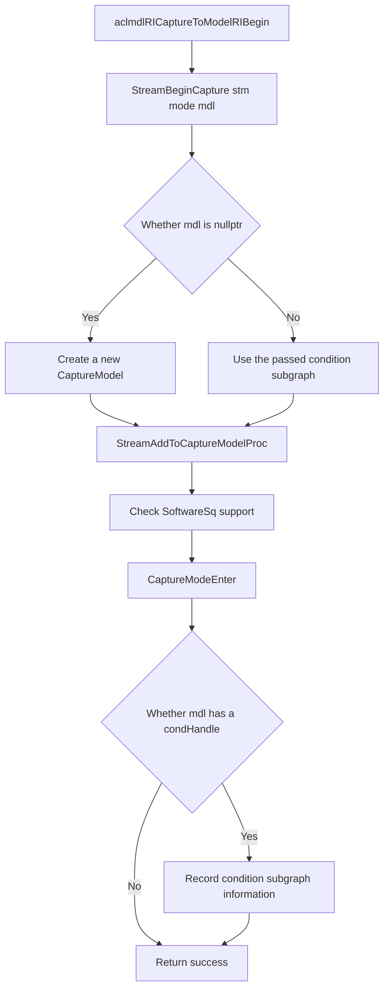

**Key code**:

```cpp
// File location: src/runtime/feature/aclgraph/context_aclgraph.cc:259-323.
rtError_t Context::StreamBeginCapture(Stream * const stm, const rtStreamCaptureMode mode, Model * const mdl)
{
    Model *captureModel = mdl;
    // ...
    if (captureModel == nullptr) {
        error = ModelCreate(&captureModel, RT_MODEL_CAPTURE_MODEL);
        // ...
    }
    // ...
    error = StreamAddToCaptureModelProc(stm, captureModel, true);
    // ...
    CaptureModeEnter(stm, mode);

    CondHandle *condHandle = nullptr;
    CaptureModel *captureMdl = dynamic_cast<CaptureModel *>(captureModel);
    const rtError_t ret = GetValidatedObject<CondHandle>(captureMdl->GetCondHandle(), condHandle);
    COND_PROC(ret != RT_ERROR_NONE, return RT_ERROR_NONE;);
    // The condHandle obtained from the parent model is nullptr, and the API returns no error.
    // ...
    return RT_ERROR_NONE;
}
```


#### Stream Capture End Process

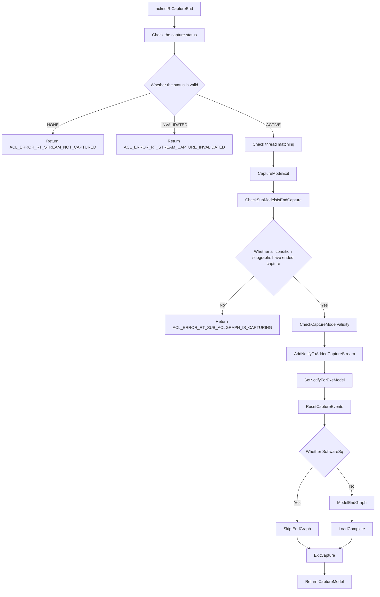

**Key code**:

```cpp
// File location: src/runtime/feature/aclgraph/context_aclgraph.cc:471-590.
rtError_t Context::StreamEndCapture(Stream * const stm, Model ** const captureMdl)
{
    std::unique_lock<std::mutex> taskLock(captureLock_);
    const rtStreamCaptureStatus status = stm->GetCaptureStatus();
    
    // Check the capture status.
    if (status == RT_STREAM_CAPTURE_STATUS_NONE) {
        return RT_ERROR_STREAM_NOT_CAPTURED;
    }

    Stream *captureStream = stm->GetCaptureStream();
    if (!(captureStream->IsOrigCaptureStream())) {
        return RT_ERROR_STREAM_CAPTURE_UNMATCHED;
    }

    rtError_t error = CheckCaptureStreamThreadIsMatch(stm);
    // ...
    CaptureModeExit(stm);

    Model *captureModel = captureStream->Model_();
    CaptureModel *captureModelTmp = RtPtrToPtr<CaptureModel *, Model *>(captureModel);
    
    // Check whether all condition subgraphs have ended capture (Cond scenario).
    const bool isCaptureFinished = CheckSubModelsIsEndCapture(captureStream);
    COND_PROC_RETURN_ERROR(!isCaptureFinished, RT_ERROR_STREAM_SUB_ACLGRAPH_IS_CAPTURING, ...);

    // Check the model validity.
    error = CheckCaptureModelValidity(captureModel);
    // ...

    // Set the Notify.
    error = AddNotifyToAddedCaptureStream(stm, static_cast<CaptureModel *>(captureModelTmp));
    error = SetNotifyForExeModel(captureModelTmp);
    error = captureModelTmp->ResetCaptureEvents(stm);

    // The non-SoftwareSq mode requires EndGraph.
    if (!captureModelTmp->IsSoftwareSqEnable()) {
        Api * const apiObj = Runtime::Instance()->ApiImpl_();
        error = apiObj->ModelEndGraph(captureModel, captureStream, 0U);
        error = captureModel->LoadComplete();
    }

    stm->ExitCapture();
    *captureMdl = captureModel;
    return RT_ERROR_NONE;
}
```

#### Model Execution Process

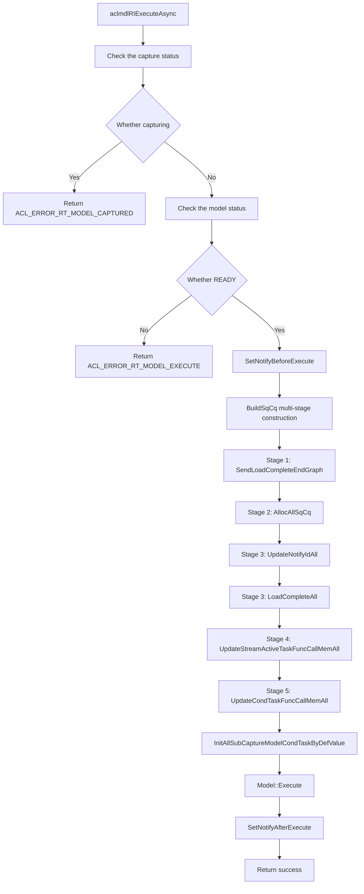

**Key code**:

```cpp
// File location: src/runtime/feature/aclgraph/capture_model.cc:198-243.
rtError_t CaptureModel::ExecuteCommon(Stream * const stm, int32_t timeout, const uint8_t executeMode)
{
    RT_LOG(RT_LOG_INFO, "capture model execute, model_id=%u!", Id_());

    if (IsCapturing()) {
        return RT_ERROR_MODEL_CAPTURED;
    }

    if (captureModelStatus_ != RtCaptureModelStatus::READY) {
        return RT_ERROR_MODEL_EXE_FAILED;
    }

    rtError_t error;
    // Set pre-execution synchronization.
    error = SetNotifyBeforeExecute(stm, this);
    // ...

    // Build the SQ/CQ (including condition subgraph processing).
    error = BuildSqCq(stm);
    // ...

    // Initialize condition values of all condition subgraphs (Cond scenario).
    error = InitAllSubCaptureModelCondTaskByDefValue(stm);
    // ...

    ReportCacheTrackData();
    if (executeMode == RT_MODEL_CAPTURE_EXECUTE_DEFAULT) {
        error = Model::Execute(stm, timeout);
    } else {
        error = Model::ExecuteAsync(stm);
    }
    // ...

    // Set post-execution synchronization.
    error = SetNotifyAfterExecute(stm, this);
    return RT_ERROR_NONE;
}
```

### 4.2 Core Mechanism Details

#### CaptureModel (Capture Model)

**Design concept**: The CaptureModel manages the captured graph structure and supports SQ/CQ dynamic binding, Notify synchronization, Event capture, and other functions.

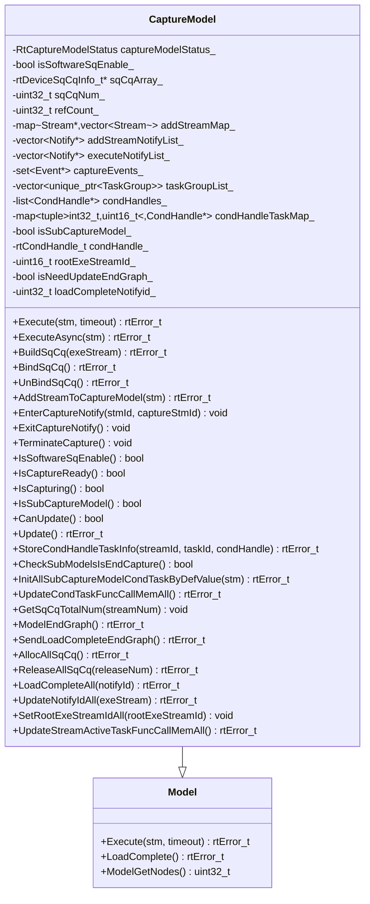

**Key code**:

```cpp
// File location: src/runtime/core/inc/model/capture_model.hpp:42-316.
class CaptureModel : public Model {
public:
    explicit CaptureModel(ModelType type = RT_MODEL_CAPTURE_MODEL);
    ~CaptureModel() noexcept override;

    rtError_t Execute(Stream * const stm, int32_t timeout = -1) override;
    rtError_t ExecuteAsync(Stream * const stm) override;
    rtError_t TearDown() override;
    rtError_t AddStreamToCaptureModel(Stream * const stm);

    // Status management.
    void SetCaptureModelStatus(RtCaptureModelStatus status);
    RtCaptureModelStatus GetCaptureModelStatus() const;
    void TerminateCapture();
    bool IsCaptureReady() const;
    bool IsCapturing() const;
    bool IsCaptureInvalid() const;
    bool CanUpdate() const;

    // SQ/CQ management.
    bool IsSoftwareSqEnable(void) const;
    void SetSoftwareSqEnable(void);
    rtError_t BuildSqCq(Stream * const exeStream);
    void DeconstructSqCq(void);
    rtError_t ReleaseSqCqAndNotifyId(uint32_t &releaseSqNum, uint32_t &releaseNtyNum);

    // Notify management.
    rtError_t SetNotifyBeforeExecute(Stream * const exeStm, CaptureModel* const captureMdl);
    rtError_t SetNotifyAfterExecute(Stream * const exeStm, CaptureModel* const captureMdl);
    void AddNotify(Notify *notify);
    void AddExeNotify(Notify *notify);

    // Event management.
    void InsertCaptureEvent(Event * const event);
    std::set<Event *> GetCaptureEvent() const;
    rtError_t ResetCaptureEvents(Stream * const stm) const;

    // TaskGroup management.
    void AddTaskGroupList(std::unique_ptr<TaskGroup> &taskGrp);
    void SetTaskGroupErrCode(const rtError_t errCode);
    const TaskGroup* GetTaskGroup(uint16_t streamId, uint16_t taskId);

    // Update-related.
    rtError_t Update(void);
    rtError_t RestoreForSoftwareSq(Device * const dev);

private:
    RtCaptureModelStatus captureModelStatus_{RtCaptureModelStatus::NONE};
    bool isSoftwareSqEnable_{false};
    rtDeviceSqCqInfo_t *sqCqArray_{nullptr};
    uint32_t sqCqNum_{0U};
    uint32_t refCount_{0U};
    std::map<Stream *, std::vector<Stream *>> addStreamMap_;
    std::vector<Notify *> addStreamNotifyList_;
    std::vector<Notify *> executeNotifyList_;
    std::set<Event *> captureEvents_;
    std::vector<std::unique_ptr<TaskGroup>> taskGroupList_;
    // ...
};
```

#### TaskGroup (Task Group)

**Design concept**: The TaskGroup records the task sequence during the capture process and supports task updates.

```cpp
// File location: src/runtime/core/src/stream/stream.hpp:139-143.
struct TaskGroup {
    std::vector<std::pair<uint16_t, uint16_t>> taskIds; // streamId + taskId
    bool isUpdate{false};
    uint32_t updateTaskIndex{0};
};
```

**Task group operations**:

```cpp
// File location: src/runtime/feature/aclgraph/context_aclgraph.cc:622-688.
rtError_t Context::StreamBeginTaskGrp(Stream * const stm)
{
    // Check the task group status.
    const StreamTaskGroupStatus status = stm->GetTaskGroupStatus();
    COND_RETURN_ERROR_MSG_INNER(status != StreamTaskGroupStatus::NONE,
        RT_ERROR_STREAM_TASKGRP_STATUS,
        "Task group is repeatedly started, or a task group is being updated.");

    Stream *captureStream = stm->GetCaptureStream();
    CaptureModel *mdl = dynamic_cast<CaptureModel *>(captureStream->Model_());

    // Create the task group.
    std::unique_ptr<TaskGroup> taskGrp(new (std::nothrow) TaskGroup);
    // ...
    captureStream->UpdateCurrentTaskGroup(taskGrp);
    mdl->InsertTaskGroupStreamId(static_cast<uint16_t>(captureStream->Id_()));
    return RT_ERROR_NONE;
}

rtError_t Context::StreamEndTaskGrp(Stream * const stm, TaskGroup ** const handle) const
{
    Stream * const captureStream = stm->GetCaptureStream();
    CaptureModel *mdl = dynamic_cast<CaptureModel *>(captureStream->Model_());

    std::unique_ptr<TaskGroup> &taskGrp = captureStream->GetCurrentTaskGroup();
    
    rtError_t errorCode = mdl->GetTaskGroupErrCode();
    if ((errorCode != RT_ERROR_NONE) || (mdl->IsCaptureInvalid())) {
        taskGrp.reset();
        *handle = nullptr;
    } else {
        *handle = taskGrp.get();
        mdl->AddTaskGroupList(taskGrp);
    }
    captureStream->ResetTaskGroup();
    // ...
    return errorCode;
}
```

#### Capture Mode Management

**Design concept**: The capture mode management supports different synchronization modes in multi-thread capture scenarios.

```cpp
// File location: src/runtime/feature/aclgraph/context_aclgraph.cc:573-620.
void Context::CaptureModeEnter(Stream * const stm, rtStreamCaptureMode mode)
{
    stm->SetStreamCaptureMode(mode);
    stm->SetBeginCaptureThreadId(runtime::GetCurrentTid());
    captureModeRefNum_[mode]++;
    InnerThreadLocalContainer::ThreadCaptureModeEnter(mode);

    // Update the context-level capture mode (take the minimum value).
    if (mode < GetContextCaptureMode()) {
        SetContextCaptureMode(mode);
    }
}

void Context::CaptureModeExit(Stream * const stm)
{
    const rtStreamCaptureMode streamCaptureMode = stm->GetStreamCaptureMode();
    stm->SetStreamCaptureMode(RT_STREAM_CAPTURE_MODE_MAX);
    stm->SetBeginCaptureThreadId(UINT32_MAX);

    if (captureModeRefNum_[streamCaptureMode] > 0U) {
        captureModeRefNum_[streamCaptureMode]--;
    }

    InnerThreadLocalContainer::ThreadCaptureModeExit(streamCaptureMode);

    // Update the context-level capture mode based on the reference count.
    // ...
}
```

#### Event Capture Mechanism

**Design concept**: The Event capture mechanism processes Record/Wait operations on events during capture.

```cpp
// File location: src/runtime/feature/aclgraph/event_capture.cc:19-90.
rtError_t Event::CaptureEventProcess(Stream * const stm)
{
    // Allocate the capture task.
    TaskInfo *tsk = stm->AllocTask(&submitTask, TS_TASK_TYPE_EVENT_RECORD, errorReason);
    // ...

    // Allocate the Event address.
    error = dev->AllocExpandingPoolEvent(&eventAddr, &newEventId);
    eventAddr_ = eventAddr;
    eventId_ = newEventId;

    // Initialize the MemWriteValue task.
    (void)MemWriteValueTaskInit(tsk, eventAddr, static_cast<uint64_t>(1U));
    tsk->typeName = "EVENT_RECORD";
    tsk->type = TS_TASK_TYPE_CAPTURE_RECORD;
    // ...
    return error;
}

rtError_t Event::CaptureWaitProcess(Stream * const stm)
{
    TaskInfo *tsk = stm->AllocTask(&submitTask, TS_TASK_TYPE_STREAM_WAIT_EVENT, errorReason, MEM_WAIT_SQE_NUM);
    // ...

    tsk->typeName = "EVENT_WAIT";
    tsk->type = TS_TASK_TYPE_CAPTURE_WAIT;
    error = MemWaitValueTaskInit(tsk, eventAddr, 1, 0x0);
    // ...
    return error;
}
```

#### Software SQ Dynamic Binding

**Design concept**: The Software SQ supports dynamic binding of the SQ/CQ to achieve efficient graph execution.

```cpp
// File location: src/runtime/feature/aclgraph/capture_model.cc:471-567.
rtError_t CaptureModel::BuildSqCq(Stream * const exeStream)
{
    // Check whether Software Sq is enabled.
    COND_PROC(!IsSoftwareSqEnable(), return RT_ERROR_NONE);
    // ...

    const uint32_t streamNum = static_cast<uint32_t>(StreamList_().size());
    
    // Allocate SQ/CQ resources.
    rtError_t error = AllocSqCqProc(streamNum);
    // ...

    sqCqNum_ = streamNum;

    // Allocate the SQ address.
    error = AllocSqAddr();
    // ...

    // Bind the SQ/CQ and send the SQE.
    error = BindSqCqAndSendSqe();
    // ...

    // Update the Stream Active task.
    error = UpdateStreamActiveTaskFuncCallMem();

    refCount_++;
    return RT_ERROR_NONE;
}

rtError_t CaptureModel::BindSqCq(void)
{
    // Update the SQ/CQ information of the stream.
    for (auto stm : StreamList_()) {
        stm->UpdateSqCq(&(sqCqArray_[index]));
        switchInfo_[index].stream_id = static_cast<uint32_t>(stm->Id_());
        switchInfo_[index].sq_id = stm->GetSqId();
        switchInfo_[index].sq_depth = stm->GetSqDepth();
        // ...
    }

    // Switch the stream to the SQ in batches.
    error = dev->Driver_()->SqSwitchStreamBatch(dev->Id_(), switchInfo_, sqCqNum_);
    return error;
}
```

#### CondHandle (Condition Handle)

**Design concept**: The CondHandle manages the condition value (device memory) and the condition subgraph list of conditional control flow, implementing dynamic branch execution for IF/WHILE/SWITCH. Each CondHandle belongs to one parent CaptureModel and manages multiple child CaptureModels. All condition subgraphs share the same Notify resource.

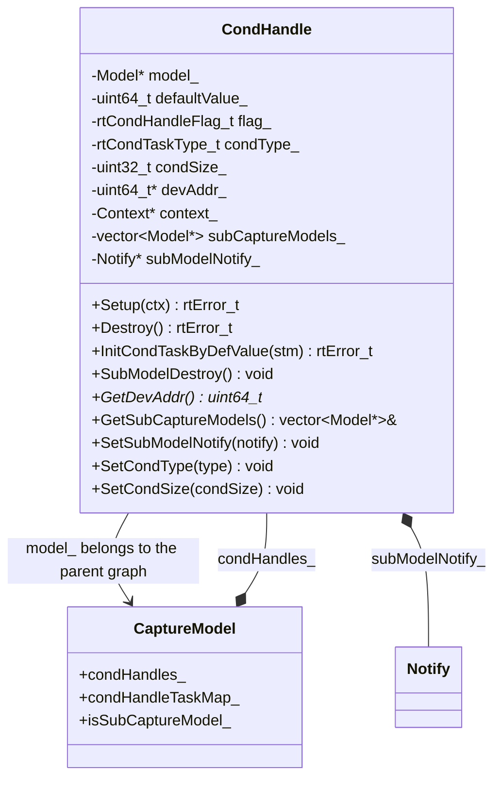

**Key code**:

```cpp
// File location: src/runtime/core/inc/cond_handle/cond_handle.hpp:22-101.
class CondHandle : public NoCopy {
public:
    explicit CondHandle(Model *mdl, uint32_t defaultValue, rtCondHandleFlag_t flag);
    ~CondHandle() noexcept override;

    rtError_t Setup(Context *ctx);
    rtError_t Destroy();
    rtError_t InitCondTaskByDefValue(Stream* const stm);
    void SubModelDestroy();
    // ...
private:
    Model *model_{nullptr};              // Parent graph that the handle belongs to.
    uint64_t defaultValue_{0U};          // Default condition value when the parent graph executes.
    rtCondHandleFlag_t flag_;            // ASSIGN_DEFAULT indicates that the condition value is initialized at execution.
    rtCondTaskType_t condType_{RT_COND_TASK_TYPE_MAX}; // Condition type.
    uint32_t condSize_{0U};              // Number of condition subgraphs.
    uint64_t *devAddr_{nullptr};         // Device pointer that stores the condition value.
    Context *context_{nullptr};
    std::vector<Model *> subCaptureModels_; // Condition subgraph list of the current condHandle.
    Notify *subModelNotify_{nullptr};    // All condition subgraphs share the same notify.
};
```

**CondHandle lifecycle**:
- **Creation**: `aclmdlRICondHandleCreate` → `new CondHandle` → `Setup` (allocate device memory) → `ModelPushBackCondHandle` (add to the parent graph)
- **Usage**: `aclmdlRIAddCondTask` → create condition subgraphs → submit condition tasks → `StoreCondHandleTaskInfo` (record to `condHandleTaskMap_`)
- **Execution**: `InitAllSubCaptureModelCondTaskByDefValue` initializes the condition value
- **Destruction**: `CondHandle::~CondHandle` → release condition subgraphs → release device memory

#### Condition Subgraph Resource Management

**Design concept**: In Cond scenarios, the parent graph BuildSqCq must process EndGraph, SQ/CQ allocation, Notify update, condition task refresh, and other operations for all condition subgraphs. All condition subgraph resources are requested and released together with the parent graph.

```cpp
// File location: src/runtime/feature/aclgraph/capture_model.cc:553-625.
rtError_t CaptureModel::BuildSqCq(Stream * const exeStream)
{
    COND_PROC(!IsSoftwareSqEnable(), return RT_ERROR_NONE);
    // ...
    // Stage 1: EndGraph + Notify application.
    error = SendLoadCompleteEndGraph();
    // Stage 2: SQ/CQ application.
    error = AllocAllSqCq();
    // Stage 3: Refresh the Notify record/wait SQE.
    error = UpdateNotifyIdAll(exeStream);
    SetRootExeStreamIdAll(static_cast<uint32_t>(exeStream->Id_()));
    error = LoadCompleteAll(loadCompleteNotifyId_);
    // Stage 4: Refresh Stream Active condition operators.
    error = UpdateStreamActiveTaskFuncCallMemAll();
    // Stage 5: Refresh Cond Task condition operators.
    error = UpdateCondTaskFuncCallMemAll();
    refCount_++;
    return RT_ERROR_NONE;
}
```

**Condition task SQE structure**:

| SQE Index | Name | Description | Applicable Type |
|----------|------|------|----------|
| SQE[0] | CondFirst | FunctionCall for condition judgment | IF/WHILE/SWITCH |
| SQE[1] | NotifyWait | Waits for the condition subgraph completion notification | IF/WHILE/SWITCH |
| SQE[2] | JumpBack | Jumps back to the loop header | WHILE only |

```cpp
// File location: src/runtime/core/src/task/inc/aclgraph_cond_task.h:20-24.
constexpr uint8_t COND_TASK_IF_SWITCH_SQE_NUM = 2U; // IF/SWITCH uses 2 SQEs.
constexpr uint8_t COND_TASK_WHILE_SQE_NUM = 3U;     // WHILE uses 3 SQEs.

// File location: src/runtime/core/inc/task/task_info_struct.hpp:493-520.
struct CaptureConditionTaskInfo {
    CondHandle *condHandle;             // Handle of the condition operation.
    void *funcCallSvmMem;               // Device memory of the FunctionCall instruction.
    void *headSqArrPtrArrSvmMem;        // Pointer array of the start address of the sq list of each model.
    void *modelSqCountArrSvmMem;        // Array of the sq quantity of each model.
    void *streamSvmPtrArrSvmMem;        // Pointer array of the start address of the svm list of each model.
    uint32_t notifyId;                  // notify_id
    uint32_t notifyTimeout;             // timeout
    void *jumpBackFuncCallSvmMem;       // JumpBack FunctionCall (WHILE only).
    // ...
};
```

### 4.3 Module Responsibilities

| Module | Responsibility | Location |
|------|------|------|
| CaptureModel | Capture model management, SQ/CQ management, execution scheduling, condition subgraph management | `core/inc/model/capture_model.hpp` |
| Context | Capture process control, capture mode management, condition task creation and submission | `feature/aclgraph/context_aclgraph.cc` |
| Stream | Capture status management, task allocation, cascaded stream management | `feature/aclgraph/stream_capture.cc` |
| Event | Event capture processing | `feature/aclgraph/event_capture.cc` |
| CondHandle | Condition handle management, condition value device memory, condition subgraph lifecycle | `core/inc/cond_handle/cond_handle.hpp` |
| CondTask | Condition task initialization, SQE construction, FuncCall reconstruction | `core/src/task/inc/aclgraph_cond_task.h` |
| CaptureModelUtils | Helper functions (checks, obtaining the capture stream, and so on) | `feature/aclgraph/capture_model_utils.cc` |
| Notify | Pre-/post-execution synchronization, condition subgraph EndGraph notification | `capture_model.cc` |

### 4.4 Core Data Structures

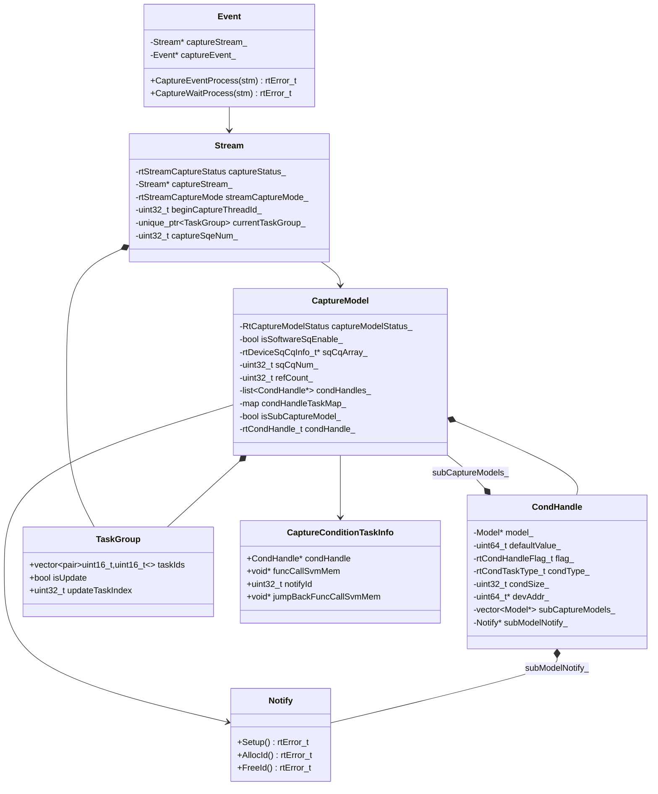

## 5. Key Design Concepts

### 5.1 Separation of Capture and Execution

- **Capture phase**: Tasks are recorded to the CaptureStream and are not executed immediately
- **Build phase**: The executable graph structure is built at EndCapture
- **Execution phase**: BuildSqCq dynamically binds the SQ/CQ and submits optimized execution tasks

### 5.2 Cascaded Capture Support

When the SQ depth of the original capture stream is insufficient, the system automatically creates a cascaded stream to continue capture:

```cpp
// SQ depth check.
if ((curCaptureStream->GetCaptureSqeNum() + reserved) >= curCaptureStream->GetSqDepth()) {
    // Create the cascaded stream.
    AllocCascadeCaptureStream(newCaptureStream, curCaptureStream);
    // Connect the cascaded stream through Stream Active.
    CondStreamActive(newCaptureStream, curCaptureStream);
    // Update the capture stream information.
    UpdateCascadeCaptureStreamInfo(newCaptureStream, curCaptureStream);
}
```

### 5.3 Software SQ Dynamic Binding

- Supports dynamic allocation and binding of the SQ/CQ
- BuildSqCq is executed at execution time, and ReleaseSqCqAndNotifyId is executed after completion
- Implements batch stream switching through SqSwitchStreamBatch

### 5.4 Notify Synchronization Mechanism

During execution, the Notify implements synchronization with AddStream:

```cpp
// Pre-execution synchronization: wait for AddStream to complete current tasks.
SetNotifyBeforeExecute(exeStream, captureModel);
// NotifyRecord(addStream) -> NotifyWait(exeStream)

// Post-execution synchronization: notify AddStream to continue execution.
SetNotifyAfterExecute(exeStream, captureModel);
// NotifyRecord(exeStream) -> NotifyWait(addStream)
```

### 5.5 Capture Mode Control

| Mode | Description | Applicable Scenario |
|------|------|----------|
| GLOBAL | All threads share the capture state | Single-thread capture |
| THREAD_LOCAL | Only the current thread can operate | Independent multi-thread capture |
| RELAXED | Other threads are allowed to operate | Cooperative multi-thread capture |

### 5.6 Conditional Control Flow Design

**Parent-child graph relationship**:

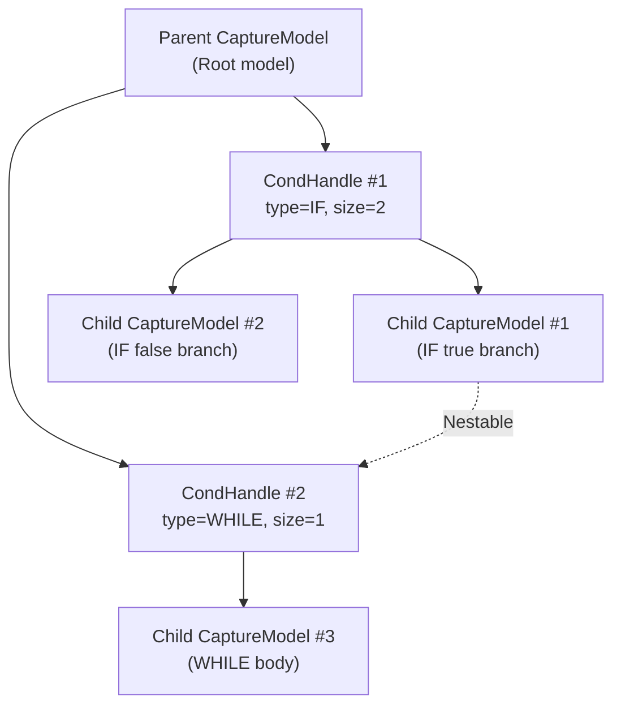

**Key design decisions**:

1. **Condition subgraphs share the Notify**: All condition subgraphs under the same CondHandle share one Notify resource to avoid repeated application. The Notify ID is requested and refreshed together during model execution.
2. **Condition subgraph resources are managed with the parent graph**: The parent graph processes the application and release of the SQ/CQ and Notify of condition subgraphs (`AllocAllSqCq`, `ReleaseAllSqCq`, and so on). Condition subgraphs do not release resources separately.
3. **Condition subgraph stream management**: During EndCapture, the system traverses condition subgraphs and calls `ModelAddStream` to add condition subgraph streams to the parent graph (not to `headStreams_`) for resource application and release during model execution.
4. **EndCapture synchronization check**: During parent graph EndCapture, `CheckSubModelsIsEndCapture` checks whether all condition subgraphs have completed EndCapture. If not, `ACL_ERROR_RT_SUB_ACLGRAPH_IS_CAPTURING` is returned.
5. **Condition value initialization**: Before model execution, `InitAllSubCaptureModelCondTaskByDefValue` initializes the condition values of all CondHandles (when flag is `ACL_MODEL_RI_COND_HANDLE_ASSIGN_DEFAULT`).
6. **Condition task SQE refresh**: During model execution, `UpdateCondTaskFuncCallMemAll` reconstructs the FunctionCall memory of condition tasks and updates device memory addresses such as the SQ list and SVM list.

## 6. Key File Index

| Module | File Path | Key Content |
|------|----------|----------|
| Capture model | `src/runtime/core/inc/model/capture_model.hpp` | CaptureModel class definition |
| Capture model implementation | `src/runtime/feature/aclgraph/capture_model.cc` | CaptureModel implementation (including condition subgraph management) |
| Context capture | `src/runtime/feature/aclgraph/context_aclgraph.cc` | BeginCapture/EndCapture/CondTask processes |
| Stream capture | `src/runtime/feature/aclgraph/stream_capture.cc` | AllocCaptureTask, cascaded stream management |
| Event capture | `src/runtime/feature/aclgraph/event_capture.cc` | Event capture processing |
| Condition handle definition | `src/runtime/core/inc/cond_handle/cond_handle.hpp` | CondHandle class definition |
| Condition handle implementation | `src/runtime/feature/aclgraph/cond_handle.cc` | CondHandle implementation |
| Condition task definition | `src/runtime/core/src/task/inc/aclgraph_cond_task.h` | Condition task SQE constants and APIs |
| Condition task implementation | `src/runtime/core/src/task/task_info/cond_op/aclgraph_cond_task.cc` | Condition task initialization and SQE construction |
| Condition task submission | `src/runtime/core/src/launch/cond_starsv2.cc` | Condition task submission and post-processing |
| Data type definition | `src/inc/runtime/rt_inner_model.h` | Runtime-layer conditional control flow type definitions |
| ACL data types | `include/external/acl/acl_rt.h` | ACL types such as aclmdlRICondHandle and aclmdlRICondTaskParams |
| Capture utilities | `src/runtime/feature/aclgraph/capture_model_utils.cc` | Helper functions |
| Model printing | `src/runtime/feature/aclgraph/model_aclgraph.cc` | DebugDotPrint, JsonPrint |
| Runtime APIs | `src/runtime/api/api_c_standard_soc.cc:674-819` | Runtime-layer implementations such as aclmdlRICaptureBegin/EndCapture/CondHandleCreate |
| ACL RI APIs | `src/acl/aclrt_impl/model_ri.cpp` | ACL-layer APIs such as aclmdlRICaptureBegin/End/CondHandleCreate |
| v100 adaptation | `src/runtime/feature/aclgraph/v100/` | v100 chip adaptation |
| v200 adaptation | `src/runtime/feature/aclgraph/v200/` | v200 chip adaptation |

## 7. Compatibility and Extensibility

### 7.1 Chip Adaptation

- **v100 adaptation**: The `feature/aclgraph/v100/` directory
- **v200 adaptation**: The `feature/aclgraph/v200/` directory
- Adaptation for different chips is implemented through the `CaptureAdapt` class

### 7.2 State Transition

```mermaid
stateDiagram-v2
    [*] --> NONE: Initialization
    NONE --> CAPTURE_ACTIVE: BeginCapture
    CAPTURE_ACTIVE --> CAPTURE_INVALIDATED: TerminateCapture
    CAPTURE_ACTIVE --> READY: EndCapture
    READY --> UPDATING: BeginUpdate
    UPDATING --> READY: EndUpdate
    READY --> FAULT: Execution failure
    READY --> [*]: Model destruction
    CAPTURE_INVALIDATED --> [*]: Model destruction
    
    note right of CAPTURE_ACTIVE
        Condition subgraph status:
        Marked by SetSubCaptureModel()
        Checked at EndCapture
        CheckSubModelsIsEndCapture
    end note
    
    note right of READY
        Condition subgraph READY conditions:
        All condition subgraphs have completed EndCapture
        BuildSqCq processes all condition subgraphs
    end note
```

### 7.3 Extensibility

- **Cascaded stream extension**: Supports unlimited cascaded streams to extend the capture depth
- **TaskGroup update**: Supports task parameter updates after capture
- **Model update**: Supports dynamic update of the captured model
- **Conditional control flow nesting**: CondHandles can be further created inside condition subgraphs, supporting multi-level condition nesting (processing)

---

_This feature document is based on analysis of the source code `src/runtime/feature/aclgraph/`, `src/runtime/core/inc/model/capture_model.hpp`, `src/runtime/core/inc/cond_handle/cond_handle.hpp`, `src/acl/aclrt_impl/model_ri.cpp`, and `include/external/acl/acl_rt.h`._
