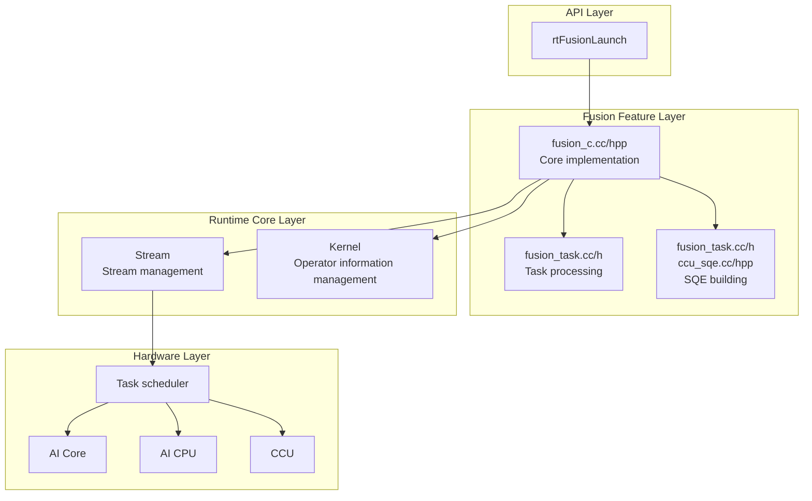
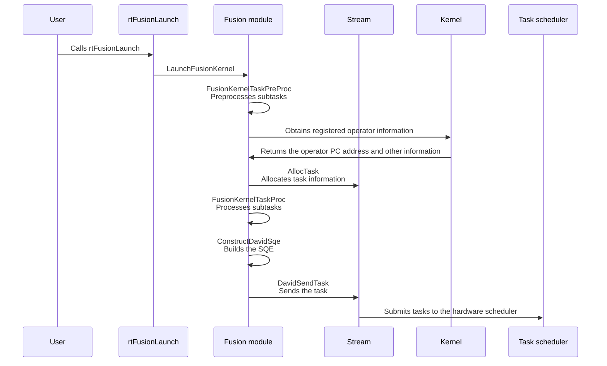
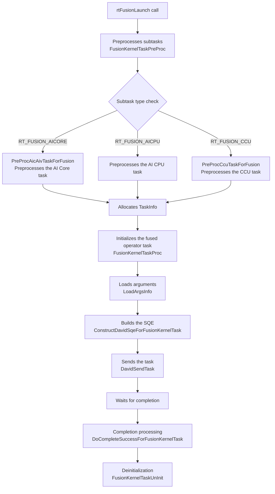

# Fusion (Operator Fusion) Feature

## 1. Feature Overview

- **Feature introduction**: Fusion is a feature supported by Ascend 950 and later-generation chips. It supports the fused dispatch and execution of multiple operator tasks of different categories (AI Core, AI CPU, HCOM CPU, and CCU). It combines multiple operator tasks into one complete fused operator task and submits the task to a Stream, which reduces task scheduling overhead and improves execution efficiency.
- **Problem background**: In the traditional execution mode, each operator or task must be submitted to a Stream separately and waits for scheduling and execution, which causes high scheduling overhead on the host side. For some fixed operator combinations or compute patterns, submitting and dispatching operators one by one causes performance bottlenecks. In addition, a capability for operators to cooperate with each other in fusion scenarios is expected, so that operators can be scheduled and executed at the same time when resources are sufficient.
- **Design goals**:
  - Supports the fused execution of multiple subtask types
  - Reduces the task submission overhead on the host side
  - Improves the overall compute performance
  - Provides flexible fusion combination modes

## 2. Use Scenarios and External APIs

### 2.1 Use Scenarios

- **Scenario 1**: Fusion of compute (or communication) and compute operators
1) AI CPU + AI Core fusion
  ```cpp
  // Create fused operator task information
  rtFunsionTaskInfo_t fusionInfo;
  fusionInfo.subTaskNum = 2;

  // Configure the AI CPU subtask
  fusionInfo.subTask[0].type = RT_FUSION_AICPU;
  fusionInfo.subTask[0].task.aicpuInfo.kernelType = ...;
  fusionInfo.subTask[0].task.aicpuInfo.blockDim = 1;

  // Configure the AI Core subtask
  fusionInfo.subTask[1].type = RT_FUSION_AICORE;
  fusionInfo.subTask[1].task.aicoreInfo.stubFunc = stubFunc;
  fusionInfo.subTask[1].task.aicoreInfo.config = launchConfig;

  // Submit the fused operator task
  rtFusionLaunch(&fusionInfo, stream, &argsInfo);
  ```

- **Scenario 2**: Fusion of communication and compute operators
1) CCU + AI Core fusion
  ```cpp
  // Create fused operator task information
  rtFunsionTaskInfo_t fusionInfo;
  fusionInfo.subTaskNum = 2;

  // Configure the CCU subtask
  fusionInfo.subTask[0].type = RT_FUSION_CCU;
  fusionInfo.subTask[0].task.ccuInfo.taskNum = 1;
  fusionInfo.subTask[0].task.ccuInfo.ccuTaskInfo[0].dieId = 0;
  fusionInfo.subTask[0].task.ccuInfo.ccuTaskInfo[0].missionId = 0;

  // Configure the AI Core subtask
  fusionInfo.subTask[1].type = RT_FUSION_AICORE;
  fusionInfo.subTask[1].task.aicoreInfo.stubFunc = stubFunc;
  fusionInfo.subTask[1].task.aicoreInfo.config = launchConfig;

  // Submit the fused operator task
  rtFusionLaunch(&fusionInfo, stream, &argsInfo);
  ```

### 2.2 External APIs

| API | File Location | Description |
|------|----------|------|
| `rtFusionLaunch` | `pkg_inc/runtime/rt_external_kernel.h:545` | Submits and dispatches the fused operator task |

**API parameter description**:
```cpp
rtError_t rtFusionLaunch(
    void * const fusionInfo,       // Fused operator task information (rtFunsionTaskInfo_t*)
    rtStream_t const stm,          // Associated Stream
    rtFusionArgsEx_t *argsInfo     // Parameter information
);
```

## 3. Architecture Overview

### Overall Design Idea

The Fusion feature is based on modules of the Runtime core layer such as Stream, Task, and Kernel. It provides the Fusion module with complete end-to-end functions at the API level, including input parameter preprocessing, task initialization, SQE building, task submission, and post-completion processing for fused operator tasks.

### Architecture Layer Diagram



### Core Module Interaction Diagram



## 4. Detailed Design

### 4.1 Core Flow



#### LaunchFusionKernel (Launches the Fusion Kernel)

**Location**: `src/runtime/feature/fusion/fusion_c.cc:450`

**Responsibilities**:

1. Preprocesses subtasks. This function covers the processing function logic of each subtask, including the processing modules of subtasks such as AI CPU, AI Core, and CCU. The specific processing logic obtains and preprocesses required fields based on the subtask combination type and the information carried by subtasks in the input parameters (calls `FusionKernelTaskPreProc`).
2. Allocates a TaskInfo by using resources on the stream.
3. Processes the fused operator task. After the required field information of each type of subtask is processed, this step initializes and assigns the fields of the overall Fusion task (calls `FusionKernelTaskProc`).
4. Loads arguments. Specifically, this step loads the args data passed in through the rtFusionLaunch API input parameters to the device side for access during operator execution (calls `LoadArgsInfo`).
5. Sends the task. This step converts the taskInfo into an SQE that hardware can recognize and sends the SQE to the hardware task scheduler through the driver pipe (calls `DavidSendTask`).

#### ConstructDavidSqeForFusionKernelTask (Builds the SQE)

**Location**: `src/runtime/feature/fusion/fusion_task.cc:279`

**Responsibilities**: Builds the corresponding SQE based on the subtask type.
- AI Core: Calls `ConstructAicAivSubSqe` and determines whether the type is AIC, AIV, or Mix based on mixType.
- AI CPU/HCOM CPU: Calls `ConstructAicpuSubSqe`.
- CCU: Calls `ConstructCcuSubSqe`.

### 4.2 Supported Subtask Types

| Subtask Type | Enum Value | Description | SQE Building Function |
|-----------|--------|------|------------|
| AI CPU | `RT_FUSION_HCOM_CPU = 0`or`RT_FUSION_AICPU = 1` | Executes AI CPU (communication or compute) operators | `ConstructAicpuSubSqe` |
| AI Core | `RT_FUSION_AICORE = 2` | Executes AI Core/Vector operators | `ConstructAicAivSubSqe` |
| CCU | `RT_FUSION_CCU = 3` | Collective communication task | `ConstructCcuSubSqe` |

### 4.3 Fusion Combination Modes

The fusion subtask combination modes are as follows:

1. **aicpu + aic**: Fuses AI CPU and AI Core. The AI CPU operator here is usually a compute operator task or a communication operator task.
2. **ccu + aic**: Fuses CCU and AI Core.

### 4.4 Core Data Structures

#### rtFunsionTaskInfo_t (Subtask Combination Information of the Fused Operator Task)
◆ Structure that summarizes the information of each subtask in a Fusion fused task.
```cpp
#define FUSION_SUB_TASK_MAX_NUM     (2U)
typedef struct tagRtFunsionTaskInfo {
    uint32_t subTaskNum;                              // Number of subtasks
    rtFusionSubTaskInfo_t subTask[FUSION_SUB_TASK_MAX_NUM];  // Subtask array (a maximum of 2 subtasks)
} rtFunsionTaskInfo_t;
```

#### FusionTaskInfo (Internal Information of the Fused Operator Task)
◆ Stores required field information related to the fused operator when the task is initialized and dispatched, for example, the subtask combination type of the fused operator, the number of tasks, and whether CCU tasks are included.
```cpp
struct FusionTaskInfo;
```

#### FusionTaskInfoAicPart (AI Core Task Part)
◆ Stores required field information of AI Core subtasks in the fused operator task, for example, the PC address, args parameter address, dimensions required for core splitting, and SIMT memory size.
```cpp
struct FusionTaskInfoAicPart;
```

## 5. Key Design Ideas

### 5.1 Reduced Scheduling Overhead

This design merges multiple subtasks into one fused operator task, reduces the number of task submissions, and lowers the scheduling overhead on the host side.

### 5.2 Flexible Combination Modes

This design supports combinations of multiple subtask types. You can select the optimal fusion combination based on different compute patterns or scenarios.

### 5.3 Task Update Support

Fused operator tasks support updating the parameters of captured tasks or the tasks themselves in ACL Graph scenarios.

## 6. Key File Index

| Module | File Path | Core Content |
|------|----------|----------|
| Fusion API | `pkg_inc/runtime/rt_external_kernel.h` | `rtFusionLaunch` API definition and data structures such as `rtFunsionTaskInfo_t` and `rtFusionArgsEx_t` |
| Fusion core implementation | `src/runtime/feature/fusion/fusion_c.cc` | `LaunchFusionKernel`, `FusionKernelTaskPreProc`, and `AixKernelTaskInitForFusion` |
| Fusion task processing | `src/runtime/feature/fusion/fusion_task.cc` | `BuildFusionKernelTaskName`, `DoCompleteSuccessForFusionKernelTask`, and `FusionKernelTaskUnInit` |
| Fusion SQE building | `src/runtime/feature/fusion/fusion_task.cc`<br>`src/runtime/feature/ccu/ccu_sqe.cc` | `ConstructDavidSqeForFusionKernelTask`, `ConstructAicAivSubSqe`, and `ConstructCcuSubSqe` |
| Task data structure | `src/runtime/core/inc/task/task_info.hpp` | Definition of the `TaskInfo` structure, which contains `FusionTaskInfo` |
| Task base structure | `src/runtime/core/inc/task/task_info_base.hpp` | Detailed definitions of `FusionTaskInfo` and `FusionTaskInfoAicPart` |
