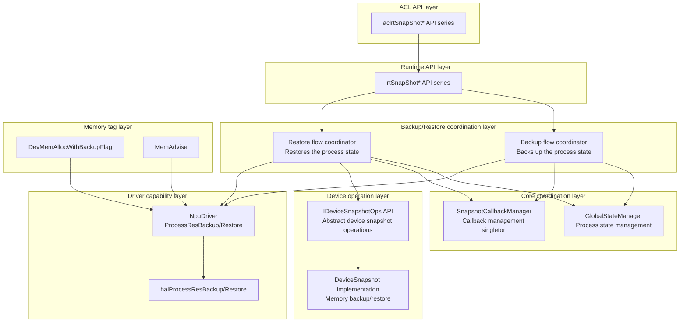
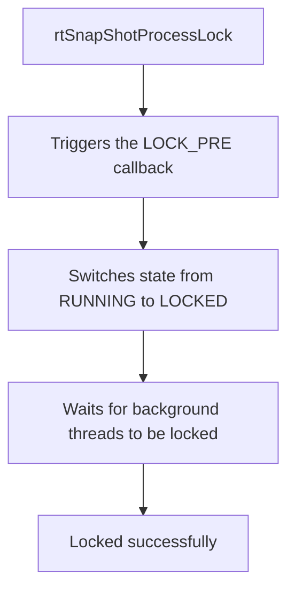
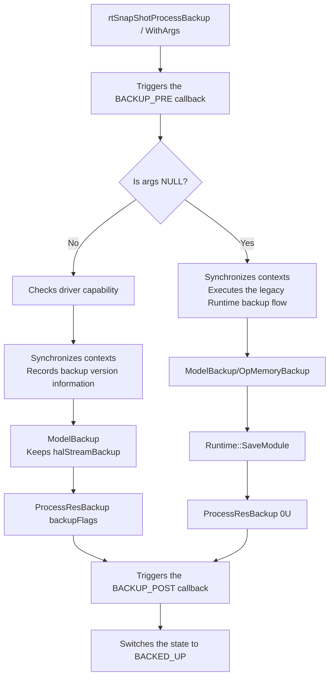
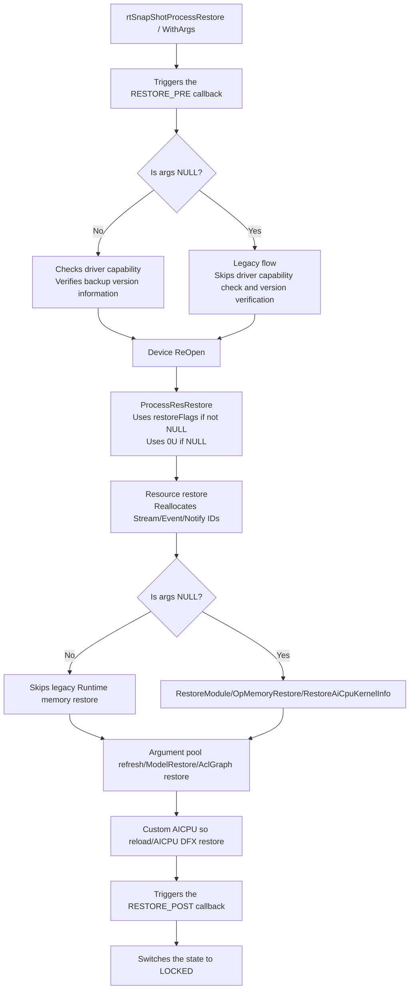
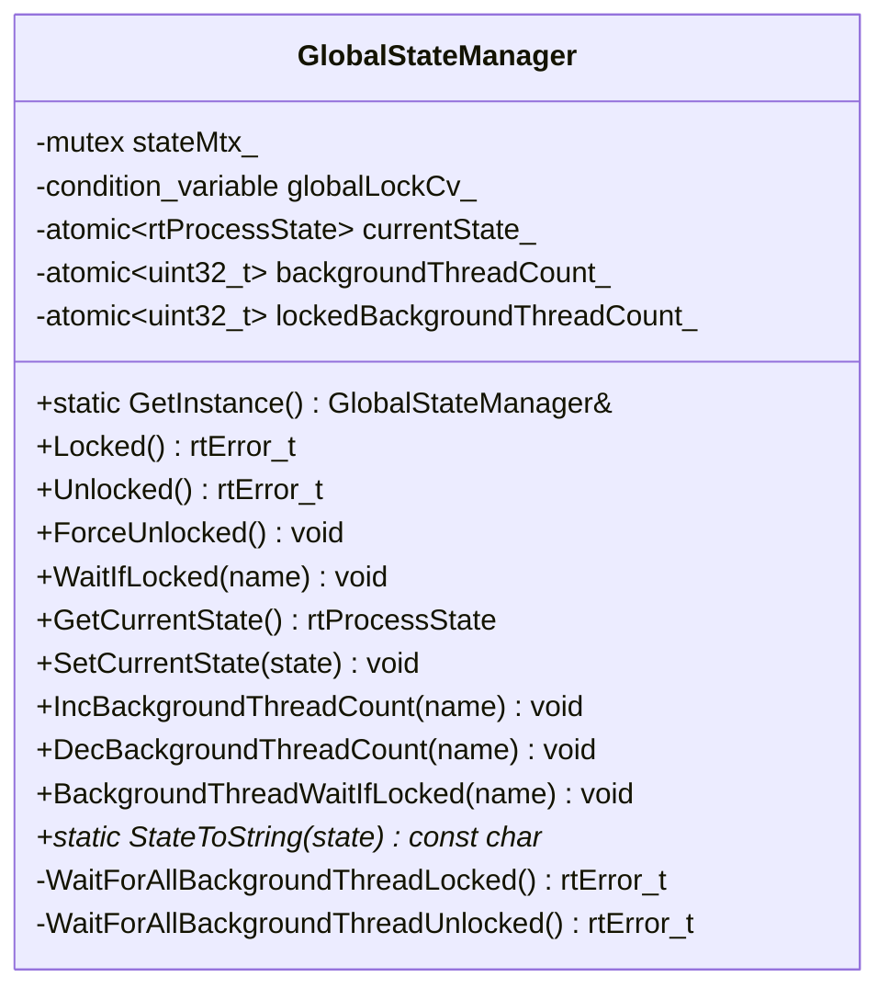
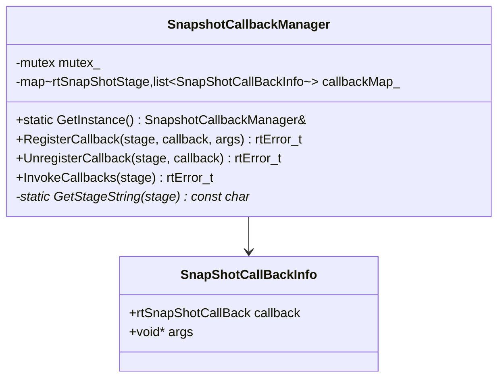
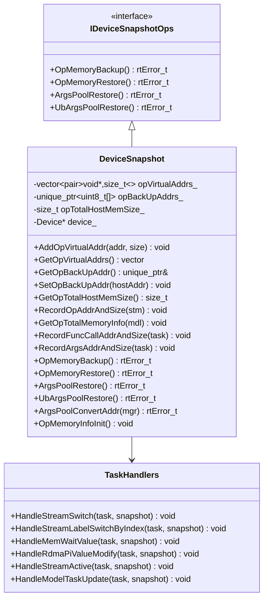
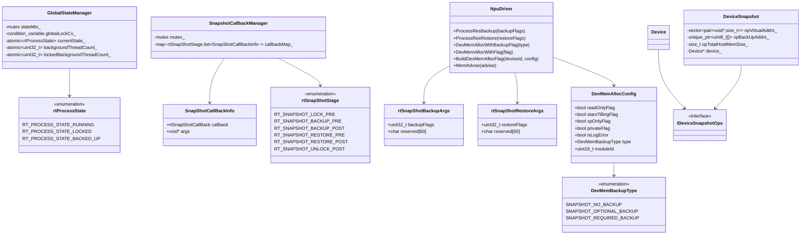
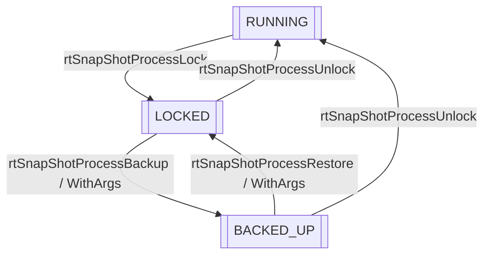

# Snapshot Feature

## 1. Feature Overview

- **Feature introduction**: The Snapshot feature supports the backup and restore of the NPU process state for process-level snapshot backup/restore scenarios (fault recovery). It locks the process, backs up key states, and restores resources, thereby implementing complete backup and restore of the process state.
- **Problem background**: A process needs to save its complete state during running so that the state can be restored later. The fault recovery efficiency of large-scale AI clusters directly affects the availability and resource utilization of training jobs. The traditional fault recovery process involves multiple serial steps, including container scheduling, process rebuilding, connection setup between the host and device, operator compilation, and weight loading. A single recovery takes more than ten minutes.
- **Design goals**:
  - Supports process lock/unlock control
  - Supports process state backup
  - Supports process state restore
  - Supports switchover between backup/restore flows based on driver capabilities
  - Supports participation of Runtime internal device memory in snapshots with the required/optional/no_backup tags
  - Provides a multi-stage callback mechanism

## 2. Use Scenarios and External APIs

### 2.1 Use Scenarios

- **Scenario 1**: Process snapshot backup
  ```cpp
  // 1. Lock the process
  aclError ret = aclrtSnapShotProcessLock(pid, nullptr);
  // 2. Back up the process state
  aclrtSnapShotBackupArgs backupArgs = {};
  backupArgs.backupFlags = 0U;
  ret = aclrtSnapShotProcessBackup(pid, &backupArgs);
  // 3. Restore the process state on the target side
  aclrtSnapShotRestoreArgs restoreArgs = {};
  restoreArgs.restoreFlags = 0U;
  ret = aclrtSnapShotProcessRestore(pid, &restoreArgs);
  // 4. Unlock the process
  ret = aclrtSnapShotProcessUnlock(pid, nullptr);
  ```

- **Scenario 2**: Register callbacks for snapshot stages
  ```cpp
  // Register the pre-backup callback
  aclrtSnapShotCallBack callback = MyBackupPreCallback;
  aclrtSnapShotCallbackRegister(ACL_RT_SNAPSHOT_BACKUP_PRE, callback, nullptr);
  // Register the post-restore callback
  aclrtSnapShotCallbackRegister(ACL_RT_SNAPSHOT_RESTORE_POST, MyRestorePostCallback, nullptr);
  ```

### 2.2 External APIs

| API | File Location | Description |
|------|----------|------|
| `aclrtSnapShotProcessLock()` | `include/external/acl/acl_rt.h` | Locks the process |
| `aclrtSnapShotProcessUnlock()` | `include/external/acl/acl_rt.h` | Unlocks the process |
| `aclrtSnapShotProcessBackup()` | `include/external/acl/acl_rt.h` | Backs up the process state |
| `aclrtSnapShotProcessRestore()` | `include/external/acl/acl_rt.h` | Restores the process from the backup point |
| `aclrtSnapShotCallbackRegister()` | `include/external/acl/acl_rt.h` | Registers a snapshot stage callback |
| `aclrtSnapShotCallbackUnregister()` | `include/external/acl/acl_rt.h` | Unregisters a snapshot stage callback |

### 2.3 Snapshot Stage Definitions

```cpp
// File location: include/external/acl/acl_rt.h
typedef enum {
    ACL_RT_SNAPSHOT_LOCK_PRE = 0,
    ACL_RT_SNAPSHOT_BACKUP_PRE,
    ACL_RT_SNAPSHOT_BACKUP_POST,
    ACL_RT_SNAPSHOT_RESTORE_PRE,
    ACL_RT_SNAPSHOT_RESTORE_POST,
    ACL_RT_SNAPSHOT_UNLOCK_POST,
} aclrtSnapShotStage;
```

### 2.4 Backup/Restore Parameters

`aclrtSnapShotBackupArgs.backupFlags` and `aclrtSnapShotRestoreArgs.restoreFlags` control the driver backup/restore scope:

| Value | Meaning |
|------|------|
| `0U` | Processes only required-level snapshot memory. |
| `1U` | Processes required-level and optional-level snapshot memory. |

When `args` is not `NULL`, the ACL layer validates parameters: `backupFlags` / `restoreFlags` must be `0U` or `1U`. If validation fails, the ACL layer directly returns an invalid parameter error.

`reserved` is a redundant reserved field. The current backup/restore flow does not use this field.

When `args` is set to `NULL`, the Runtime is compatible with the legacy API semantics, directly executes the legacy Runtime backup/restore flow, and does not use `backupFlags` / `restoreFlags` in the judgment. When `args` is not `NULL`, the Runtime checks whether the driver supports process-level device memory snapshots. If the driver supports the feature, the Runtime controls the driver backup/restore scope based on the flags. If not, the Runtime directly returns an unsupported error and does not fall back to the legacy Runtime flow.

## 3. Architecture Overview

### Overall Design Idea

The Snapshot feature uses a layered architecture design:
- **ACL API layer**: Provides C language APIs (aclrtSnapShot* series)
- **Runtime API layer**: When ACL parameters are empty, calls the legacy parameterless `rtSnapShotProcessBackup` / `rtSnapShotProcessRestore` to maintain the compatible semantics of the legacy flow. When ACL parameters are not empty, uses `rtSnapShotProcessBackupWithArgs` / `rtSnapShotProcessRestoreWithArgs` to take over and pass through `backupFlags` / `restoreFlags`
- **Core coordination layer**: GlobalStateManager manages the process state and version information, and SnapshotCallbackManager manages callbacks
- **Backup/restore coordination layer**: Namespace-level functions coordinate the backup/restore flows
- **Device operation layer**: DeviceSnapshot implements legacy Runtime memory backup/restore and refreshes argument pool addresses
- **Driver capability layer**: NpuDriver calls `halProcessResBackup` / `halProcessResRestore` to execute process-level device memory snapshots
- **Memory tag layer**: Writes the required/optional/no_backup tags when device memory is allocated or when `MemAdvise` is called, so that the driver can select the backup scope based on flags

### Architecture Layer Diagram



### Core Module Interaction Diagram

```mermaid
sequenceDiagram
participant App as Application layer
participant ACL as ACL API
participant RT as Runtime API
participant ApiImpl as ApiImpl
participant SCM as SnapshotCallbackManager
participant GSM as GlobalStateManager
participant Process as SnapShotProcessBackup
participant Dev as Device
participant DS as DeviceSnapshot
participant Drv as NpuDriver
App->>ACL: aclrtSnapShotProcessLock()
ACL->>RT: rtSnapShotProcessLock()
RT->>ApiImpl: SnapShotProcessLock()
ApiImpl->>SCM: InvokeCallbacks(RT_SNAPSHOT_LOCK_PRE)
SCM->>SCM: Iterates over the callback map and invokes the callback for each device
SCM-->>ApiImpl: Callback results
ApiImpl->>GSM: Locked()
GSM->>GSM: Switches state from RUNNING to LOCKED
GSM->>GSM: WaitForAllBackgroundThreadLocked()
GSM-->>ApiImpl: Locked successfully
ApiImpl-->>App: Returns the result
App->>ACL: aclrtSnapShotProcessBackup()
ACL->>RT: Calls rtSnapShotProcessBackup if args is NULL; otherwise, calls rtSnapShotProcessBackupWithArgs(args)
RT->>ApiImpl: SnapShotProcessBackup()
ApiImpl->>SCM: InvokeCallbacks(RT_SNAPSHOT_BACKUP_PRE)
SCM-->>ApiImpl: Callback results
ApiImpl->>Process: SnapShotProcessBackup()
alt args != NULL
    Process->>Drv: CheckIsSupportFeature(FEATURE_SVM_PROCESS_DEVICE_MEM_SNAPSHOT)
    Process->>Process: SnapShotPreProcessBackup(synchronizes contexts)
    Process->>Process: SnapShotVersionInfoBackup()
else args == NULL
    Process->>Process: SnapShotPreProcessBackup(synchronizes contexts)
    Process->>Process: Legacy flow: skips driver compatibility check and version recording
end
Process->>Dev: Iterates over all devices
Process->>Process: QueryCustomAicpuProcess/ModelBackup(devId)
alt args != NULL and compatibility check passes
    Process->>Process: Model::SinkSqTasksBackup(keeps halStreamBackup)
    Process->>Drv: ProcessResBackup(backupFlags)
else args == NULL (legacy flow)
    Process->>DS: OpMemoryBackup()
    Process->>Process: Runtime::SaveModule()
    Process->>Drv: ProcessResBackup(0U)
end
ApiImpl->>SCM: InvokeCallbacks(RT_SNAPSHOT_BACKUP_POST)
ApiImpl->>GSM: SetCurrentState(BACKED_UP)
ApiImpl-->>App: Returns the result
App->>ACL: aclrtSnapShotProcessRestore()
ACL->>RT: Calls rtSnapShotProcessRestore if args is NULL; otherwise, calls rtSnapShotProcessRestoreWithArgs(args)
RT->>ApiImpl: SnapShotProcessRestore()
ApiImpl->>SCM: InvokeCallbacks(RT_SNAPSHOT_RESTORE_PRE)
ApiImpl->>Process: SnapShotProcessRestore()
alt args != NULL
    Process->>Drv: CheckIsSupportFeature(FEATURE_SVM_PROCESS_DEVICE_MEM_SNAPSHOT)
    Process->>Process: CheckSnapShotVersionInfo()
else args == NULL
    Process->>Process: Legacy flow: skips driver compatibility check and version verification
end
Process->>Process: SnapShotDeviceRestore(ReOpen)
Process->>Drv: ProcessResRestore(args != NULL ? restoreFlags : 0U)
Process->>Process: SnapShotResourceRestore(Stream/Event/Notify)
alt args == NULL (legacy flow)
    Process->>Process: Runtime::RestoreModule()
else args != NULL (new flow)
    Process->>Process: Skips Runtime module restore
end
Process->>Dev: Iterates over all devices
alt args == NULL (legacy flow)
    Process->>DS: OpMemoryRestore()
    Process->>Dev: RestoreAiCpuKernelInfo()
else args != NULL (new flow)
    Process->>Process: Skips legacy Runtime memory restore
end
Process->>DS: ArgsPoolRestore()
Process->>DS: UbArgsPoolRestore()
Process->>Process: ModelRestore(devId)
Process->>Process: SnapShotAclGraphRestore(dev)
Process->>Process: BatchLoadCustomAicpuSo/SetAicpuDfxForRestore
ApiImpl->>SCM: InvokeCallbacks(RT_SNAPSHOT_RESTORE_POST)
ApiImpl->>GSM: SetCurrentState(LOCKED)
ApiImpl-->>App: Returns the result
App->>ACL: aclrtSnapShotProcessUnlock()
ACL->>RT: rtSnapShotProcessUnlock()
RT->>ApiImpl: SnapShotProcessUnlock()
ApiImpl->>GSM: Unlocked()
GSM->>GSM: Switches state from LOCKED to RUNNING
GSM->>GSM: Notifies blocked threads
GSM->>GSM: WaitForAllBackgroundThreadUnlocked()
ApiImpl->>SCM: InvokeCallbacks(RT_SNAPSHOT_UNLOCK_POST)
ApiImpl-->>App: Returns the result
```

## 4. Detailed Design

### 4.1 Core Flows

#### Process Locking Flow



**Function description**:
- **Callback triggering**: Triggers the LOCK_PRE stage callback, which allows upper layers to perform preparation work
- **State switching**: GlobalStateManager switches the process state from RUNNING to LOCKED
- **Thread synchronization**: Waits for all registered background threads to enter the blocked state, ensuring state consistency
- **Error handling**: Returns an error code if the current state is not RUNNING or the wait times out

Key file location: `src/runtime/api/impl/api_impl_snapshot.cc`

#### Process Backup Flow



**Function description**:
- **Preprocessing stage**: Triggers the BACKUP_PRE callback. When `args` is not `NULL`, checks driver capability first, and synchronizes all contexts after the check passes to ensure that no task is being executed
- **Non-NULL parameter flow**: Checks whether the driver supports `FEATURE_SVM_PROCESS_DEVICE_MEM_SNAPSHOT`. If not, directly returns an unsupported error. If supported, synchronizes contexts and records version information, skips legacy Runtime memory backup, and delegates processing to the driver through `NpuDriver::ProcessResBackup(backupFlags)`
- **NULL parameter flow**: Is compatible with the legacy API semantics, does not perform driver capability check or version recording, executes legacy Runtime backup logic such as `OpMemoryBackup` and `Runtime::SaveModule`, and passes `0U` to the driver
- **Post-processing stage**: Triggers the BACKUP_POST callback and switches the process state to BACKED_UP

Key file locations:
- `src/runtime/api/impl/api_impl_snapshot.cc`
- `src/runtime/feature/snapshot/snapshot_process_helper.cc`

#### Process Restore Flow



**Function description**:
- **Preprocessing stage**: Triggers the RESTORE_PRE callback and prepares the restore environment
- **Non-NULL parameter flow**: First checks whether the driver supports `FEATURE_SVM_PROCESS_DEVICE_MEM_SNAPSHOT`. If not, directly returns an unsupported error. If supported, verifies the Runtime/Driver API versions recorded during backup. The restore fails if the versions are inconsistent
- **NULL parameter flow**: Is compatible with the legacy API semantics, does not perform driver capability check or version consistency verification, and executes the legacy Runtime restore flow
- **Device restore stage**: Reopens all devices and calls the driver to restore process resources
- **Resource restore stage**: Clears and reallocates Stream IDs, Event IDs, and Notify IDs
- **Non-NULL parameter new flow**: Skips legacy Runtime memory restore operations such as `RestoreModule`, `OpMemoryRestore`, and `RestoreAiCpuKernelInfo` to avoid duplication with driver restore
- **NULL parameter legacy flow**: Retains the legacy Runtime memory restore logic
- **Retained flows**: Argument pool address refresh, `ModelRestore`, ACL Graph restore, custom AICPU so reload, and AICPU DFX restore continue to be executed. `halStreamRestore` is retained in `ModelRestore`
- **Post-processing stage**: Triggers the RESTORE_POST callback and switches the process state to LOCKED

Key file locations:
- `src/runtime/api/impl/api_impl_snapshot.cc`
- `src/runtime/feature/snapshot/snapshot_process_helper.cc`

#### Compatibility and Memory Tag Policies

Snapshot selects the new or legacy flow based on whether `args` is empty. The driver feature check is performed only when `args` is not empty:

| Condition | Backup Behavior | Restore Behavior |
|------|----------|----------|
| `args == NULL` | Compatible with the legacy API semantics. Does not check `FEATURE_SVM_PROCESS_DEVICE_MEM_SNAPSHOT` and executes the legacy Runtime backup flow. | Compatible with the legacy API semantics. Does not check `FEATURE_SVM_PROCESS_DEVICE_MEM_SNAPSHOT` or verify backup/restore version consistency, and executes the legacy Runtime restore flow. |
| `args != NULL` and `FEATURE_SVM_PROCESS_DEVICE_MEM_SNAPSHOT` is supported | The underlying driver performs backup based on the passed `backupFlags` and device memory tags. When `backupFlags` is `1U`, the driver backs up memory with the optional and required tags. When `backupFlags` is `0U`, the driver backs up only memory with the required tag. | The system first verifies backup/restore version consistency. After verification passes, the underlying driver performs restore based on the passed `restoreFlags` and device memory tags. When `restoreFlags` is `1U`, the driver restores memory with the optional and required tags. When `restoreFlags` is `0U`, the driver restores only memory with the required tag. |
| `args != NULL` and `FEATURE_SVM_PROCESS_DEVICE_MEM_SNAPSHOT` is not supported | The current driver version does not support process-level device memory backup. The system directly returns an unsupported error and does not fall back to the legacy Runtime backup flow. | The current driver version does not support process-level device memory restore. The system directly returns an unsupported error and does not fall back to the legacy Runtime restore flow. |

When `args` is not empty and the compatibility check passes, the driver determines the backup/restore scope based on device memory tags and `backupFlags` / `restoreFlags`. When `args` is empty, the backup and restore logic is completed by the legacy Runtime flow. In this case, tags do not participate in the legacy flow judgment, and the tags themselves have no practical meaning. The Runtime uses the following tag principles internally:

| Tag | Usage Principle |
|------|----------|
| `SNAPSHOT_REQUIRED_BACKUP` | Memory that the driver must back up/restore when the compatibility check passes, regardless of whether `backupFlags` / `restoreFlags` is `0U` or `1U`. Applicable to Runtime internal device memory whose content must remain consistent after restore. |
| `SNAPSHOT_OPTIONAL_BACKUP` | Memory that the driver backs up/restores only when the compatibility check passes and `backupFlags` / `restoreFlags` is `1U`. Applicable to Runtime auxiliary memory that is not necessarily backed up or can be rebuilt/re-dispatched during the restore stage. |
| `SNAPSHOT_NO_BACKUP` | Memory that the driver does not need to back up/restore even when the compatibility check passes. Applicable to external user memory allocated by aclrt-related APIs, which does not participate in Snapshot backup/restore. |

Only device memory allocated internally by the Runtime needs to participate in snapshot backup. Select the required or optional tag based on the content consistency requirements after restore. External user memory allocated by aclrt-related APIs uniformly uses `SNAPSHOT_NO_BACKUP` and does not participate in snapshots. Device memory allocation uses two methods, `DevMemAllocWithBackupFlag` and `DevMemAllocWithFlag` (for API descriptions, see `docs/zh/design/modules/memory/memory.md`):

- When all members of config use default values, calls `DevMemAllocWithBackupFlag`, and the backup tag is explicitly passed in through the positional `type` parameter.
- When config has members that do not use default values, calls `DevMemAllocWithFlag`. The caller first constructs config and assigns values to the non-default members, generates `drvFlag` through `NpuDriver::BuildDevMemAllocFlag(deviceId, &config)`, and allocates memory with both of them.

### 4.2 Core Component Details

#### GlobalStateManager: Process State Management

**Design idea**: Manages the global process state, controls API call blocking, and coordinates background thread locking. This component is located in the `cce::runtime` namespace.



Key file locations:
- Header file: `src/runtime/core/inc/common/global_state_manager.hpp`
- Implementation file: `src/runtime/core/src/common/global_state_manager.cc`

#### SnapshotCallbackManager: Callback Manager

**Design idea**: An independent singleton that manages snapshot callback functions and provides callback registration, unregistration, and triggering functions. This component is located in the `cce::runtime` namespace.



Key file locations:
- Header file: `src/runtime/feature/snapshot/snapshot_callback_manager.hpp`
- Implementation file: `src/runtime/feature/snapshot/snapshot_callback_manager.cc`

#### IDeviceSnapshotOps: Device Snapshot Operation API

**Design idea**: The abstract API defines core device snapshot operations, facilitating extension and adaptation to different hardware versions. In the legacy flow where `args` is empty, `DeviceSnapshot` performs legacy Runtime memory backup/restore. When `args` is not empty and the compatibility check passes, the driver takes over legacy memory backup/restore, and `ArgsPoolRestore` / `UbArgsPoolRestore` are still used to refresh argument pool address information.



Key file locations:
- API definition: `src/runtime/core/inc/common/idevice_snapshot_ops.hpp`
- Implementation class header file: `src/runtime/feature/snapshot/device_snapshot.hpp`
- Implementation file: `src/runtime/feature/snapshot/device_snapshot.cc`

#### SnapShotProcessHelper: Snapshot Processing Helper

**Design idea**: Provides auxiliary functions such as pre-backup processing, version recording/verification, device restore, resource restore, model backup/restore, and ACL Graph restore. This module selects the new or legacy Snapshot flow based on whether `args` is empty. When `args` is not empty, this module checks the driver feature and passes `backupFlags` / `restoreFlags` to the driver.

Key file locations:
- Header file: `src/runtime/feature/snapshot/snapshot_process_helper.hpp`
- Implementation file: `src/runtime/feature/snapshot/snapshot_process_helper.cc`

#### NpuDriver Snapshot Capabilities

**Design idea**: Encapsulates driver-side process-level resource backup/restore capabilities and uniformly handles device memory snapshot tags.

Core responsibilities:
- `ProcessResBackup`: Calls `halProcessResBackup` and carries the optional backup flag when `backupFlags == 1U`.
- `ProcessResRestore`: Calls `halProcessResRestore` and carries the optional restore flag when `restoreFlags == 1U`.
- `DevMemAllocWithBackupFlag` / `DevMemAllocWithFlag`: Writes the `DevMemBackupType` tag when device memory is allocated (the former passes the tag in through the `type` input parameter; the latter requires the caller to set `config.type`, and `NpuDriver::BuildDevMemAllocFlag(deviceId, &config)` then encodes the backup type and other allocation attributes into the flag).
- `MemAdvise`: Adds the required tag to device addresses that are already allocated or held by tasks.

Key file locations:
- Header file: `src/runtime/driver/npu_driver.hpp`
- Implementation files: `src/runtime/driver/npu_driver.cc` and `src/runtime/driver/npu_driver_mem.cc`
- Driver abstract API: `src/runtime/core/inc/drv/driver.hpp`

### 4.3 Module Responsibility Division

| Module | Responsibility | Location |
|------|------|------|
| GlobalStateManager | Process state management and API call blocking control | `core/inc/common/global_state_manager.hpp` |
| SnapshotCallbackManager | Callback management singleton | `feature/snapshot/snapshot_callback_manager.hpp` |
| IDeviceSnapshotOps | Abstract API for device snapshot operations | `core/inc/common/idevice_snapshot_ops.hpp` |
| DeviceSnapshot | Device memory backup/restore implementation | `feature/snapshot/device_snapshot.hpp` |
| SnapShotProcessHelper | Backup/restore auxiliary functions | `feature/snapshot/snapshot_process_helper.hpp` |
| NpuDriver | Driver-side process resource backup/restore and memory tag conversion | `driver/npu_driver.hpp` |
| DevMemAllocWithBackupFlag | General fast-path entry (the backup tag is explicitly passed in through the positional `type` parameter; Runtime internal memory uses required / optional as needed, and aclrt-related APIs pass in `SNAPSHOT_NO_BACKUP`) | `core/inc/drv/driver.hpp` |
| DevMemAllocWithFlag | General API (used when config has non-default members): the caller first sets config, builds the flag through `NpuDriver::BuildDevMemAllocFlag(deviceId, &config)`, and explicitly passes in the flag together with config | `core/inc/drv/driver.hpp` |
| ApiImpl | API implementation and flow coordination | `api/impl/api_impl_snapshot.cc` |
| TaskHandlers | Task type handlers | `feature/snapshot/device_snapshot.hpp` |

### 4.4 Core Data Structures



## 5. Key Design Ideas

### 5.1 Process State Machine

#### State Definitions

The process state is defined by the `rtProcessState` enumeration. There are three states in total:

| State | Description | Allowed Operations |
|------|------|-----------|
| **RT_PROCESS_STATE_RUNNING** | Normal running state of the process | All APIs execute normally, and you can call Lock() to enter the LOCKED state |
| **RT_PROCESS_STATE_LOCKED** | Locked state of the process | Backup() can enter the BACKED_UP state, or Unlock() can return to the RUNNING state |
| **RT_PROCESS_STATE_BACKED_UP** | Backed-up state of the process | Restore() can return to the LOCKED state, or Unlock() can return to the RUNNING state |

#### State Transition Rules

Process state transitions follow a strict state machine:



#### State Transition Constraints

**Normal transition paths**:
- RUNNING → LOCKED: Lock() succeeds only when the current state is RUNNING
- LOCKED → BACKED_UP: Backup() succeeds only when the current state is LOCKED
- BACKED_UP → LOCKED: Restore() succeeds only when the current state is BACKED_UP
- LOCKED/BACKED_UP → RUNNING: Unlock() succeeds only when the state is LOCKED or BACKED_UP

**State transition failure handling**:
- **Lock failure**: If the current state is not RUNNING or background thread synchronization times out, the state rolls back to RUNNING, and all blocked threads are notified
- **Unlock failure**: If the current state is not LOCKED or BACKED_UP, returns the error code RT_ERROR_SNAPSHOT_UNLOCK_FAILED
- **Backup/Restore failure**: Does not affect state transitions and is handled inside the specific flow

#### Forced Unlock Scenario

`ForceUnlocked()` forces unlocking when the process exits.

**Trigger time**: Process exit (the main function returns, exit() is called, or the process is terminated)

The function is registered as a process exit cleanup function through `atexit()`:
```cpp
(void)atexit(&ThreadGuard::ThreadExit);
```
File location: `src/runtime/core/src/utils/osal.cc:218`

**Necessity**:
- If the process is still in the `LOCKED` or `BACKED_UP` state when it exits, other threads may be blocked on condition variables waiting for unlock
- Without forced unlocking, these threads will never exit, and the process cannot end normally
- Forced unlocking notifies all blocked threads to unblock, allowing the process to exit normally

**Design purpose**: Cleans up when the process exits abnormally, preventing resource deadlocks and stuck threads

Key file locations:
- `src/runtime/core/src/common/global_state_manager.cc`
- `src/runtime/core/src/utils/osal.cc`

### 5.2 API Blocking Mechanism

#### Blocking Scenario Description

After the process is locked, APIs that involve device resource modifications block and wait in the **host-side calling thread** until the process is unlocked.

#### Blocking Mechanism Implementation

The API layer implements blocking through the `GLOBAL_STATE_WAIT_IF_LOCKED()` macro:

```cpp
#define GLOBAL_STATE_WAIT_IF_LOCKED() \
    GlobalStateManager::GetInstance().WaitIfLocked(__func__)
```

Blocking logic:
- **Blocking condition**: The process state is `RT_PROCESS_STATE_LOCKED` or `RT_PROCESS_STATE_BACKED_UP`
- **Blocking behavior**: The host-side calling thread blocks on the condition variable `globalLockCv_` and waits for the state to change to `RT_PROCESS_STATE_RUNNING`
- **Non-blocking scenario**: If the process state is `RUNNING`, the API directly returns and continues execution

Key file location: `src/runtime/core/inc/common/global_state_manager.hpp`

#### Blocking API Examples (Involving Device Resource Modifications)

| API Category | Examples of Blocking APIs |
|---------|---------------|
| **Memory API** | rtMalloc, rtFree, rtsMemcpy2D, rtsMallocHost, rtMallocHost, rtsHostRegister, rtHostRegisterV2, and rtHostGetDevicePointer |
| **Stream API** | rtStreamCreate, rtStreamDestroy, rtStreamDestroyForce, rtStreamWaitEvent, rtStreamSwitchN, rtSetStreamSqLock, and rtSetStreamSqUnlock |
| **Kernel API** | rtKernelLaunch and rtCccKernelLaunch |
| **Device API** | rtSetDevice, rtDeviceReset, and rtsResetDevice |
| **Model API** | rtModelLoad and rtModelExecute |
| **Event API** | rtsEventCreate and rtEventDestroy |
| **Context API** | rtCtxCreate and rtCtxDestroy |

**Blocking statistics**: In total, 249 APIs in the source code use the `GLOBAL_STATE_WAIT_IF_LOCKED()` macro.

#### Non-Blocking API Examples (Not Involving Resource Modifications)

**Query APIs**:
- rtGetDeviceCount, rtGetDevice, and rtGetDeviceIDs
- rtStreamQuery, rtStreamGetPriority, and rtStreamGetFlags
- rtSnapShotProcessGetState

**Synchronization APIs**:
- rtStreamSynchronize and rtStreamSynchronizeWithTimeout
- rtEventSynchronize

**Snapshot management APIs**:
- rtSnapShotProcessLock and rtSnapShotProcessUnlock
- rtSnapShotProcessBackup, rtSnapShotProcessRestore, rtSnapShotProcessBackupWithArgs, and rtSnapShotProcessRestoreWithArgs
- rtSnapShotCallbackRegister and rtSnapShotCallbackUnregister

**Design principle**: The code comment states "For any api that involves modifications to device resources, this should be added". That is, only APIs that involve device resource modifications block, while query and synchronization APIs do not block.

### 5.3 Callback Stage Design

Callbacks are triggered at each key stage and allow upper-layer applications to execute custom logic:

| Stage | Trigger Time | Typical Use |
|------|----------|----------|
| LOCK_PRE | Before locking | Preparation work |
| BACKUP_PRE | Before backup | Saves additional states |
| BACKUP_POST | After backup | Confirms backup completion |
| RESTORE_PRE | Before restore | Prepares the restore environment |
| RESTORE_POST | After restore | Confirms restore completion |
| UNLOCK_POST | After unlocking | Cleanup work |

### 5.4 Background Thread Management

During locking, the system waits for all background threads to enter the blocked state:
- `IncBackgroundThreadCount(name)`: A background thread registers that it needs to be blocked
- `BackgroundThreadWaitIfLocked(name)`: A background thread checks and blocks
- `DecBackgroundThreadCount(name)`: A background thread unregisters when it exits

## 6. Key File Index

| Module | File Path | Core Content |
|------|----------|----------|
| API header file | `pkg_inc/runtime/rts/rts_snapshot.h` | External API definitions and state enumerations |
| ACL implementation | `src/acl/aclrt_impl/snapshot.cpp` | ACL layer API encapsulation |
| Runtime API | `src/runtime/api/api_c_snapshot.cc` | C API implementation |
| API implementation | `src/runtime/api/impl/api_impl_snapshot.cc` | Implementation of the SnapShotProcess APIs |
| State management | `src/runtime/core/inc/common/global_state_manager.hpp` | Definition of the GlobalStateManager class |
| State management implementation | `src/runtime/core/src/common/global_state_manager.cc` | Process state management implementation |
| Callback management | `src/runtime/feature/snapshot/snapshot_callback_manager.hpp` | Definition of the SnapshotCallbackManager class |
| Callback management implementation | `src/runtime/feature/snapshot/snapshot_callback_manager.cc` | Implementation of callback registration/unregistration/triggering |
| Driver abstraction | `src/runtime/core/inc/drv/driver.hpp` | Abstract APIs `DevMemAllocWithBackupFlag` and `MemAdvise` |
| Driver encapsulation | `src/runtime/driver/npu_driver.hpp` and `src/runtime/driver/npu_driver.cc` | Process resource backup/restore and memory tag conversion |
| Device memory allocation | `src/runtime/driver/npu_driver_mem.cc` | Writes snapshot tags when allocating device memory |
| Device snapshot API | `src/runtime/core/inc/common/idevice_snapshot_ops.hpp` | Abstract API IDeviceSnapshotOps |
| Device snapshot | `src/runtime/feature/snapshot/device_snapshot.hpp` | Definition of the DeviceSnapshot class |
| Device snapshot implementation | `src/runtime/feature/snapshot/device_snapshot.cc` | Implementation of legacy Runtime memory backup/restore and argument pool restore |
| Snapshot helper | `src/runtime/feature/snapshot/snapshot_process_helper.hpp` | Declarations of processing auxiliary functions |
| Snapshot helper implementation | `src/runtime/feature/snapshot/snapshot_process_helper.cc` | Compatibility check, backup/restore flow selection, and driver calls |
| Device adaptation v100 | `src/runtime/feature/snapshot/v100/device_snapshot_adapter.cc` | v100 version adaptation |
| Device adaptation v200 | `src/runtime/feature/snapshot/v200_base/device_snapshot_adapter.cc` | v200 version adaptation |

## 7. Typical Issues and Troubleshooting

### 7.1 Key Log Points

- `locked success.`: Locked successfully
- `unlocked success.`: Unlocked successfully
- `start to restore resource`: Starts to restore resources
- `the resource is restored successfully`: Resources are restored successfully
- `current state is not the running state, current state is %s`: State error
- `Timeout: only %u/%u background threads locked`: Background thread locking times out

### 7.2 Problem Locating Methods

1. **Lock failure**: Check whether the current process state is RUNNING
2. **Lock timeout**: Check whether background threads are correctly registered and blocked
3. **Backup failure**: Check whether context synchronization succeeds, and check whether the model is of the AICPU type (not supported)
4. **Restore failure**: Check steps such as Device ReOpen and Stream ID reallocation

### 7.3 State Check

Call `rtSnapShotProcessGetState()` to obtain the current process state.

---

_This feature document is based on analysis of the source code in `src/runtime/feature/snapshot/` and `src/runtime/core/src/common/global_state_manager.cc`._
