# Context Module Architecture

## 1. Module Overview

- **Function Description**: Context maintains the execution context of the Runtime on a specified Device. Context is bound to a Device and manages the default Stream, user Streams, Models, CaptureModels, Modules, and error states. When a Runtime API executes, it first obtains the Context associated with the current thread, and then determines the target Device through that Context. Subsequent task dispatching, synchronization, exception handling, and resource reclamation are completed on that Context and its associated Device.
- **Design Objectives**:
  - The Runtime supports associating the default Context through `aclrtSetDevice` and explicitly creating a user Context through `aclrtCreateContext`.
  - The Runtime uses a thread-local variable in thread-local storage (TLS) to save the current Context, isolating the execution environments of threads from each other.
  - The Runtime manages the associations between the Context and related resources, as well as resource reclamation.
  - The Runtime combines mechanisms such as the lifecycle state machine, USER/INTERNAL access modes, and thread association to ensure safe Context access.

Contexts fall into two types based on how they are created and bound:

| Form | Creation Entry | Core Object | Lifecycle Management |
| --- | --- | --- | --- |
| Default Context | `aclrtSetDevice()` | `Context(dev, true)` | Managed by Device setting/resetting. The Runtime maintains the default Context object and its **reference count** through `RefObject<Context *>`. A reset releases associated resources but retains the Context object for later reuse. |
| User Context | `aclrtCreateContext()` | `Context(dev, false)` | Registered by `ContextManage` and explicitly destroyed by `aclrtDestroyContext()`. The final deletion of the Context object is controlled by the thread binding reference count. |

## 2. Usage Scenarios and External APIs

### 2.1 Usage Scenarios

- **Scenario 1**: Set a Device and use the default Context.

  ```cpp
  aclrtSetDevice(0);
  // The Runtime internally creates or reuses the default Context for device 0 and binds it to the current thread.
  ```

- **Scenario 2**: Explicitly create two user Contexts, switch between them, and destroy them.

  ```cpp
  aclrtContext ctxA = nullptr;
  aclrtContext ctxB = nullptr;
  aclrtCreateContext(&ctxA, 0);
  aclrtCreateContext(&ctxB, 0);
  // After ctxB is created, ctxB is the current Context.
  
  aclrtSetCurrentContext(ctxA);
  // The current Context switches from ctxB to ctxA.
  // ... Submit tasks under ctxA ...
  
  aclrtSetCurrentContext(ctxB);
  // The current Context switches back from ctxA to ctxB.
  // ... Submit tasks under ctxB ...
  
  aclrtDestroyContext(ctxA);
  aclrtDestroyContext(ctxB);
  ```

- **Scenario 3**: Obtain the default Stream of the current Context.

  ```cpp
  aclrtStream stream = nullptr;
  aclrtCtxGetCurrentDefaultStream(&stream);
  ```

- **Scenario 4**: Reuse the same user Context across multiple threads.

  ```cpp
  aclrtContext sharedCtx = nullptr;
  aclrtCreateContext(&sharedCtx, 0);
  
  auto worker = [sharedCtx]() {
      aclrtSetCurrentContext(sharedCtx);    // Reuse the same Context
      // ... Submit tasks under sharedCtx ...
  };
  
  std::thread threadA(worker);
  std::thread threadB(worker);
  threadA.join();
  threadB.join();
  aclrtDestroyContext(sharedCtx);
  ```

### 2.2 External APIs

| ACL API | Description |
| --- | --- |
| `aclrtSetDevice()` | Sets the Device used by the current thread. The Runtime internally creates or reuses the corresponding default Context and associates it with the current thread. |
| `aclrtResetDevice()` | Resets the specified Device and releases resources associated with the default Context. The Context object can be retained for reuse when the Device is set again. |
| `aclrtCreateContext()` | Creates a user Context and sets it as the Context of the current thread. |
| `aclrtDestroyContext()` | Destroys a user Context. It cannot be used to destroy a default Context. |
| `aclrtSetCurrentContext()` | Associates the specified Context with the current thread. |
| `aclrtGetCurrentContext()` | Obtains the Context associated with the current thread. |
| `aclrtCtxGetCurrentDefaultStream()` | Obtains the default Stream of the current Context. |
| `aclrtGetPrimaryCtxState()` | Queries whether the default Context of a specified Device is in the active state. |

## 3. Architecture Overview

### 3.1 Overall Design Ideas

The overall design of the Context module covers Context lifecycle management, thread association of the current Context, context resource management, validity protection, and abnormal state handling.

| Design Point | Description |
| --- | --- |
| Context lifecycle management | Default Contexts are managed by the Device setting and resetting paths and support reuse. User Contexts are explicitly created and destroyed by users. For details, see [4.1 Core Flows](#41-core-flows). |
| Thread association | Runtime APIs without an explicit Context parameter find the Context through the current thread association to determine the execution environment. Thread association supports inter-thread isolation and Context switching. For details, see [4.3.1 Thread Association Mechanism](#431-thread-association-mechanism). |
| Resource management | Streams, Models, Modules, and other resources are managed by their owning Contexts, and related operations must be completed under the owning Context. For details, see [4.2 Context Resource Management](#42-context-resource-management). |
| Validity protection | Context validity, state access, concurrent destruction, and abnormal state propagation are managed in a unified manner. For details, see [4.3 Details of Core Mechanisms](#43-details-of-core-mechanisms). |

### 3.2 Relationship Diagram of Context Core Modules

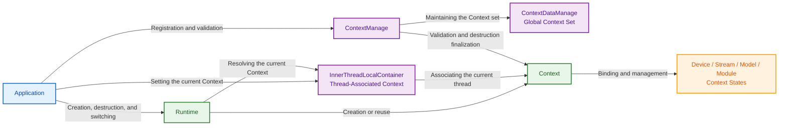

### 3.3 Interaction Diagrams of Core Modules

#### 3.3.1 Default Context

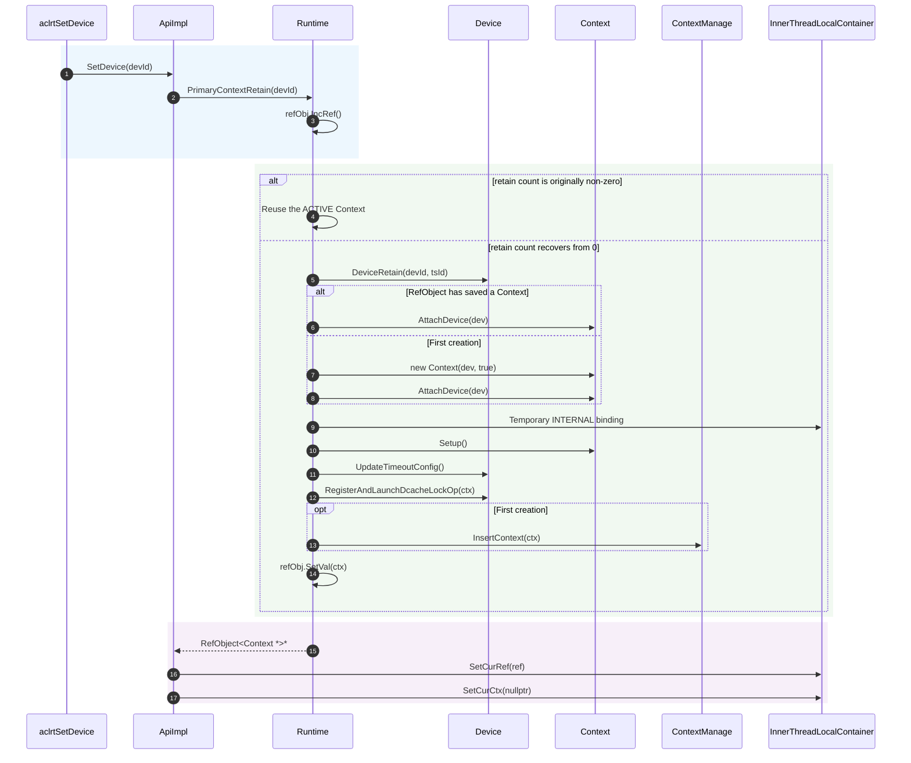

#### 3.3.2 User Context

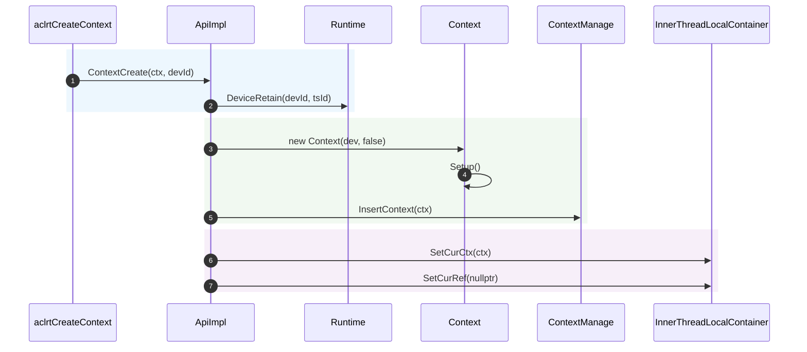

## 4. Detailed Design

### 4.1 Core Flows

#### 4.1.1 Core Flow of the Default Context

##### Creation and Reuse Flow

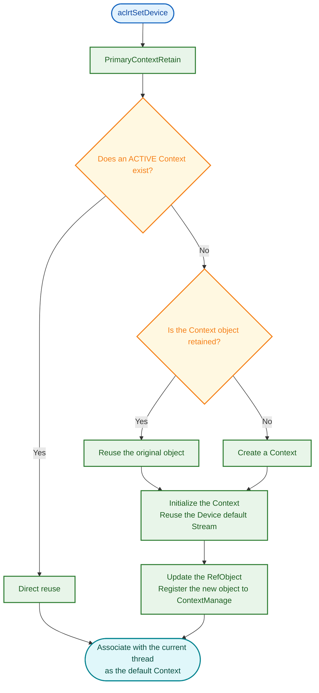

The Runtime maintains a default Context for each Device/TS. `aclrtSetDevice()` creates or reuses the corresponding Context, completes initialization if necessary, and associates it with the current thread.

**Key Code**:

```cpp
// File location: src/runtime/api/impl/api_impl.cc
rtError_t ApiImpl::SetDevice(const int32_t devId)
{
    Runtime * const rt = Runtime::Instance();
    RefObject<Context *> *context = rt->PrimaryContextRetain(static_cast<uint32_t>(devId));
    NULL_PTR_RETURN_MSG(context, RT_ERROR_DEVICE_RETAIN);
    InnerThreadLocalContainer::SetCurRef(context);
    Context * const curCtx = context->GetVal();
    CHECK_CONTEXT_VALID_WITH_RETURN(curCtx, RT_ERROR_CONTEXT_NULL);
    InnerThreadLocalContainer::SetCurCtx(nullptr);
    return RT_ERROR_NONE;
}
```

##### Reset and Release Flow

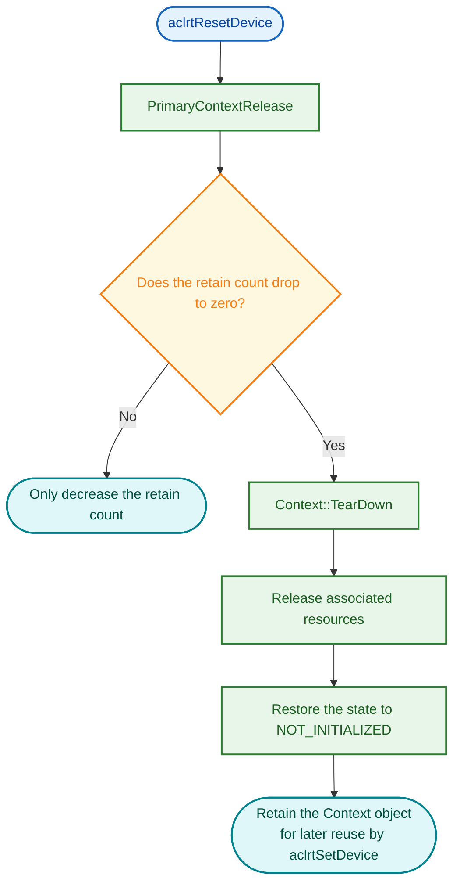

After the retain count drops to zero, the default Context executes teardown and releases associated resources, while `RefObject<Context *>` continues to retain the Context object. A subsequent `aclrtSetDevice()` re-initializes and reuses the object.

#### 4.1.2 Core Flow of the User Context

##### Creation Flow

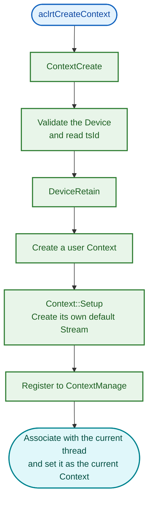

After the creation succeeds, `ContextCreate()` immediately calls `ContextSetCurrent()`, so the new Context becomes the Context associated with the current thread.

**Key Code**:

```cpp
// File location: src/runtime/api/impl/api_impl.cc
rtError_t ApiImpl::ContextCreate(Context ** const inCtx, const int32_t devId)
{
    rtError_t error = NewContext(static_cast<uint32_t>(devId), tsId, inCtx);
    ERROR_RETURN_MSG_INNER(error, "new context failed, drv devId=%d", devId);

    ContextManage::InsertContext(*inCtx);
    error = ContextSetCurrent(*inCtx);
    ERROR_RETURN_MSG_INNER(error, "Failed to set current context");
    return RT_ERROR_NONE;
}
```

##### Destruction Flow

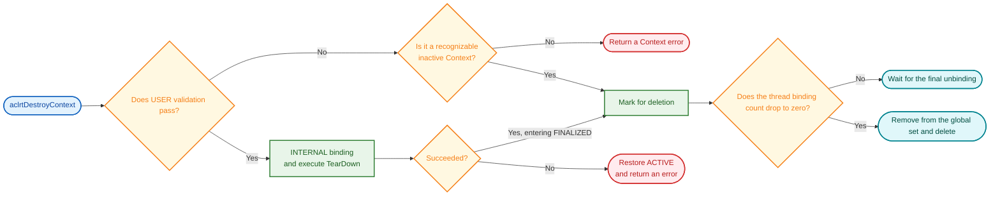

The user Context uses INTERNAL access during teardown. After teardown succeeds, the Context is marked for deletion, and `TryDeleteIfNeeded()` completes the deletion when `threadRefCount_` drops to zero. For details, see [the "Destruction Protection Mechanism" section](#434-destruction-protection-mechanism).

#### 4.1.3 Flow of Setting and Obtaining the Current Context

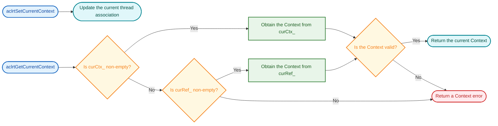

`aclrtSetCurrentContext()` associates a specified valid Context with the current thread, without distinguishing between default Contexts and user Contexts.

`aclrtGetCurrentContext()` returns the Context associated with `curCtx_` first. If `curCtx_` is empty, it obtains the default Context associated by `aclrtSetDevice()` from `curRef_`.

### 4.2 Context Resource Management

A Context is bound to one Device and manages the Streams, Models, Modules, and auxiliary resources in that execution environment. The Context maintains resource ownership and the reclamation order, while the Device and resource modules perform the actual allocation and execution.

#### 4.2.1 Resource Overview

A Context establishes resources on demand in `Setup()` and reclaims them in reverse order in `TearDown()` and the destructor. The resource fields held by a Context include:

```cpp
// File location: src/runtime/core/inc/context/context.hpp
class Context : public NoCopy {
protected:
    Device* device_;                                // Bound Device
private:
    Stream* defaultStream_;                         // Default Stream
    Stream* onlineStream_;
    std::list<Stream*> streams_;                    // User Stream set
    SpinLock modelLock_;
    std::list<Model*> models_;                      // Model set
    std::mutex moduleLock_;
    ObjAllocator<Module*>* moduleAllocator_;        // Module allocator (by Program ID)
    void* overflowAddr_ = nullptr;
    Atomic<bool> callBackThreadExist_;
    ContextCallBack threadCallBack_;                // Host Callback executor
    std::unique_ptr<Thread> hostFuncCallBackThread_;// Host Callback thread
    // ...
};
```

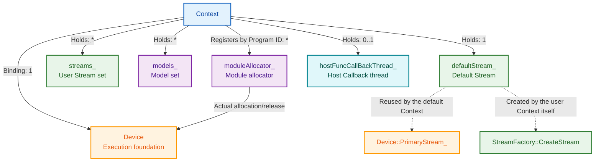

**Resource Ownership Constraints**:

- **Device**: Each Context is bound to only one Device, and the Streams, Models, and Modules owned by the Context all use the execution capability of that Device.
- **Streams, Models, and Modules**: Related operations must be completed under the Context that owns the resources. Using, binding, or destroying resources across Contexts is not allowed.

#### 4.2.2 Stream Management

The Context is mainly responsible for managing the following two types of Streams:

| Stream Type | Source | Context Responsibility | Reclamation Path |
| --- | --- | --- | --- |
| Default Stream (`defaultStream_`) | Default Context: reuses `Device::PrimaryStream_()`<br />User Context: `StreamFactory::CreateStream` + `Setup` | Serves as the execution entry when no Stream is explicitly specified | User Context: destroyed by `TearDownContextStream`<br />Default Context: only the association is removed |
| User Stream (`streams_`) | Explicitly created by `StreamCreate` under the current Context and then registered by `InsertStreamList` | Records ownership and is handled uniformly during Context synchronization/destruction | Destroyed uniformly by `TearDownOwnedStreamsOnContextTearDown` |

**Context Synchronization Rules**:

- `Context::Synchronize` traverses `streams_` and skips Streams that do not participate in synchronization (`IsStreamNotSync`).
- A Stream in the capture state directly reports an error (`RT_ERROR_STREAM_CAPTURED`). Other Streams perform synchronization after task reclamation.

```cpp
// File location: src/runtime/core/src/context/context.cc
rtError_t Context::Synchronize(int32_t timeout)
{
    for (const auto& syncStream : streams_) {
        if (IsStreamNotSync(syncStream->Flags())) { continue; }
        COND_RETURN_ERROR(syncStream->IsCapturing(), RT_ERROR_STREAM_CAPTURED, ...);
        COND_PROC(syncStream->IsSyncFinished() && (GetCtxMode() == ABORT_ON_FAILURE), continue;);
        syncStreams.push_back(syncStream);
    }
    (void)TaskReclaimforSyncDevice(startTime, timeout);   // Reclaim tasks first
    const rtError_t error = CheckStatus();                // Check the Context state next
    return SyncStreamsWithTimeout(syncStreams, timeout, startTime);
}
```

#### 4.2.3 Model Management

The Context records the Models created in its execution environment in `models_`. The binding between a Model and a Stream must satisfy the same-Context constraint.

- **Creation**: `ModelCreate` generates a Model, and the Context records it in `models_`.
- **Binding**: `ModelBindStream` requires that a Model and a Stream belong to the same Context. One Model can bind multiple Streams.
- **Reclamation**: During Context TearDown, `TearDownModelsOnContextTearDown()` uniformly reclaims the Models that still exist.

```cpp
// File location: src/runtime/core/src/context/context.cc
void Context::TearDownModelsOnContextTearDown()
{
    std::list<Model*> modelsToDelete;
    modelLock_.Lock();
    for (Model* tdModel : models_) {
        PrepareModelForDelete(tdModel);   // Unbind Streams and clean up Executors
    }
    modelsToDelete.swap(models_);
    modelLock_.Unlock();

    for (Model* tdModel : modelsToDelete) {
        DeleteModelOnContextTearDown(tdModel);   // Perform the actual delete
    }
}
```

#### 4.2.4 Module Management

The Device performs the actual memory allocation and release of Modules, while the Context registers, searches for, and reuses Modules by Program ID through `moduleAllocator_`. The same Program establishes separate Module registration relationships under different Contexts.

- **Obtaining**: `GetModule(prog)` searches by Program ID, reuses an existing Module, or creates and registers a new one.
- **Reclamation**: During final Context release, `ReleaseModulesAfterTearDown()` traverses `moduleAllocator_` and releases all unreleased Modules.

```cpp
// File location: src/runtime/core/src/context/context.cc
void Context::ReleaseModulesAfterTearDown()
{
    uint32_t i = 0U;
    while ((i < Runtime::maxProgramNum_) && (moduleAllocator_ != nullptr)) {
        if (!moduleAllocator_->CheckIdValid(i)) {
            i = moduleAllocator_->NextPoolFirstId(i);
            continue;
        }
        ReleaseModule(i);   // Release the Module corresponding to this Program ID
        i++;
    }
}
```

### 4.3 Details of Core Mechanisms

The Context determines the current execution context environment through **thread association**, controls validity through the **lifecycle state machine** and **access modes**, protects the destruction process through **thread binding references**, and controls post-failure behavior through **abnormal state propagation**.

#### 4.3.1 Thread Association Mechanism

**Design Idea**: The Runtime saves a per-thread Context association (`curCtx_`) in TLS, enabling Runtime APIs without an explicit Context parameter to determine the execution environment. Thread association also provides destruction protection for user Contexts through `threadRefCount_`.

**Two Types of Thread Association**:

| Association Method | Storage Location | Setting Entry | Whether `threadRefCount_` Is Increased | Applicable Context |
| --- | --- | --- | --- | --- |
| `curCtx_` | Direct `Context*` pointer | `ContextSetCurrent` and the internal `SetCurCtx` | Yes (for a user Context with non-internal access) | User Contexts and internal temporary bindings |
| `curRef_` | `RefObject<Context*>*` reference object | `aclrtSetDevice` through `SetCurRef` | No (the lifecycle of a default Context is managed by `RefObject` itself) | Default Contexts |

**Association Establishment and Removal**:

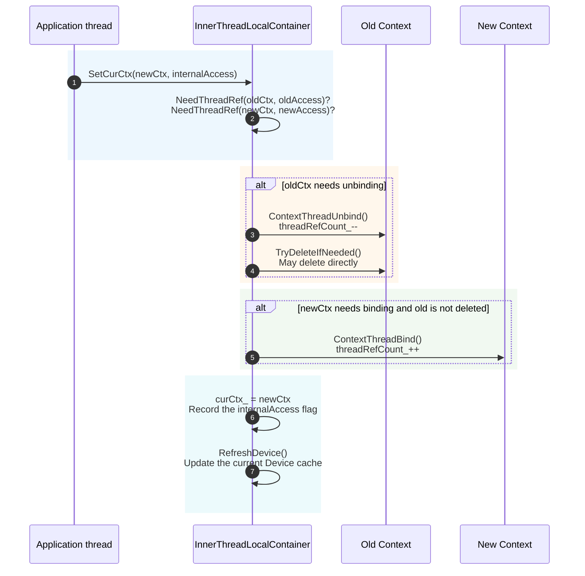

**Key Code**:

```cpp
// File location: src/runtime/core/src/common/inner_thread_local.cpp
bool UpdateThreadBinding(Context* oldCtx, bool oldNeedThreadRef,
                         Context* newCtx, bool newNeedThreadRef)
{
    if (needUnbindOldCtx) {
        (void)oldCtx->ContextThreadUnbind();        // threadRefCount_--
        oldCtxDeleted = oldCtx->TryDeleteIfNeeded();// May be the final unbinding
    }
    if (needBindNewCtx && ((!oldCtxDeleted) || !oldCtxIsNewCtx)) {
        newCtx->ContextThreadBind();                // threadRefCount_++
    }
    return oldCtxDeleted;
}

bool NeedThreadRef(const Context* const ctx, const bool internalAccess)
{
    // Only "user Context + user access" occupies threadRefCount_
    return (ctx != nullptr) && !internalAccess && !ctx->IsPrimary();
}
```

**Key Mechanism Points**:

1. **Inter-thread isolation**: `curCtx_` is a TLS variable, so switching affects only the current thread.
2. **Multi-thread sharing**: The same user Context can be associated by multiple threads, and each thread binds/unbinds independently.

#### 4.3.2 Lifecycle State Machine

**Design Idea**: The Context manages its entire lifecycle through the `lifecycleState_` atomic state machine. All state switches are completed through `TrySwitchState` or `SetState`, ensuring state consistency under multi-thread concurrency.

**State Definitions and Transitions**:

```cpp
// File location: src/runtime/core/inc/context/context.hpp
enum class ContextState : uint8_t {
    CTX_STATE_NOT_INITIALIZED = 0U,   // Not initialized or waiting for reuse after reset
    CTX_STATE_INITIALIZING    = 1U,   // Setup in progress; internal access only
    CTX_STATE_ACTIVE          = 2U,   // Accessible to user APIs
    CTX_STATE_FINALIZING      = 3U,   // TearDown in progress; user access is blocked
    CTX_STATE_FINALIZED       = 4U,   // TearDown complete; resources not fully released
    CTX_STATE_DEINITIALIZING  = 5U,   // Final release in progress
};
```

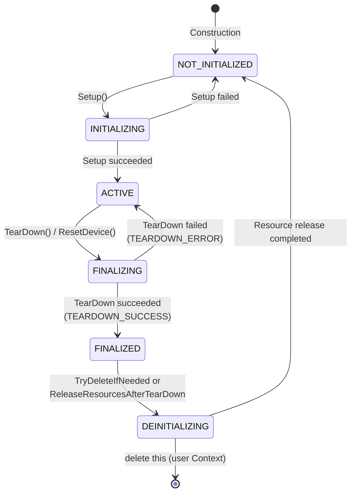

**Key Code**:

```cpp
// File location: src/runtime/core/src/context/context.cc
bool Context::TrySwitchState(const ContextState expectedState,
                              const ContextState targetState, const char_t* const trigger)
{
    ContextState expected = expectedState;
    const bool switched = lifecycleState_.compare_exchange_strong(
        expected, targetState, std::memory_order_acq_rel);
    if (switched) { LogStateTransition(expectedState, targetState, trigger); }
    return switched;
}
```

**Key Mechanism Points**:

- `FINALIZING` is the state that blocks user access: once this state is entered, all user API accesses are rejected immediately.
- `FINALIZED` is an intermediate state: TearDown is complete and sub-resources have been reclaimed, but final resources such as Module/Device references have not been released.
- `DEINITIALIZING` is the only state that allows object release, triggered by `TryDeleteIfNeeded` or the destructor path.

#### 4.3.3 Context Handle Validity Check and Access Modes

**Design Idea**: All user API entries use `CheckContextIsValid` to uniformly check Context availability. The check has two steps: first query the global valid set (an `unordered_set` protected by a read-write lock), and then query the state machine. Access is allowed only when both steps pass. In addition, if a user-mode check fails, the association between the current thread and the Context is proactively removed, preventing a thread from holding an invalid handle for a long time.

**Access Modes**:

```cpp
// File location: src/runtime/core/inc/context/context_manage.hpp
enum class ContextAccessMode : uint8_t {
    USER = 0,        // User API access; requires the Context to be ACTIVE
    INTERNAL = 1,    // Runtime internal access; allows INITIALIZING/FINALIZING
};
```

**Check Flow**:

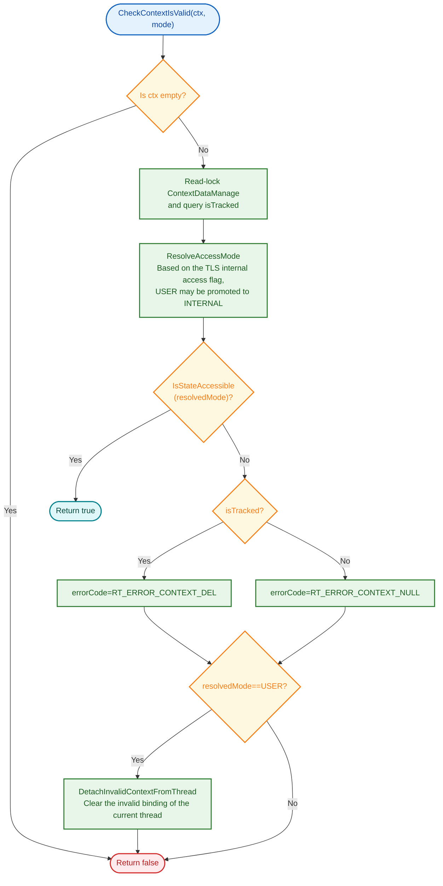

**Key Code**:

```cpp
// File location: src/runtime/core/src/context/context_manage.cc
bool ContextManage::CheckContextIsValid(Context* const curCtx,
    ContextAccessMode accessMode, rtError_t* errorCode)
{
    if (curCtx == nullptr) { return false; }
    {
        const ReadProtect rp(&(g_ctxMan.GetSetRwLock()));
        const bool isTracked = g_ctxMan.ExistsSetValueWithoutLock(curCtx);
        const ContextAccessMode resolvedAccessMode = ResolveAccessMode(curCtx, accessMode);
        if (IsContextAccessAllowed(curCtx, resolvedAccessMode, isTracked)) {
            return true;
        }
        needDetachUserBinding = (resolvedAccessMode == ContextAccessMode::USER);
    }
    if (needDetach && needDetachUserBinding) {
        DetachInvalidContextFromThread(curCtx);
    }
    return false;
}
```

**State-Access Mode Matrix** (`Context::IsStateAccessible`):

| Context State | USER Access | INTERNAL Access |
| --- | --- | --- |
| `ACTIVE` | ✅ Allowed | ✅ Allowed |
| `INITIALIZING` | ❌ Rejected | ✅ Allowed |
| `FINALIZING` | ❌ Rejected | ✅ Allowed |
| `NOT_INITIALIZED` / `FINALIZED` / `DEINITIALIZING` | ❌ Rejected | ❌ Rejected |

**Key Mechanism Points**:

- **TRACKED is a prerequisite for USER access**: A user Context must be registered to the global set through `InsertContext` before USER access is allowed. An unregistered Context is available only when the current thread is already bound and the access is INTERNAL (used for the `Setup` window of `aclrtCreateContext` before `InsertContext`).
- **Automatic cleanup on check failure**: If a USER-mode check fails, `DetachInvalidContextFromThread` removes the binding between the current thread and the Context. The unbinding may be the last reference, which triggers `TryDeleteIfNeeded`.
- **Access mode promotion**: `ResolveAccessMode` checks the `internalAccess` flag in the TLS of the current thread. If the thread is already in an internal access context, the check is automatically performed as INTERNAL.

#### 4.3.4 Destruction Protection Mechanism

**Design Idea**: The destruction of a user Context is divided into two phases: **stopping external use and cleaning up resources**, and **deleting the Context object**. When destruction starts, the Context state switches to `FINALIZING` to block new user API accesses, and then `TearDown()` cleans up associated resources. After the cleanup succeeds, the Context is marked as "pending deletion". The Context object is deleted only after all user threads have removed their associations, preventing access after the object is released (Use-After-Free, UAF).

**Destruction Protection Fields**:

```cpp
// File location: src/runtime/core/inc/context/context.hpp
class Context {
    std::atomic<uint64_t> threadRefCount_;   // User thread binding count
    Atomic<bool> isNeedDelete_;              // Set after TearDown completes
    std::atomic<bool> deleteScheduled_;      // Ensures delete is triggered only once
};
```

**Destruction Flow**:

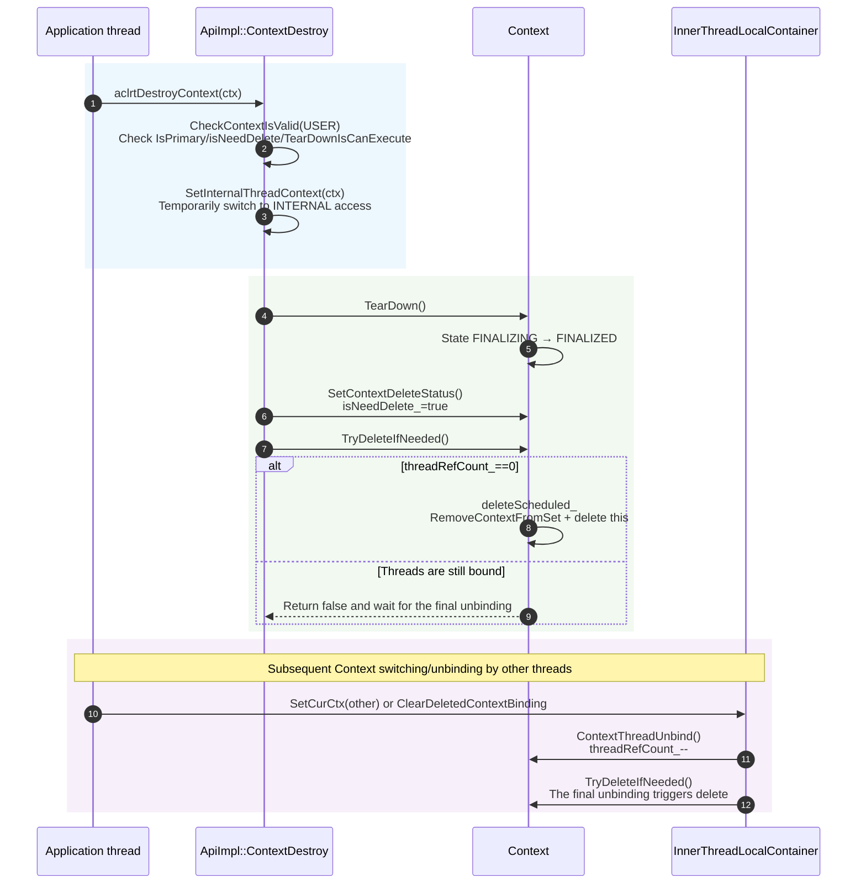

**Key Code**:

```cpp
// File location: src/runtime/core/src/context/context.cc
bool Context::TryDeleteIfNeeded()
{
    if (isPrimary_ || !GetContextIsNeedDelStatus()) {
        return false;                          // Default Context or not marked for deletion
    }
    if (GetThreadRefCount() != 0U) {
        return false;                          // User threads are still bound
    }
    bool expected = false;
    if (!deleteScheduled_.compare_exchange_strong(expected, true, ...)) {
        return false;                          // Another thread has entered the deletion path
    }
    SetState(ContextState::CTX_STATE_DEINITIALIZING, "TryDeleteIfNeeded");
    (void)ContextManage::RemoveContextFromSet(this);
    delete this;                               // Triggers ~Context → ReleaseResourcesAfterTearDown
    return true;
}
```

**Key Mechanism Points**:

1. **Triple deletion prerequisite**: Non-Primary + `isNeedDelete_==true` + `threadRefCount_==0`. All three are required.
2. **`deleteScheduled_` atomic flag**: Ensures that only one thread executes `delete this` when multiple threads unbind concurrently.
3. **Deletion is destruction**: `delete this` triggers `~Context`→`ReleaseResourcesAfterTearDown` to complete resource release.
4. **TLS fallback cleanup**: `ClearDeletedContextBinding` ensures that subsequent `SetCurCtx` calls on other threads no longer hold pointers to the deleted Context.

#### 4.3.5 Exception Handling Mechanism

**Design Idea**:

- ctxMode_ serves as the stop-on-failure switch and controls how the Context is handled after an exception occurs.
- The Context divides exceptions into two channels: **the latest error** (`lastErr_`) and **the failure state** (`failureError_`). The former retains the most recent API error for query. The latter determines whether execution can continue before synchronization or task dispatching.

**Failure Mode Control**:

```cpp
// File location: src/runtime/core/inc/context/context.hpp
TsStreamFailureMode GetCtxMode() const { return ctxMode_; }
void SetCtxMode(const TsStreamFailureMode flag) { ctxMode_ = flag; }
```

- **Enabling stop-on-failure**: `aclrtSetStreamFailureMode(stream, ACL_STOP_ON_FAILURE)` → the Context internally calls `SetCtxMode(STOP_ON_FAILURE)`.
- **`ctxMode_` is the stop-on-failure switch, and `failureError_` is the error code**: `ctxMode_` determines the behavior after a failure. `failureError_` is only the error code record corresponding to the current failure state.

**Key Mechanism Points**:

1. **Device/Driver exceptions have the highest priority**: An error is returned directly regardless of `ctxMode_`, preventing further task dispatching on an abnormal device.
2. **`CONTINUE_ON_FAILURE` is the default mode**: It retains `failureError_` for later query but does not block the current path, facilitating fault tolerance on the service side.
3. **`STOP_ON_FAILURE` blocks immediately**: It returns `failureError_` and blocks subsequent task dispatching, facilitating fast failure locating.
4. **Device-level propagation by Device ID** (`SetGlobalFailureErr`): An asynchronous Stream error is written to its owning Context. For a device-level critical exception, the traversal of `ContextDataManage` synchronously calls `SetFailureError`+`SetStreamsStatus`+`SetDeviceStatus` on all Contexts where `IsContextOnDevice` is true.

**Error Channel Comparison**:

| Dimension | `lastErr_` | `failureError_` |
| --- | --- | --- |
| Writer | Written by `SetGlobalErrToCtx` when a common API returns an error | Written by `SetGlobalFailureErr` on an asynchronous Stream error or a device-level critical exception |
| Reader | `GetContextLastErr` reads and clears the value<br />`PeekContextLastErr` reads and retains the value | `CheckStatus`/`CheckTaskSend` query it before execution |
| Scope | The Context associated with the current thread | All Contexts on the Device (propagated by Device ID) |
| Lifecycle | Cleared once read (one-time) | Until the Device recovers or the Context is destroyed |

**Pre-execution Check Flow**:

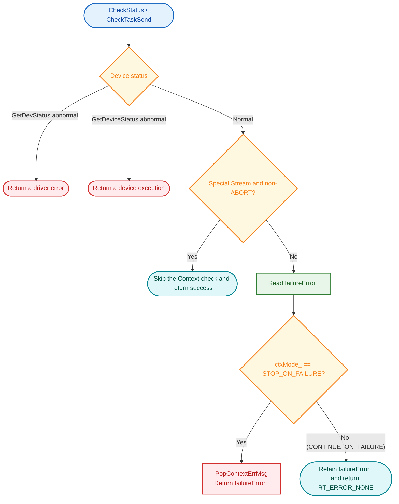

**Key Code**:

```cpp
// File location: src/runtime/core/src/context/context.cc
rtError_t Context::CheckStatus(const Stream* const stm, const bool isBlockDefault)
{
    // 1. Device/Driver status is checked first (unaffected by ctxMode_)
    status = device_->GetDevStatus();
    COND_PROC_RETURN_ERROR_MSG_CALL(ERR_MODULE_DRV, status != RT_ERROR_NONE, ...);
    status = device_->GetDeviceStatus();
    COND_RETURN_ERROR(status != RT_ERROR_NONE, ...);

    // 2. Special Streams (CtrlSQ/Primary) in non-ABORT mode: skip the Context check
    if (!isBlockDefault && (stm != nullptr) && ... && (stm->GetFailureMode() != ABORT_ON_FAILURE)) {
        return RT_ERROR_NONE;
    }

    // 3. Handle the Context failure state by mode
    status = GetFailureError();
    if (status != RT_ERROR_NONE) { PopContextErrMsg(); }
    if (ctxMode_ != STOP_ON_FAILURE) { return RT_ERROR_NONE; }   // Continue execution
    return status;
}
```

### 4.4 Module Responsibility Division

| Core Module or Class | Main Responsibility | Association with Context |
| --- | --- | --- |
| `ApiImpl` | Implements core operations such as Context creation, destruction, setting the current Context, and obtaining the current Context | Calls `Runtime` to manage the default Context, registers or validates Contexts through `ContextManage`, and updates thread associations. |
| `Runtime` | Maintains the default Context object and its reference count, links with the Device lifecycle, and resolves the current Context | Creates or reuses the default Context and resolves the current Context from thread-local storage. |
| `Context` | Main body of Context lifecycle and resource management | Binds a Device and manages Streams, Models, Modules, error states, and thread association references. |
| `ContextManage` | Context registration, validity check, destruction finalization, and exception propagation | Maintains the global Context set through `ContextDataManage` and performs state checks on Contexts. |
| `ContextDataManage` | Provides insertion, removal, existence query, and traversal access to the global Context set | Provides the data basis for validity checks. Fast recovery and Snapshot also traverse this set. |
| `InnerThreadLocalContainer` | Saves the user or default Context associated with the current thread, and the INTERNAL access flag | Establishes or removes the association between a thread and a Context, and triggers thread reference increments and decrements. |

### 4.5 Core Data Structures

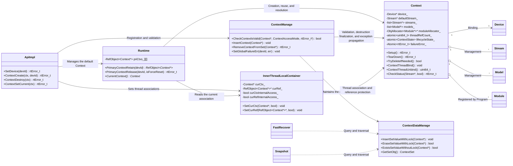

## 5. Key File Index

| Module | File Path | Core Content |
| --- | --- | --- |
| ACL public header file | `include/external/acl/acl_rt.h` | ACL Context API declarations and API constraints. |
| ACL C entry | `src/acl/aclrt_c/runtime/context.c` | ACL Context C symbol entry, which forwards calls to the wrapper. |
| ACL implementation | `src/acl/aclrt_impl/context.cpp` | ACL Context implementation, parameter validation, and error code conversion. |
| Runtime Context header file | `pkg_inc/runtime/runtime/context.h` | Runtime Context handle and internal C API declarations. |
| RTS Context header file | `pkg_inc/runtime/runtime/rts/rts_context.h` | RTS Context internal C API declarations. |
| Runtime C API | `src/runtime/api/api_c.cc` | Context C-layer forwarding entry. |
| RTS C API | `src/runtime/api/api_c_context.cc` | Context RTS forwarding entry. |
| Device C API | `src/runtime/api/api_c_device.cc` | Runtime implementation of Device setting and resetting, and the default Context lifecycle linkage. |
| API abstraction | `src/runtime/api/api.hpp` | Definitions of Context-related virtual APIs. |
| ApiError | `src/runtime/api/impl/api_error.cc` | Context API parameter validation, null pointer validation, and resource binding relationship validation. |
| Profiling decorators | `src/runtime/core/src/profiler/api_profile_decorator.cc` and `src/runtime/core/src/profiler/api_profile_log_decorator.cc` | Context API Profiling records. |
| ApiImpl | `src/runtime/api/impl/api_impl.cc` | Context creation, destruction, and thread binding implementation. |
| Runtime | `src/runtime/core/inc/runtime.hpp` and `src/runtime/core/src/runtime.cc` | Default Context retain/release, current Context resolution, and internal access context. |
| Context header file | `src/runtime/core/inc/context/context.hpp` | Context class, state machine, access modes, validation macros, and core method declarations. |
| Context implementation | `src/runtime/core/src/context/context.cc` | Context lifecycle, resource management, state transitions, thread binding references, synchronization, and error states. |
| Context platform implementation | `src/runtime/core/src/context/context_standard_soc.cc` and `src/runtime/core/src/context/context_stub.cc` | Context implementation differences between the standard platform and the stub. |
| ContextManage | `src/runtime/core/inc/context/context_manage.hpp` and `src/runtime/core/src/context/context_manage.cc` | Global Context set, USER/INTERNAL validity checks, inactive destruction finalization, and device exception propagation. |
| ContextDataManage | `src/runtime/core/src/common/context_data_manage.h` and `src/runtime/core/src/common/context_data_manage.cc` | Addition, removal, query, and traversal of the Context set; also used by validity checks, fast recovery, and Snapshot. |
| InnerThreadLocalContainer | `src/runtime/core/inc/common/inner_thread_local.hpp` and `src/runtime/core/src/common/inner_thread_local.cpp` | Current Context in thread-local storage, internal access flag, and thread association reference increments/decrements. |

## 6. Design Constraints and Maintenance Suggestions

- Default Contexts are managed by the Device setting/resetting paths. The user explicit destruction API cannot destroy a Context whose `IsPrimary()` is true.
- Operations on resources such as Streams, Models, and Modules must be completed under the Context that owns the resources. Using, binding, or destroying resources across Contexts is not allowed.
- When adding an API that receives `Context *` or depends on the current Context, explicitly use the USER or INTERNAL access mode. External APIs use USER by default.
- Internal resource access during teardown/reset must use `Runtime::SetInternalThreadContext()` or an equivalent INTERNAL binding.

---

_This module document is compiled based on source code analysis of `src/runtime/core/src/context/`, `src/runtime/core/src/runtime.cc`, `src/runtime/api/impl/api_impl.cc`, `src/runtime/core/src/common/inner_thread_local.cpp`, and Context-related APIs._
