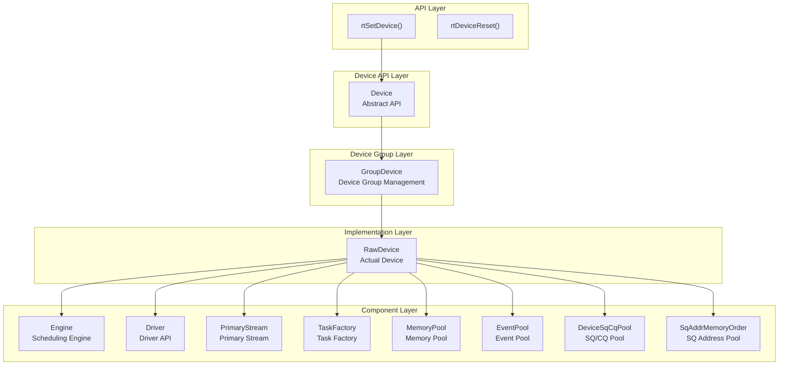
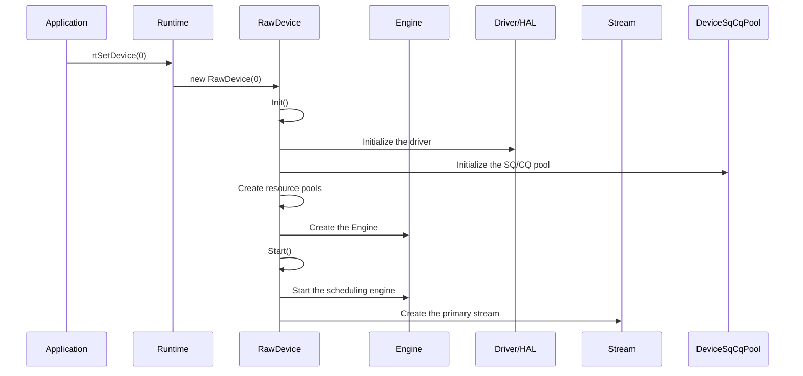
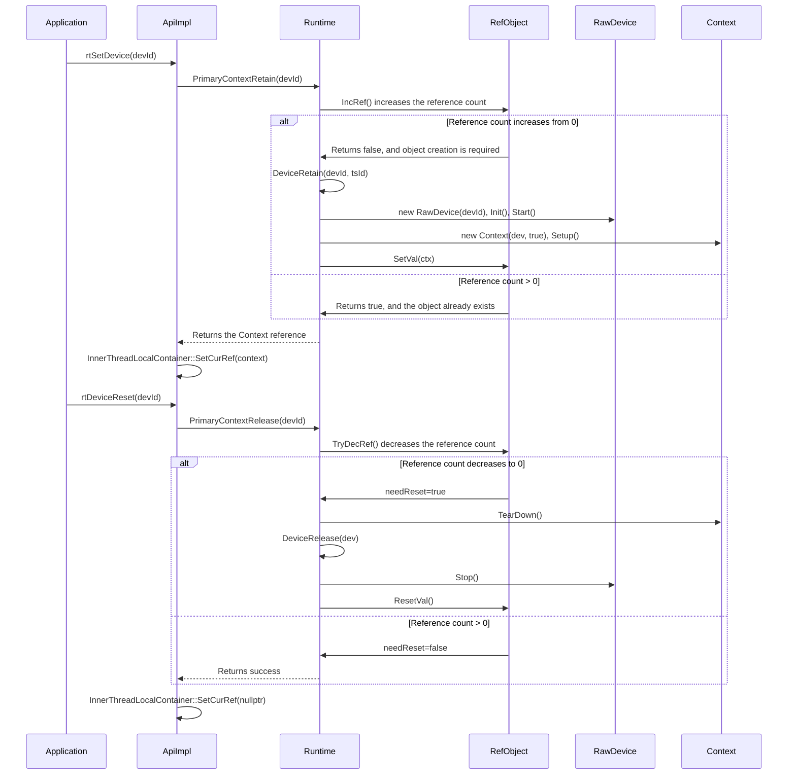
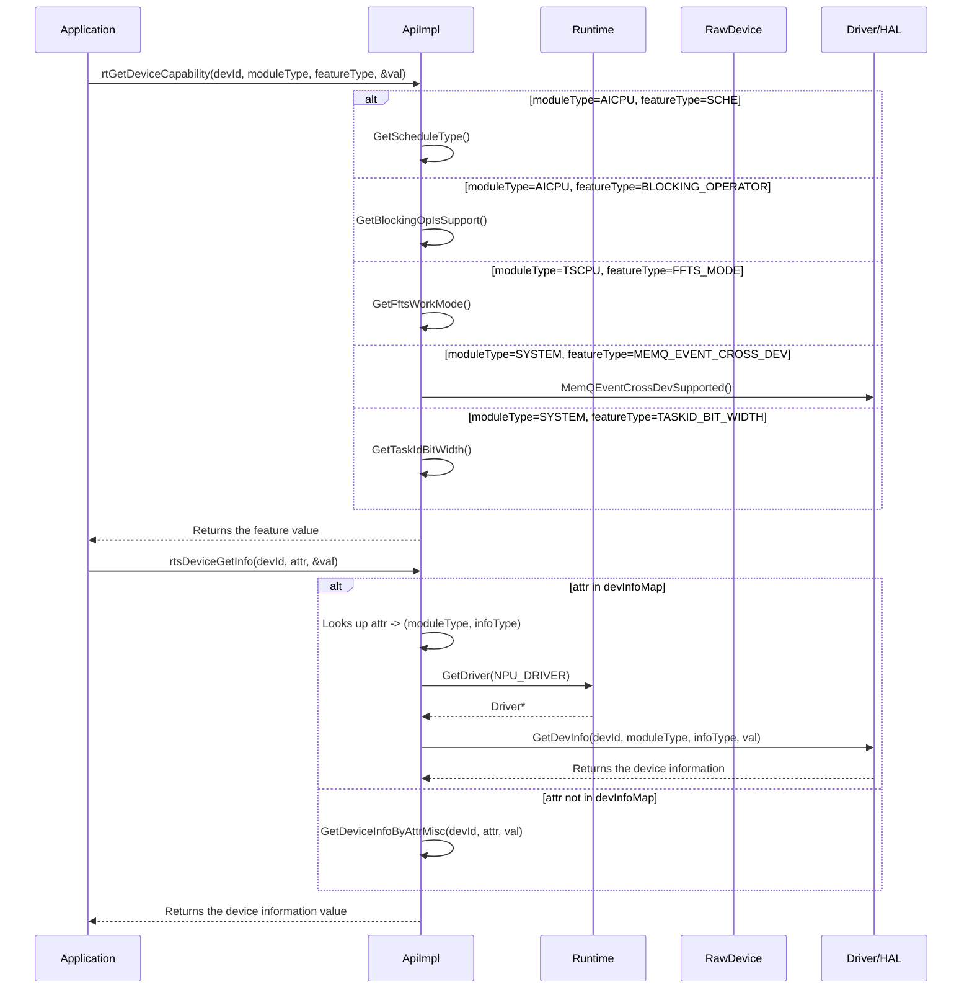
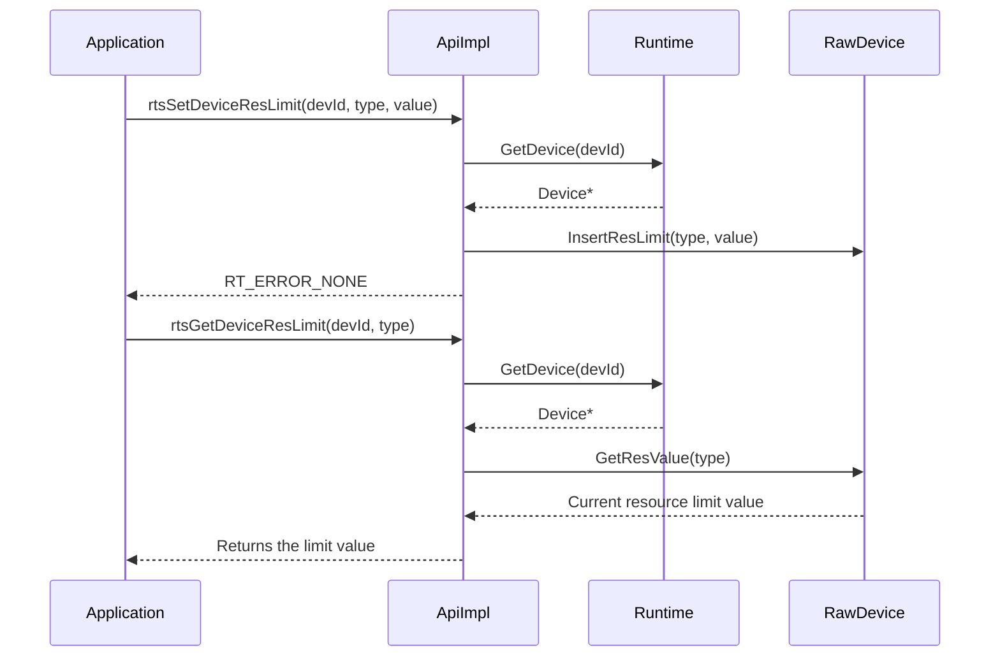
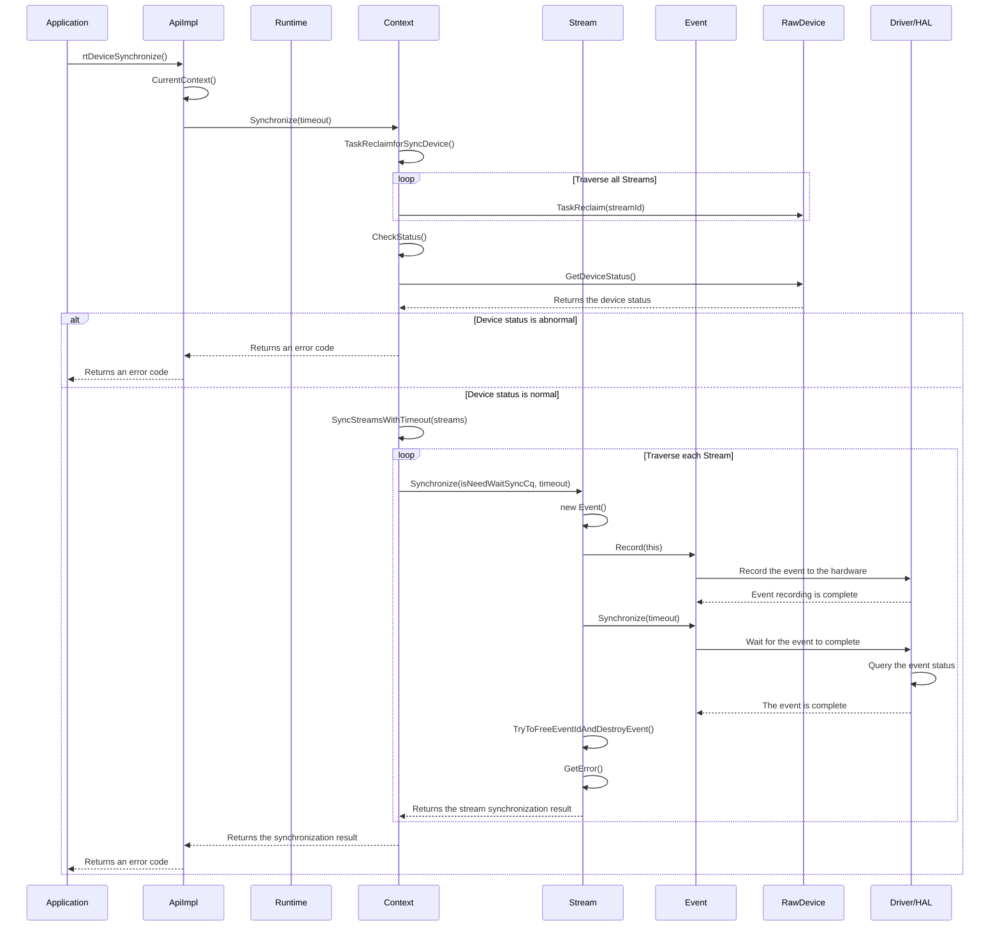
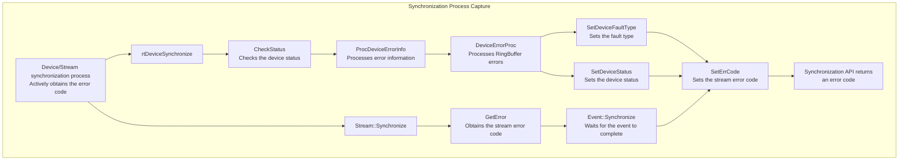
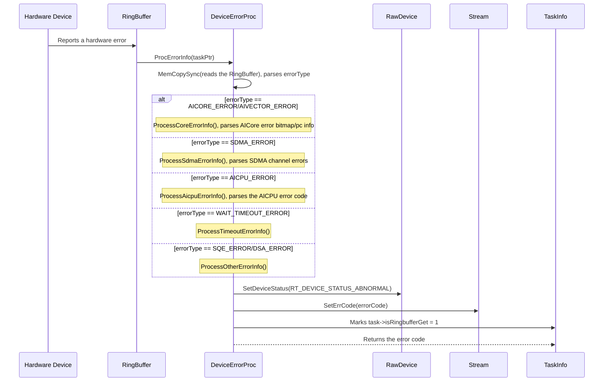
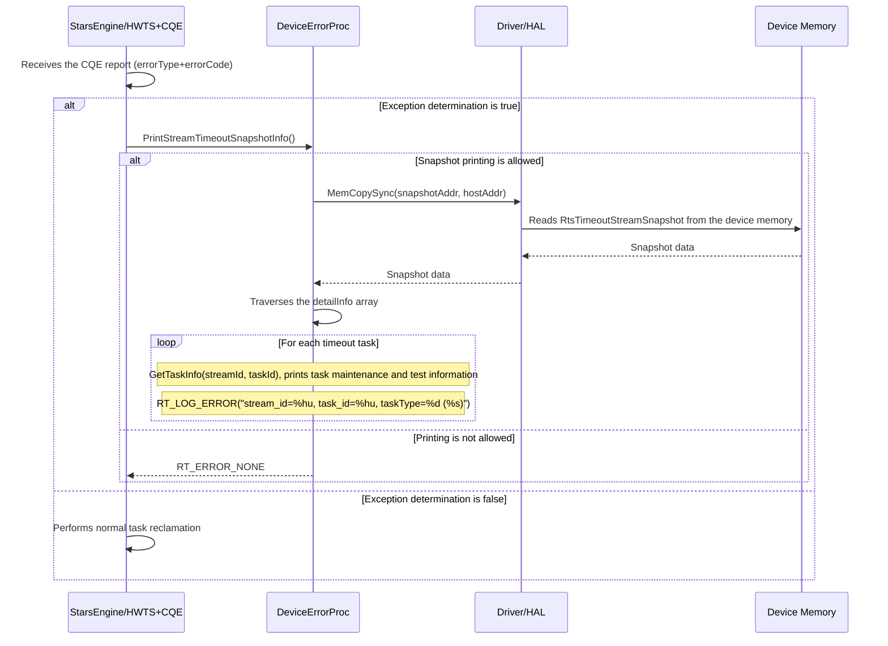

# Device Module Architecture

## 1. Module Overview

- **Function Introduction**: The Device module manages device resources of the Ascend AI processor. The management functions include device initialization, startup, stopping, status management, task submission, and resource pool management. The module adopts a three-layer inheritance structure: Device (API) → GroupDevice (device group) → RawDevice (actual device).
- **Design Goals**:
  - Provide a unified device management API
  - Manage the device lifecycle (initialization, running, and stopping)
  - Provide task submission and reclamation mechanisms
  - Manage device resource pools (Event, Memory, SQ/CQ, and so on)
  - Support device error handling and status callbacks

## 2. Usage Scenarios and External APIs

### 2.1 Usage Scenarios

- **Scenario 1**: Set the current compute device
  ```cpp
  rtError_t err = rtSetDevice(0);
  // Runtime::DeviceRetain(0) → Device::Init() → Device::Start()
  ```
  `rtSetDevice()` sets the device ID for the current thread. Most `rt`/`aclrt` APIs do not carry a device ID parameter. After you call this API, the current thread executes subsequent operations on this device by default. This behavior binds the device context at the thread level.

- **Scenario 2**: Get device capability information
  
  **Get device capability features**:
  ```cpp
  int32_t val;
  rtError_t ret = rtGetDeviceCapability(0, RT_MODULE_TYPE_AICORE, FEATURE_TYPE_SCHE, &val);
  if (ret != RT_ERROR_NONE) {
      // The query fails.
  }
  // val contains the scheduling capability information of the AI Core.
  ```
  | Parameter | Description |
  |------|------|
  | `moduleType` | Module type, for example, `RT_MODULE_TYPE_AICORE`, `RT_MODULE_TYPE_AICPU`, and `RT_MODULE_TYPE_TSCPU` |
  | `featureType` | Feature type, for example, `FEATURE_TYPE_SCHE` (scheduling capability) and `FEATURE_TYPE_BLOCKING_OPERATOR` (blocking operator) |

- **Scenario 3**: Monitor the device status and handle exceptions
  
  **Device status query**:
  ```cpp
  rtDeviceStatus deviceStatus;
  rtError_t ret = rtDeviceStatusQuery(0, &deviceStatus);
  if (ret != RT_ERROR_NONE || deviceStatus != RT_DEVICE_STATUS_NORMAL) {
      // The device is abnormal. Further fault cause analysis is required.
  }
  ```
  
  The following table lists the `rtDeviceStatus` status values:
  | Status Value | Description |
  |--------|------|
  | `RT_DEVICE_STATUS_NORMAL` | The device runs normally |
  | `RT_DEVICE_STATUS_ABNORMAL` | The device is abnormal. Fault analysis is required |
  
  **Device synchronization and error capture**:
  ```cpp
  rtError_t ret = rtDeviceSynchronize();
  if (ret != RT_ERROR_NONE) {
      // The task fails to execute. The synchronization API returns an error code.
      // The upper layer performs targeted processing based on the error code type.
  }
  // All tasks on the device complete successfully.
  ```

### 2.2 External APIs

| API | File Location | Description |
|------|----------|------|
| `rtSetDevice()` | `src/runtime/api/api_c_device.cc` | Sets the current device |
| `rtDeviceReset()` | `src/runtime/api/api_c_device.cc` | Resets the device |
| `rtGetDevice()` | `src/runtime/api/api_c_device.cc` | Obtains the current device ID |
| `rtGetDeviceCapability()` | `src/runtime/api/api_c_device.cc` | Obtains device capabilities |
| `rtsDeviceGetInfo()` | `src/runtime/api/api_c_device.cc` | Obtains device information |
| `rtsGetDeviceResLimit()` | `src/runtime/api/api_c_device.cc` | Obtains the device resource limit value |
| `rtsSetDeviceResLimit()` | `src/runtime/api/api_c_device.cc` | Sets device resource limits |
| `rtsResetDeviceResLimit()` | `src/runtime/api/api_c_device.cc` | Resets device resource limits |
| `rtSetDeviceFailureMode()` | `src/runtime/api/api_c_device.cc` | Sets the device failure mode |
| `rtDeviceSynchronize()` | `src/runtime/api/api_c_device.cc` | Synchronizes the device |
| `rtDeviceStatusQuery()` | `src/runtime/api/api_c_device.cc` | Queries the device status |

## 3. Architecture Overview

### Overall Design Approach

Device implements device management through a three-layer inheritance structure. The abstract API layer (Device) defines all core methods. The middle layer (GroupDevice) manages device groups. The bottom layer (RawDevice) implements specific device operations. Each Device contains core components, including Engine (scheduling engine), Driver (driver), Stream (primary stream), DeviceSqCqPool (SQ/CQ pool), and SqAddrMemoryOrder (SQ address memory pool).

### Architecture Layer Diagram



### Core Module Interaction Diagram

## 4. Detailed Design

### 4.1 Device Initialization Process

#### Device Initialization Interaction



#### rtSetDevice/rtDeviceReset Reference Counting Mechanism

**Design Concept**: This mechanism uses the `RefObject` class to implement thread-safe reference counting. The mechanism supports concurrent access from multiple threads. The reference count manages the lifecycle of Device and Context objects. The system destroys an object only when the reference count decreases to 0.

**Reference counting flow**:



#### Thread-Local Variable Settings

**Design Concept**: This mechanism uses `InnerThreadLocalContainer` to manage the thread-level device context. The mechanism ensures that each thread has an independent device binding in a multi-threaded environment.

**Thread variables set by `rtSetDevice`**:

```cpp
// File location: src/runtime/core/inc/common/inner_thread_local.hpp
class InnerThreadLocalContainer {
private:
    static __THREAD_LOCAL__ Context *curCtx_;         // Current context
    static __THREAD_LOCAL__ RefObject<Context *> *curRef_;  // Context reference object
    static __THREAD_LOCAL__ Device *device_;          // Current device
    static __THREAD_LOCAL__ uint32_t lastTaskId_;     // Latest task ID
    static __THREAD_LOCAL__ uint32_t lastStreamId_;   // Latest stream ID
    static __THREAD_LOCAL__ rtError_t globalError_;   // Global error code
};
```

**Multi-threaded concurrency safety**:
- Each thread has an independent device context. Threads do not interfere with each other.
- The reference count uses atomic operations. This guarantees multi-threading safety.

### 4.2 Device Capability Information Query

The device capability query APIs provide multiple query capabilities, including hardware capability feature queries and device resource configuration. The APIs enable upper-layer applications to perceive device features and configure the device.

#### Device Capability Query Process



**rtGetDeviceCapability input parameter type enumerations**:

```cpp
// File location: pkg_inc/runtime/runtime/dev.h
typedef enum tagRtDeviceModuleType {
    RT_MODULE_TYPE_SYSTEM = 0,      // System information
    RT_MODULE_TYPE_AICPU,           // AICPU information
    RT_MODULE_TYPE_CCPU,            // CCPU information
    RT_MODULE_TYPE_DCPU,            // DCPU information
    RT_MODULE_TYPE_AICORE,          // AI Core information
    RT_MODULE_TYPE_TSCPU,           // TSCPU information
    RT_MODULE_TYPE_PCIE,            // PCIe information
    RT_MODULE_TYPE_VECTOR_CORE,     // Vector Core information
    RT_MODULE_TYPE_HOST_AICPU,      // Host AICPU information
    RT_MODULE_TYPE_QOS,             // QoS information
    RT_MODULE_TYPE_MEMORY           // Memory information
} rtModuleType_t;

typedef enum tagRtDeviceFeatureType {
    FEATURE_TYPE_SCHE,                    // Scheduling capability
    FEATURE_TYPE_BLOCKING_OPERATOR,       // Blocking operator support
    FEATURE_TYPE_FFTS_MODE,               // FFTS working mode
    FEATURE_TYPE_MEMQ_EVENT_CROSS_DEV,    // Cross-device event support
    FEATURE_TYPE_MODEL_TASK_UPDATE,       // Model task update support
    FEATURE_TYPE_END,
} rtDeviceFeatureType_t;
```

**rtsDeviceGetInfo input parameter type enumerations**:

```cpp
// File location: pkg_inc/runtime/runtime/rts/rts_device.h
typedef enum { 
    RT_DEV_ATTR_AICPU_CORE_NUM  = 1U,         // Number of AICPU cores
    RT_DEV_ATTR_AICORE_CORE_NUM = 101U,       // Number of AI Cores
    RT_DEV_ATTR_CUBE_CORE_NUM   = 102U,       // Number of Cube Cores
    
    RT_DEV_ATTR_VECTOR_CORE_NUM = 201U,       // Number of Vector Cores
    RT_DEV_ATTR_WARP_SIZE       = 202U,       // Warp size
    RT_DEV_ATTR_MAX_THREAD_PER_VECTOR_CORE  = 203U,  // Maximum number of threads per Vector Core
    RT_DEV_ATTR_UBUF_PER_VECTOR_CORE   = 204U,       // UB cache size per Vector Core
    
    RT_DEV_ATTR_TOTAL_GLOBAL_MEM_SIZE   = 301U,      // Total global memory size
    RT_DEV_ATTR_L2_CACHE_SIZE           = 302U,      // L2 cache size
    
    RT_DEV_ATTR_SMP_ID = 401U,                      // SMP ID (whether devices are in the same OS)
    RT_DEV_ATTR_PHY_CHIP_ID = 402U,                 // Physical chip ID
    RT_DEV_ATTR_IS_VIRTUAL = 501U,                  // Whether the device is virtual
    RT_DEV_ATTR_NPU_ARCH = 601U,                    // NPU architecture type
    
    RT_DEV_ATTR_MAX
} rtDevAttr;
```

#### Device Resource Limit Management Process



Currently, the system supports configuring and obtaining resource limits for two resource types: Cube Core and Vector Core.

```cpp
// File location: pkg_inc/runtime/runtime/base.h
typedef enum {
    RT_DEV_RES_CUBE_CORE = 0,      // Cube Core resource limit
    RT_DEV_RES_VECTOR_CORE,        // Vector Core resource limit
    RT_DEV_RES_TYPE_MAX
} rtDevResLimitType_t;
```

### 4.3 Device Synchronization

#### rtDeviceSynchronize Call Process

**Design Concept**: The device synchronization API implements blocking synchronization by waiting for all tasks on the device to complete. The API also captures error states during task execution. During synchronization, the system reclaims tasks, checks statuses, and waits for all Streams. This ensures that upper-layer applications can perceive device execution exceptions in a timely manner.



### 4.4 Exception Handling

**Design Concept**: Runtime provides multi-layer error capture mechanisms. The mechanisms cover task execution, stream synchronization, device synchronization, and application API calls. Each layer captures and transfers error information. Exception handling adopts the branch dispatch mode. The system routes errors to dedicated processing functions based on the error type. Maintenance and test information is transferred from the device to the host machine through the RingBuffer. The information includes detailed error contexts, task information, and hardware status. The log system outputs the information for fault location.

#### Error Capture Mechanisms

```mermaid
graph TB
    subgraph Monitor Thread Capture
        MON1[MonitoringRun<br/>Periodically checks the device status]
        SOCKET[ReportSocketCloseProc<br/>Checks the HDC connection status]
        OOM[ReportOomQueryProc<br/>Checks the OOM status]
        HEARTBEAT[ReportHeartBreakProcV2<br/>Checks the device heartbeat]
        
        MON1 --> SOCKET
        MON1 --> OOM
        MON1 --> HEARTBEAT
        
        SOCKET --> GLOBAL1[SetDevStatus<br/>Sets the global error code<br/>RT_ERROR_SOCKET_CLOSE]
        OOM --> GLOBAL2[Triggers the exception callback<br/>OOM error]
        HEARTBEAT --> GLOBAL3[SetDevStatus<br/>Sets the global error code<br/>RT_ERROR_LOST_HEARTBEAT]
        
        GLOBAL1 --> RETURN1[External rt API call<br/>Returns an error code]
        GLOBAL2 --> RETURN1
        GLOBAL3 --> RETURN1
        
        MON2[MonitorForWatchDog<br/>Monitors the RingBuffer]
        RINGBUFFER[ReportRingBuffer<br/>Reads the RingBuffer]
        MON2 --> RINGBUFFER
        
        RINGBUFFER --> CONTEXT1[SetWatchDogDevStatus<br/>Sets the device status<br/>RT_DEVICE_STATUS_ABNORMAL]
        CONTEXT1 --> RECLAIM[MonitorTaskReclaim<br/>Reclaims failed tasks]
        RECLAIM --> CONTEXT2[Returns the error through the<br/>Context-level error code]
    end

    subgraph RAS Thread Capture
        RAS[ReportRasRun thread<br/>Monitors RAS exception alarms]
        HBM_RAS[ReportHBMRasProc<br/>Handles HBM ECC errors]
        PAGE_FAULT[ReportPageFaultProc<br/>Handles page faults]
        UB_RAS[ReportUBMemRasProc<br/>Handles UB memory errors]
        
        RAS --> HBM_RAS
        RAS --> PAGE_FAULT
        RAS --> UB_RAS
        
        HBM_RAS --> GLOBAL4[SetGlobalFailureErr<br/>Sets the global error code<br/>RT_ERROR_MEM_RAS_ERROR]
        PAGE_FAULT --> GLOBAL5[Sets the global error code<br/>Page Fault error]
        UB_RAS --> GLOBAL6[Sets the global error code<br/>UB RAS error]
        
        GLOBAL4 --> RETURN2[External rt API call<br/>Returns an error code]
        GLOBAL5 --> RETURN2
        GLOBAL6 --> RETURN2
    end
```





**Comparison of the four error capture mechanisms**:

| Feature | Monitor Thread - Device Status | Monitor Thread - RingBuffer | RAS Thread - RAS Alarm | Proactive Check in Synchronization Process |
|------|----------------------|------------------------|----------------|------------------|
| **Check method** | Periodic polling (1 second) | Periodic RingBuffer reading (1 second) | Periodic polling (10ms) | Active call during synchronization |
| **Error source** | HDC connection, heartbeat, and OOM | RingBuffer reporting | Hardware RAS alarm | Device/Stream status |
| **Transfer path** | SetDevStatus → external API | SetWatchDogDevStatus → Context | SetGlobalFailureErr → external API | GetError → direct return |
| **Applicable scenario** | Device offline, communication interruption, and OOM | Task execution failure | Hardware fault (HBM ECC and UB memory errors) | Task execution exception capture |

#### Exception Branch Handling Process

DeviceErrorProc reads error information from the RingBuffer. Based on different `errorType` values and register maintenance and test information (for example, Error Bitmap, PC value, and Channel ID), DeviceErrorProc routes errors to the corresponding error handling function branches. After printing detailed maintenance and test logs, DeviceErrorProc sets the fault type and returns the corresponding error code.

**Exception branch handling sequence diagram**:



The following code shows the mapping between different error types and their processing functions:

```cpp
// File location: src/runtime/core/src/device/v100/device_error_proc.cc
static const std::map<uint64_t, DeviceErrorProc::StarsErrorInfoProc> starsFuncMap = {
    {AICORE_ERROR, &DeviceErrorProc::ProcessStarsCoreErrorInfo},
    {AIVECTOR_ERROR, &DeviceErrorProc::ProcessStarsCoreErrorInfo},
    {FFTS_PLUS_AICORE_ERROR, &DeviceErrorProc::ProcessStarsCoreErrorInfo},
    {FFTS_PLUS_AIVECTOR_ERROR, &DeviceErrorProc::ProcessStarsCoreErrorInfo},
    {WAIT_TIMEOUT_ERROR, &DeviceErrorProc::ProcessStarsWaitTimeoutErrorInfo},
    {SDMA_ERROR, &DeviceErrorProc::ProcessStarsSdmaErrorInfo},
    {AICPU_ERROR, &ProcessStarsAicpuErrorInfo},
    {FFTS_PLUS_SDMA_ERROR, &DeviceErrorProc::ProcessStarsSdmaErrorInfo},
    {FFTS_PLUS_AICPU_ERROR, &ProcessStarsAicpuErrorInfo},
    {DVPP_ERROR, &DeviceErrorProc::ProcessStarsDvppErrorInfo},
    {DSA_ERROR, &DeviceErrorProc::ProcessStarsDsaErrorInfo},
    {FFTS_PLUS_DSA_ERROR, &DeviceErrorProc::ProcessStarsDsaErrorInfo},
    {SQE_ERROR, &DeviceErrorProc::ProcessStarsSqeErrorInfo},
    {HCCL_FFTSPLUS_TIMEOUT_ERROR, &DeviceErrorProc::ProcessStarsHcclFftsPlusTimeoutErrorInfo},
    {AICORE_TIMEOUT_DFX, &DeviceErrorProc::ProcessStarsCoreTimeoutDfxInfo}
};
```

#### Task Exception Snapshot Maintenance and Test

When a task execution exception occurs, Runtime reads the snapshot information of the timeout task from the device memory through `PrintStreamTimeoutSnapshotInfo`. Runtime prints detailed maintenance and test logs. The logs help you locate the cause of stuck or timeout tasks.

**Snapshot printing process**:



**Snapshot information content**:
- **Basic information**: `stream_id`, `task_id`, and `taskType` (task type)
- **Task-specific information**:
  - EVENT_RECORD task: `EventId`
  - STREAM_WAIT_EVENT task: `EventId`
  - NOTIFY_RECORD task: `NotifyId`
  - NOTIFY_WAIT task: `NotifyId` and `waitType`
  - KERNEL task: `kernel_name`

---

_This module document is based on analysis of the source code in `src/runtime/core/src/device/`._
