# Event Module Architecture

## 1. Module Overview

- **Function Introduction**: The Event module provides synchronization mechanisms and supports event recording, waiting, and status queries. An Event can record an execution position in a stream. Other streams can wait for the Event to complete, which implements cross-stream synchronization. The module supports IPC Events for inter-process synchronization.
- **Design Goals**:
  - Provide an efficient cross-stream synchronization mechanism
  - Implement inter-process event synchronization through shared memory in IPC scenarios
  - Support event status queries and waiting with a timeout
  

## 2. Usage Scenarios and External APIs

### 2.1 Usage Scenarios

- **Scenario 1**: Cross-stream synchronization

  ```cpp
  aclrtRecordEvent(event, stream1);  // Record the event in stream1
  aclrtStreamWaitEvent(stream2, event);  // stream2 waits for the event
  ```

- **Scenario 2**: Query the event status

  ```cpp
  aclrtEventRecordedStatus status;
  aclrtQueryEventStatus(event, &status);  // Query whether the event is complete
  if (status == ACL_EVENT_RECORDED_STATUS_COMPLETE) {
      // The event is complete.
  }
  ```

- **Scenario 3**: Block and wait for an event (the host machine blocks until the Event completes. This scenario applies to cases where you need to synchronously wait for the compute result before further processing)

  ```cpp
  aclrtCreateEventExWithFlag(&event, ACL_EVENT_SYNC);  // Create the synchronous event
  aclrtRecordEvent(event, stream);                      // Record the event on the Stream
  // ... Dispatch compute tasks on the Stream ...
  aclrtSynchronizeEvent(event);                         // Block and wait for the event to complete. This ensures that all Stream tasks before the Event have been executed
  aclrtDestroyEvent(event);                             // Destroy the event
  ```

- **Scenario 4**: IPC inter-process synchronization

  ```cpp
  // Process A: create the IPC Event, record the event, and export the handle
  aclrtCreateEventExWithFlag(&event, ACL_EVENT_IPC);
  aclrtRecordEvent(event, streamA);               // Process A records the event on the stream
  aclrtIpcGetEventHandle(event, &ipcHandle);
  // Pass ipcHandle to process B (for example, through shared memory or a socket)

  // Process B: open the IPC Event and wait for the event
  aclrtIpcOpenEventHandle(ipcHandle, &remoteEvent);
  aclrtStreamWaitEvent(stream, remoteEvent);
  ```

- **Scenario 5**: Compute the elapsed time between events (you need the two Events startEvent and endEvent to mark the start and end moments respectively. Before timing, you need to synchronously wait for both Events to complete)

  ```cpp
  aclrtCreateEventWithFlag(&startEvent, ACL_EVENT_TIME_LINE);  // Create the start event
  aclrtCreateEventWithFlag(&endEvent, ACL_EVENT_TIME_LINE);    // Create the end event
  aclrtRecordEvent(startEvent, stream);        // Record the start event in the stream
  // ... Execute the tasks that require timing ...
  aclrtRecordEvent(endEvent, stream);          // Record the end event in the stream
  aclrtSynchronizeEvent(startEvent);           // Wait for the start event to complete
  aclrtSynchronizeEvent(endEvent);             // Wait for the end event to complete
  float elapsedTime = 0.0f;
  aclrtEventElapsedTime(&elapsedTime, startEvent, endEvent);  // Compute the elapsed time between the two events (in milliseconds)
  printf("Task elapsed time: %.3f ms\n", elapsedTime);
  aclrtDestroyEvent(startEvent);
  aclrtDestroyEvent(endEvent);
  ```

### 2.2 External APIs

| API | Description |
|------|------|
| `aclrtCreateEvent()` | Creates an event (default flag) |
| `aclrtCreateEventWithFlag()` | Creates an event with a flag |
| `aclrtCreateEventExWithFlag()` ⭐ | Creates a reusable event with a flag (**recommended**) |
| `aclrtDestroyEvent()` | Destroys an event |
| `aclrtRecordEvent()` | Records an event in a stream |
| `aclrtResetEvent()` | Resets an event |
| `aclrtQueryEventStatus()` ⭐ | Queries the event completion status (**recommended**) |
| `aclrtQueryEventWaitStatus()` | Queries the event wait status |
| `aclrtSynchronizeEvent()` | Blocks and waits for the event to complete |
| `aclrtSynchronizeEventWithTimeout()` | Blocks and waits with a timeout |
| `aclrtStreamWaitEvent()` | The stream waits for an event |
| `aclrtStreamWaitEventWithTimeout()` | The stream waits for an event with a timeout |
| `aclrtEventElapsedTime()` | Computes the elapsed time between two events |
| `aclrtEventGetTimestamp()` | Obtains the event record timestamp |
| `aclrtGetEventId()` | Obtains the event ID |
| `aclrtIpcGetEventHandle()` | Obtains the cross-process handle of an IPC Event |
| `aclrtIpcOpenEventHandle()` | Opens an IPC Event handle in the current process |

### 2.3 Event Flag Types

You pass an Event Flag through `aclrtCreateEventWithFlag` or `aclrtCreateEventExWithFlag`. The flag determines the creation branch and synchronization behavior of the Event. `ACL_EVENT_IPC` is supported only through `aclrtCreateEventExWithFlag`:

| Flag | Value | Description |
|------|-----|------|
| `ACL_EVENT_SYNC` | 0x01 | Synchronization event |
| `ACL_EVENT_CAPTURE_STREAM_PROGRESS` | 0x02 | Stream capture progress marker |
| `ACL_EVENT_TIME_LINE` | 0x08 | Timeline event (used for timing) |
| `ACL_EVENT_DEVICE_USE_ONLY` | 0x10 | Used inside the device only |
| `ACL_EVENT_EXTERNAL` | 0x20 | Deprecated in CANN 9.3.0 and planned to be deleted after December 30, 2027 |
| `ACL_EVENT_IPC` | 0x40 | IPC event (inter-process synchronization) |

### 2.4 Event Status Enumerations

| Enumeration Type | Value | Description |
|----------|-----|------|
| `aclrtEventRecordedStatus` | `NOT_READY(0)` / `COMPLETE(1)` | Event recorded status |
| `aclrtEventWaitStatus` | `COMPLETE(0)` / `NOT_READY(1)` / `RESERVED(0xFFFF)` | Event wait status |

## 3. Architecture Overview

**Overall Design Approach**
**Event management consists of two parts in general:**
- **Record/Wait processing path**: The Record/Wait entry of DavidEvent is handled by the `EvtRecord`/`EvtWait` functions in `event_c.cc`. The Record/Wait operations of IpcEvent are handled by `IpcEventRecordStarsV2`/`IpcEventWaitStarsV2`. Different Event type and Flag combinations go through different processing branches.
- **Task dispatch process**: The process works with the APIs to complete runtime scheduling through Stream task application, SQE assembly, and task dispatch.

### 3.1 Event Record/Wait Processing Path Architecture

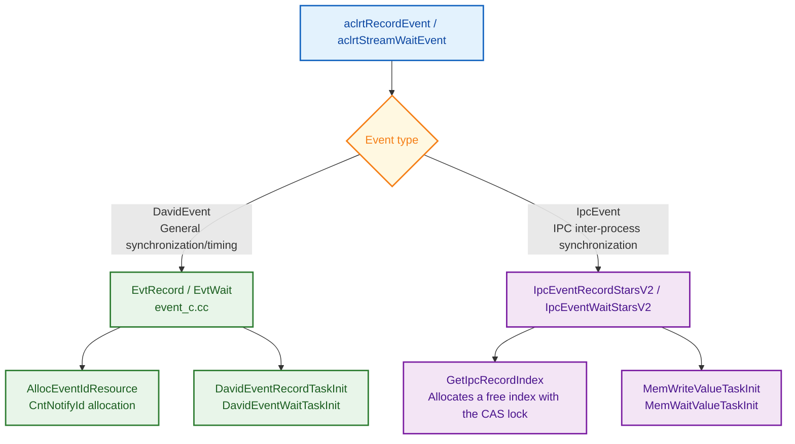

### 3.2 Event Dispatch Process Interaction Diagram

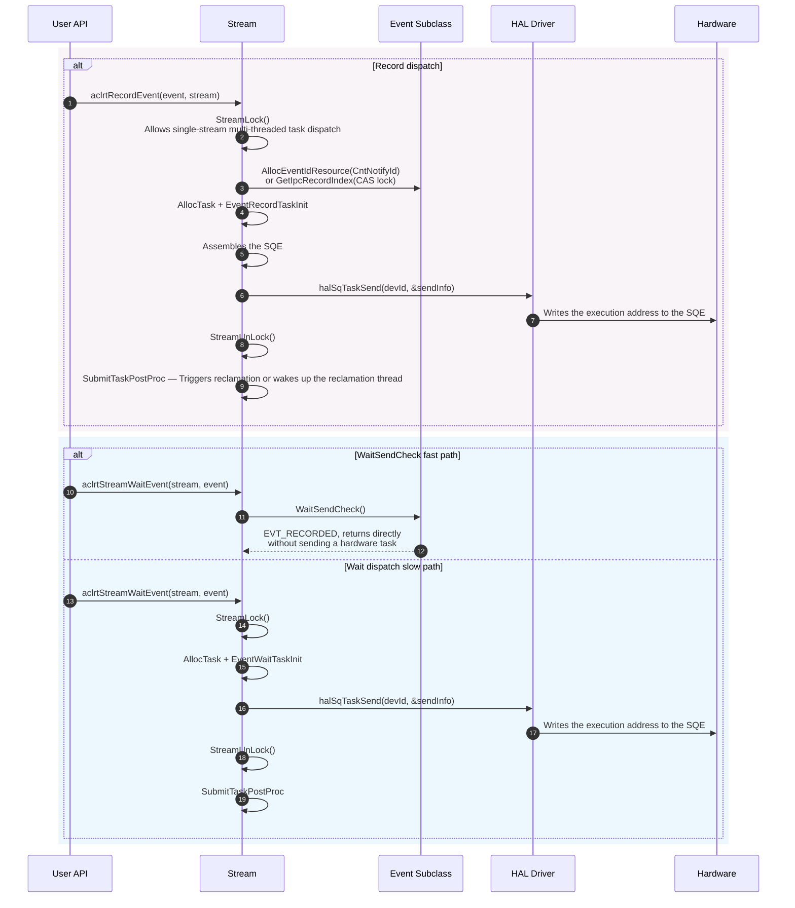

## 4. Detailed Design

### 4.1 DavidEvent Record Process

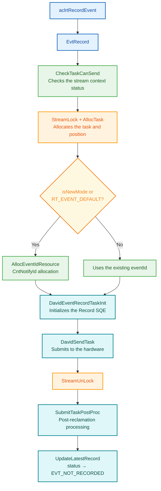

**Process step descriptions**:

- **CheckTaskCanSend**: Checks the stream context status. This step ensures that the Context is not aborted. Otherwise, the step returns an error
- **AllocEventIdResource**: DavidEvent uses CntNotifyId instead of the traditional eventId. DavidStream manages CntNotifyId (`cntNotifyId_`). During the first Record, DavidEvent applies for the ID from the driver through `ApplyCntNotifyId`. When `IsCntNotifyReachThreshold` reaches the threshold, DavidEvent must first wait for previous Wait tasks to complete before applying for a new ID
- **StreamLock / StreamUnLock**: The entire task allocation and submission process completes under the protection of the Stream lock. This prevents concurrent modification of the Stream task queue
- **SubmitTaskPostProc**: Performs reclamation processing after task submission, including updating the Stream queue position and triggering Profiling

### 4.2 DavidEvent Wait Process

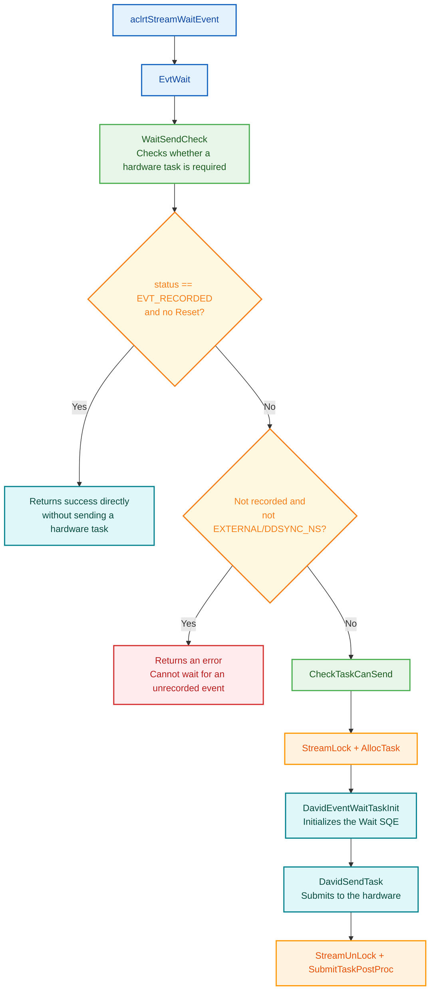

**Process step descriptions**:

- **WaitSendCheck** is the key decision point: if the Event status is EVT_RECORDED and the Event is not reset, WaitSendCheck returns success directly without sending a hardware task. This is an optimization of DavidEvent: when the Record is complete, Wait only needs to check the status and does not need to insert an additional SQE
- If the Event is not recorded and the Flag is not EXTERNAL/DDSYNC_NS, the system returns `ACL_ERROR_RT_INVALID_VALUE`, because you cannot wait for an event that is not recorded
- Otherwise, the system sends the Wait task to the hardware. The SQE waits for CntNotifyId to complete

### 4.3 IPC Event Record Process (StarsV2)

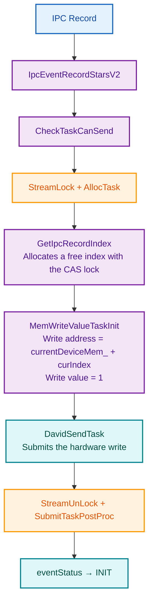

**Process step descriptions**:

- IPC Record does not use CntNotifyId/eventId. Instead, IPC Record implements synchronization through the **shared memory index**: `GetIpcRecordIndex` allocates a free `curIndex` in `IpcHandleVa.deviceMemRef[]` through the CAS spin lock (`IpcVaLock/IpcVaUnLock`)
- The hardware executes the `MemWriteValue` SQE and writes the value 1 to the `currentDeviceMem_ + curIndex` address. The write is visible across processes through the P2P shared memory
- After the write completes, the MemWaitValue of the remote process can perceive the value change at this address

### 4.4 IPC Event Wait Process (StarsV2)

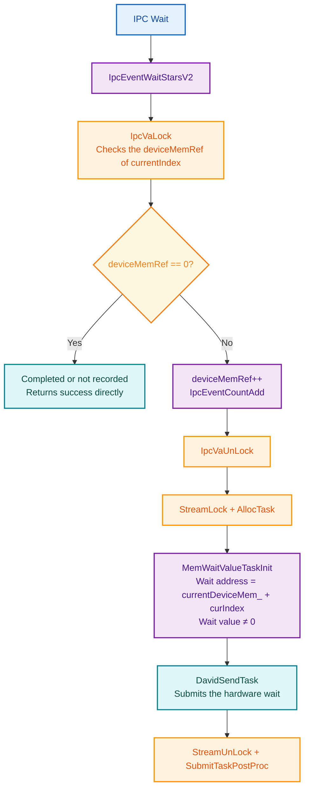

**Process step descriptions**:

- IPC Wait uses the `MemWaitValue` SQE to wait for the shared memory address to change to a non-zero value. After the hardware executes the MemWriteValue of Record, the address changes from 0 to 1, and the Wait task completes
- `IpcVaLock` (the CAS spin lock) protects concurrent counting of `deviceMemRef[]`. The lock supports reference count management for multiple Wait operations on the same IPC Event
- `deviceMemRef == 0` means that the Record is complete (the reference is consumed) or the Record has not occurred. In both cases, the system does not need to send a hardware task and returns directly

### 4.5 Core Mechanism Details

#### DavidEvent State Machine and CntNotify Mechanism

**Design Concept**: DavidEvent simplifies the three-state state machine of the base class (INIT/RECORDING/RECORDED) into two states (`EVT_NOT_RECORDED`/`EVT_RECORDED`). DavidEvent uses the CntNotifyId maintained by DavidStream instead of the traditional eventId pool allocation. This reduces cross-component resource management overhead.

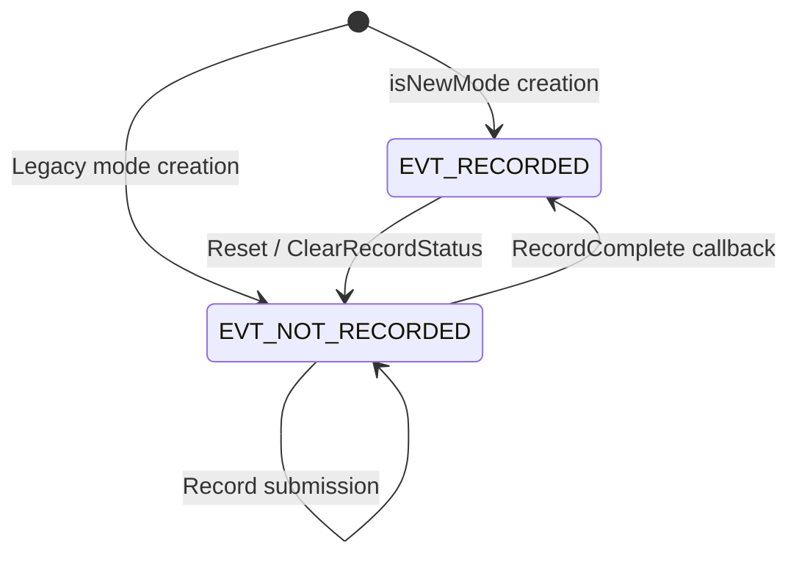

DavidStream manages CntNotifyId:
- The `cntNotifyId_` member maintains the NotifyId of the current Stream
- DavidStream applies for the ID from the driver through `ApplyCntNotifyId` for the first time
- When `IsCntNotifyReachThreshold` reaches the threshold, DavidStream needs to wait for previous Wait tasks to complete
- The `isCntNotify_` flag distinguishes between the two ID sources: pre-allocation (newMode/RT_EVENT_DEFAULT) and driver allocation

#### IPC Event Shared Memory Synchronization Mechanism

**Design Concept**: The IPC Event does not depend on CntNotifyId hardware synchronization. Instead, the IPC Event implements cross-process event synchronization through the P2P shared memory plus MemWriteValue/MemWaitValue SQEs. This avoids the restriction that NotifyIds cannot be shared between processes.

Core data structure `IpcHandleVa`:

| Field | Type | Description |
|------|------|------|
| `lockStatus` | `uint64_t volatile` | CAS spin lock (LOCK_RELEASED/LOCK_OCCUPIED) |
| `deviceMemHandle` | `void*` | P2P shared memory handle (exported by Export) |
| `deviceMemRef[8192]` | `uint64_t[IPC_EVENT_P2P_SIZE]` | Ring index array. Each slot records the Record/Wait count |
| `currentIndex` | `uint16_t` | Current Record position |

**Setup process (creating side)**:

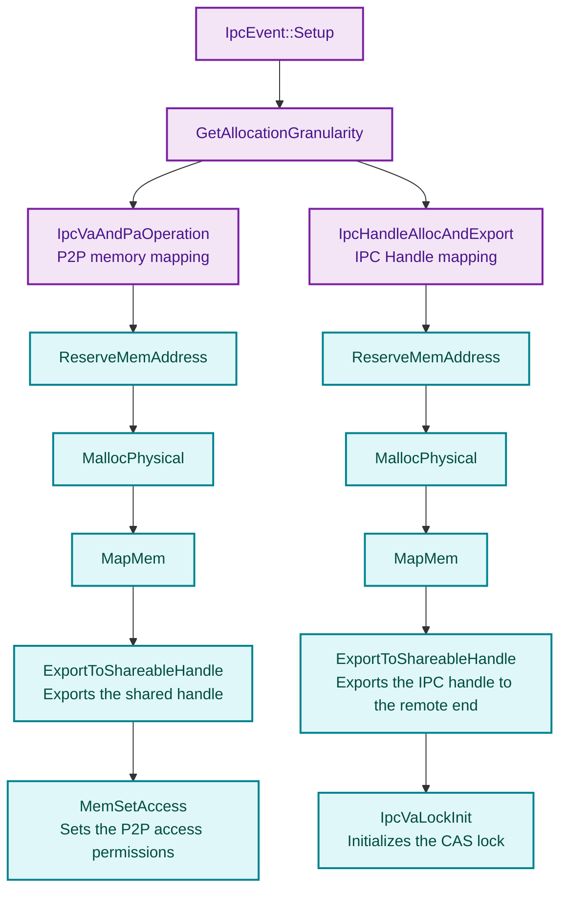

**Open process (remote process)**:

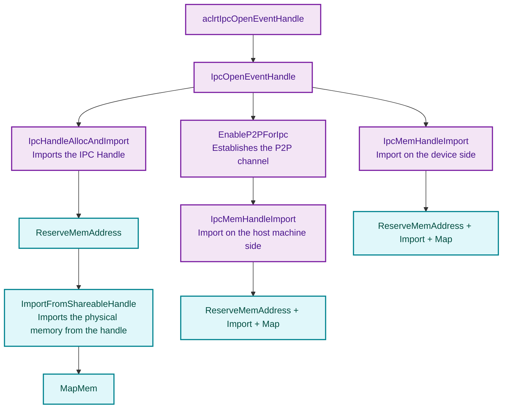

- **Creating side**: Allocates the P2P shared memory plus the IPC Handle, and exports two shareable handles (deviceMemHandle + ipcHandle)
- **Remote process**: Imports the IPC Handle → obtains the IpcHandleVa pointer → enables P2P → imports the shared memory on both the host machine and device sides
- Cross-process synchronization: The creating side writes to `currentDeviceMem_ + curIndex` through MemWriteValue. The remote end waits for the value change at the same address through MemWaitValue

### 4.6 Module Responsibility Division

| Module | Responsibility | Location |
|------|------|------|
| Event | Event base class. Status management, taskId mapping, and Synchronize | `core/inc/event/event.hpp` |
| DavidEvent | Event subclass of the Stars architecture. CntNotifyId mode and two-state state machine | `core/inc/event/event_david.hpp` |
| IpcEvent | IPC Event subclass. P2P shared memory synchronization | `core/inc/event/ipc_event.hpp` |
| event_c.cc | Record/Wait/Reset entry of the Stars architecture | `core/src/event/event_c.cc` |
| event_david.cc | DavidEvent implementation | `core/src/event/event_david.cc` |
| ipc_event.cc | IpcEvent basic implementation (Setup/Open) | `core/src/event/ipc_event.cc` |
| ipc_event_starsV2.cc | IPC StarsV2 Record/Wait | `core/src/event/ipc_event_starsV2.cc` |

### 4.7 Core Data Structures

#### 4.7.1 Event Inheritance Hierarchy Class Diagram

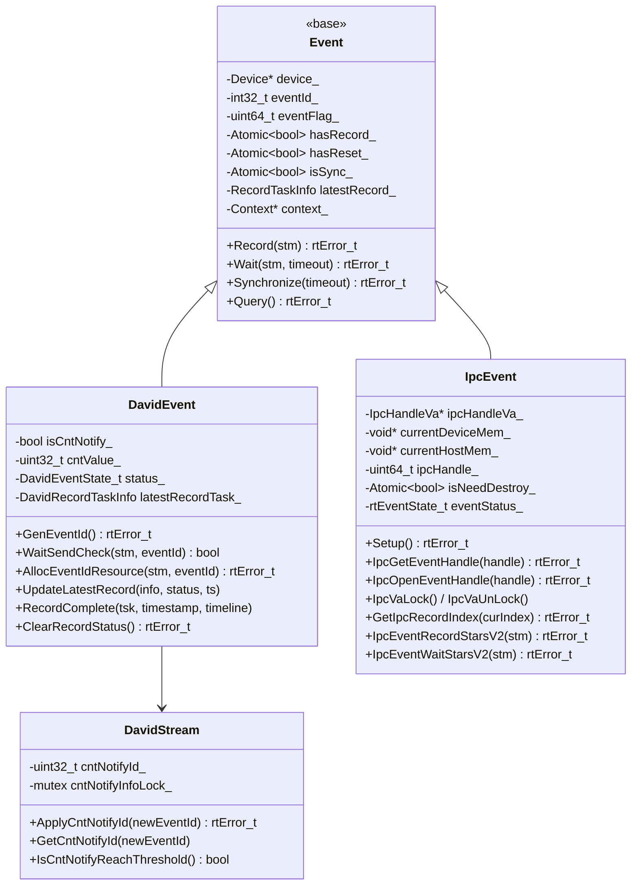

#### 4.7.2 IpcHandleVa Data Structure Class Diagram

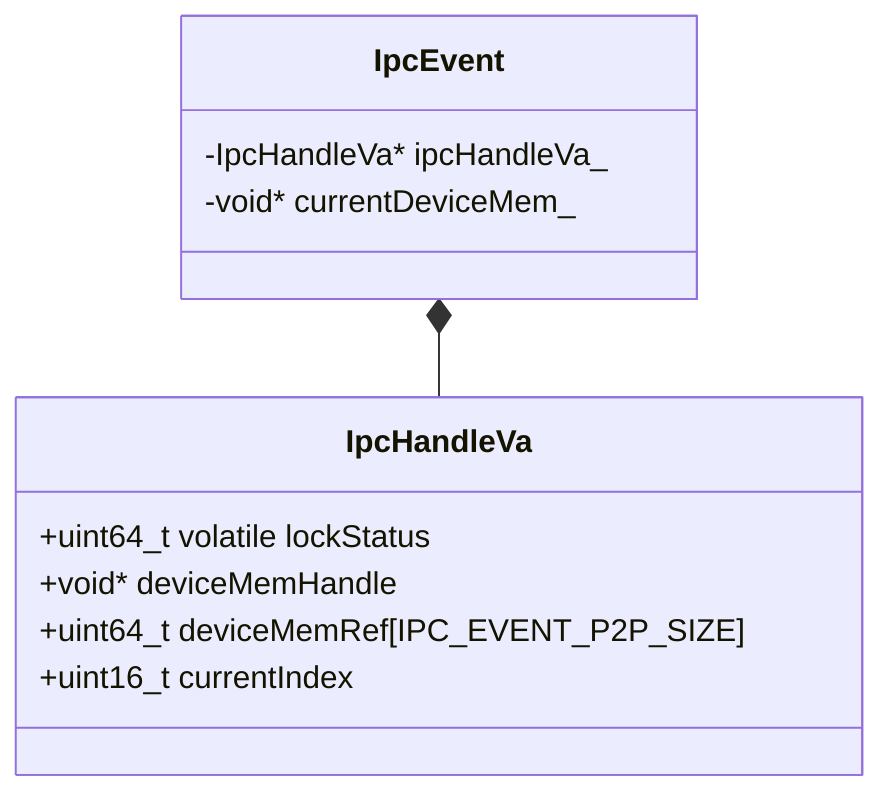

## 5. Key File Index

| Module | File Path | Core Content |
|------|----------|----------|
| Event base class | `src/runtime/core/inc/event/event.hpp` | Event class definition |
| Event base class implementation | `src/runtime/core/src/event/event.cc` | Core implementation of the Event base class |
| DavidEvent definition | `src/runtime/core/inc/event/event_david.hpp` | DavidEvent class definition and two-state state machine |
| DavidEvent implementation | `src/runtime/core/src/event/event_david.cc` | CntNotifyId, status management, and Query |
| Stars entry | `src/runtime/core/src/event/event_c.cc` | EvtRecord/EvtWait/EvtReset |
| IpcEvent definition | `src/runtime/core/inc/event/ipc_event.hpp` | IpcEvent class and IpcHandleVa |
| IpcEvent implementation | `src/runtime/core/src/event/ipc_event.cc` | Setup/Open process |
| IPC StarsV2 | `src/runtime/core/src/event/ipc_event_starsV2.cc` | IPC Record/Wait StarsV2 |
| C API layer | `src/runtime/api/api_c_event.cc` | aclrt/rt Event external APIs |
| Task definitions | `src/runtime/core/src/task/task_info/event/` | Event/Notify task types |

## 6. Performance Optimization Strategies

- **CntNotifyId mode**: DavidEvent uses the CntNotifyId maintained by the Stream instead of global pool allocation. This reduces cross-component ID management overhead
- **Two-state state machine**: DavidEvent is simplified into the two states EVT_NOT_RECORDED/EVT_RECORDED. This reduces state judgment complexity
- **Wait fast path**: When WaitSendCheck detects a completed Event, WaitSendCheck returns directly without sending a hardware task

---

_This module document is based on analysis of the source code in `src/runtime/core/src/event/` and `src/runtime/core/inc/event/`._
