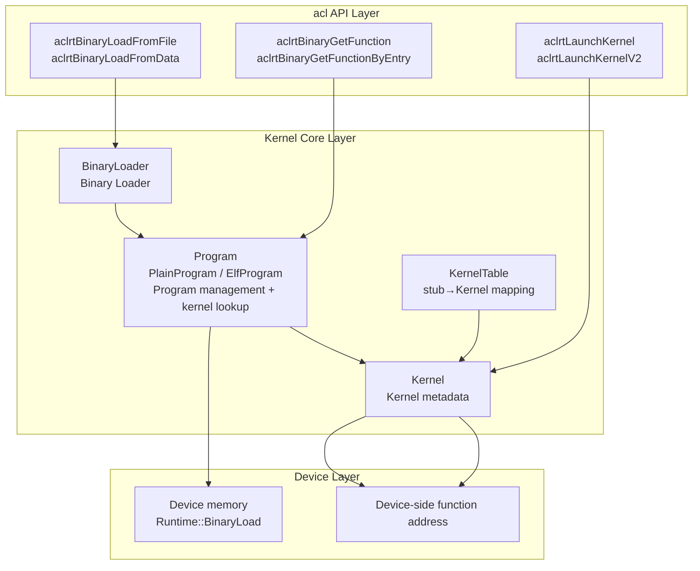
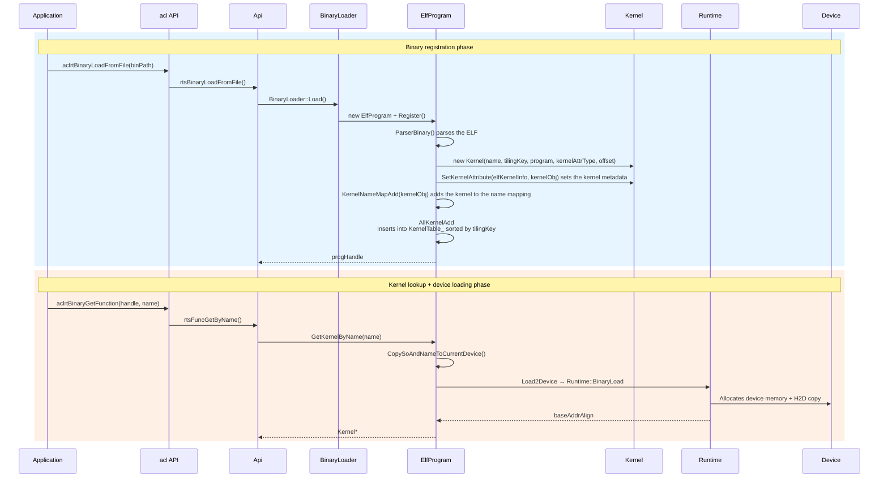
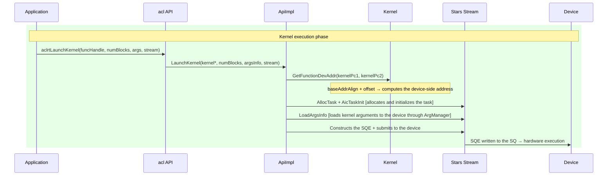
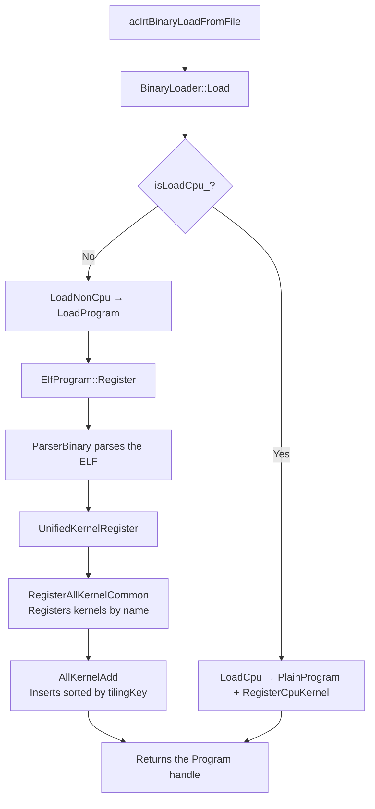
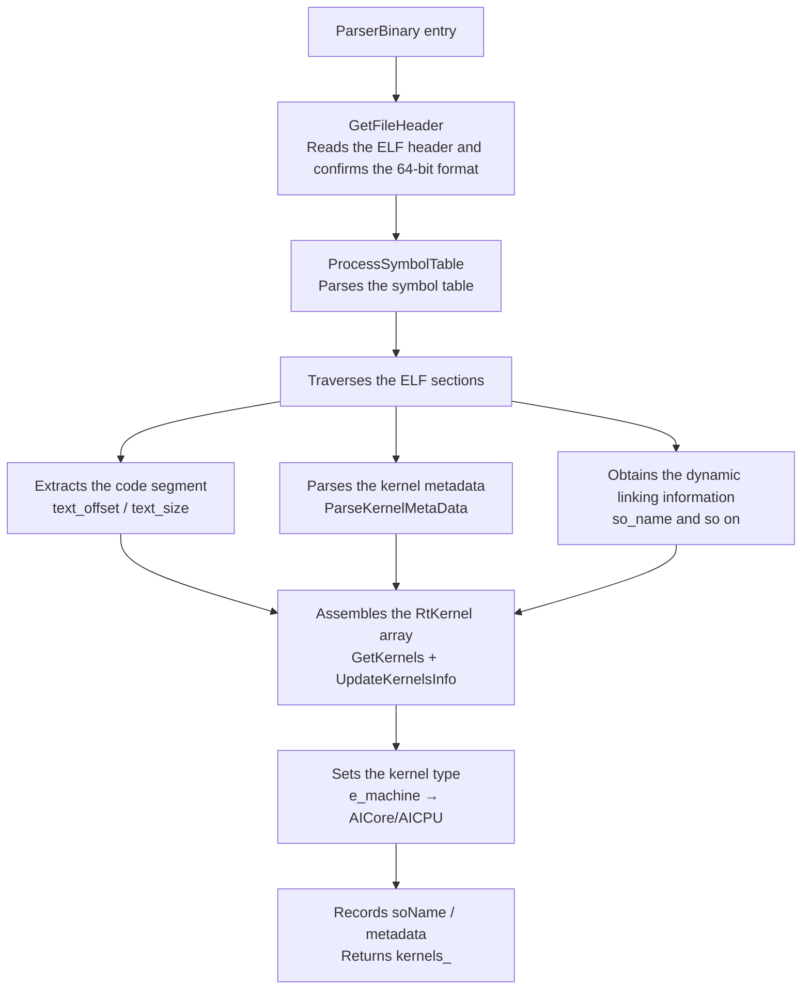
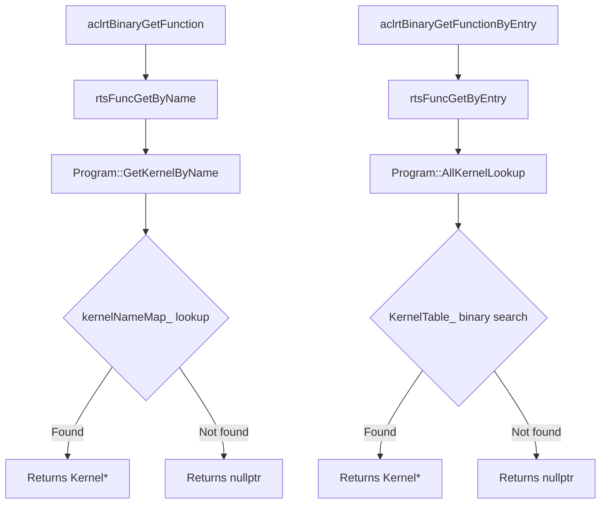
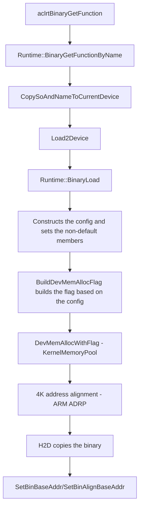
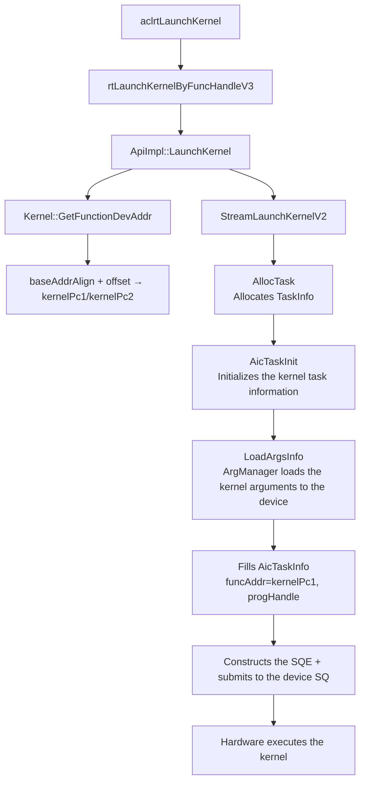
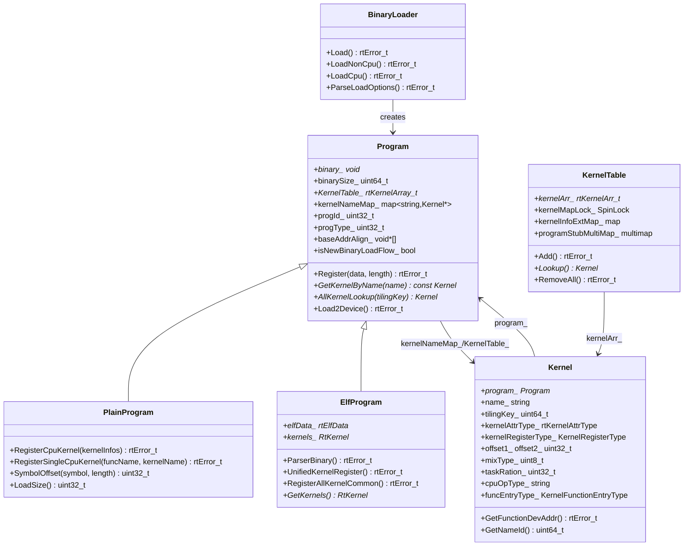

# Kernel Module Architecture

## 1. Module Overview

- **Function Introduction**: The Kernel module manages the registration, lookup, and execution of kernel binaries. Kernel maintains kernel metadata (name, offset, parameters, and so on).
- **Design Goals**:
  - Provide the kernel registration and lookup mechanisms
  - Manage kernel metadata
  - Support loading kernel binaries to the device
  - Support registration of multiple operator types: AI Core (AI Cube and AI Vector), MIX (a mixture of AI Cube and AI Vector), and AICPU
  - Support two lookup methods: by kernel function name (Function Name) and by kernel function entry (Function Entry)

## 2. Usage Scenarios and External APIs

### 2.1 Usage Scenarios

- **Scenario 1**: Binary registration (from a file)
  ```cpp
  aclrtBinHandle binHandle = nullptr;
  aclrtBinaryLoadFromFile(binPath, nullptr, &binHandle);
  // Internal path: rtsBinaryLoadFromFile → BinaryLoader::Load → ElfProgram::Register → UnifiedKernelRegister
  ```

- **Scenario 2**: Binary registration (from memory)
  ```cpp
  aclrtBinHandle binHandle = nullptr;
  aclrtBinaryLoadFromData(data, length, nullptr, &binHandle);
  // Internal path: rtsBinaryLoadFromData → BinaryLoader::Load → ElfProgram::Register
  ```

- **Scenario 3**: Kernel lookup and execution
  ```cpp
  aclrtFuncHandle funcHandle = nullptr;
  aclrtBinaryGetFunction(binHandle, kernelName, &funcHandle);
  aclrtLaunchKernel(funcHandle, numBlocks, argsData, argsSize, stream);
  ```

- **Scenario 4**: Kernel lookup (by kernel function entry)
  ```cpp
  aclrtFuncHandle funcHandle = nullptr;
  aclrtBinaryGetFunctionByEntry(binHandle, funcEntry, &funcHandle);
  ```

### 2.2 External APIs

| API | Corresponding rt Call | Description |
|------|-------------|------|
| `aclrtCreateBinary()` | Local new rtDevBinary_t | Creates a binary description object |
| `aclrtDestroyBinary()` | Local delete | Destroys a binary description object |
| `aclrtBinaryLoad()` | `rtBinaryLoadWithoutTilingKey()` | Registers a binary (legacy API, without a tiling key) |
| `aclrtBinaryUnLoad()` | `rtBinaryUnLoad()` | Unloads a binary |
| `aclrtBinaryLoadFromFile()` | `rtsBinaryLoadFromFile()` | Registers a binary from a file |
| `aclrtBinaryLoadFromData()` | `rtsBinaryLoadFromData()` | Registers a binary from memory |
| `aclrtBinaryGetFunction()` | `rtsFuncGetByName()` | Obtains a kernel function by name |
| `aclrtBinaryGetFunctionByEntry()` | `rtsFuncGetByEntry()` | Obtains a kernel function by kernel function entry |
| `aclrtBinaryGetDevAddress()` | `rtsBinaryGetDevAddress()` | Obtains the device-side address of a binary |
| `aclrtBinaryGetGlobal()` | `rtBinaryGetGlobal()` | Obtains the global symbol address |
| `aclrtBinarySetExceptionCallback()` | `rtBinarySetExceptionCallback()` | Sets the exception callback |
| `aclrtLaunchKernel()` | `rtLaunchKernelByFuncHandleV3()` | Executes a kernel |
| `aclrtLaunchKernelV2()` | `rtsLaunchKernelWithDevArgs()` | Executes a kernel (V2) |
| `aclrtLaunchKernelWithConfig()` | `rtsLaunchKernelWithConfig()` | Executes a kernel (with configuration) |
| `aclrtLaunchKernelWithHostArgs()` | `rtsLaunchKernelWithHostArgs()` | Executes a kernel (host arguments) |
| `aclrtLaunchKernelWithArgsArray()` | `rtLaunchKernelWithArgsArray()` | Executes a kernel (argument array) |

## 3. Architecture Overview

### 3.1 Overall Design Approach

- **BinaryLoader**: The kernel registration entry. BinaryLoader loads a binary from a file or memory and creates a Program.
- **Program**: Manages kernel binaries and lookup. Program maintains two lookup mechanisms: the name mapping and the ordered tilingKey table. ElfProgram parses the ELF and registers kernels. PlainProgram registers CPU kernels.
- **Kernel**: Maintains kernel metadata. Kernel computes the device-side function address directly from the base address of the owning Program.
- **KernelTable**: The global ordered stub→Kernel mapping table. KernelTable supports binary search and batch unloading by Program.
- Device-side loading is completed through Program::Load2Device → Runtime::BinaryLoad. The loading is triggered inside aclrtBinaryGetFunction.

### 3.2 Architecture Layer Diagram



### 3.3 Core Module Interaction Diagram





## 4. Detailed Design

### 4.1 Core Processes

#### Binary Registration Process



**Process step descriptions**:

1. BinaryLoader determines the CPU/non-CPU path (distinguished through the `isLoadCpu_` flag)
2. Non-CPU path: LoadProgram creates an ElfProgram → Register saves the binary → ParserBinary parses the ELF symbols and attributes → UnifiedKernelRegister performs the two-step registration
3. UnifiedKernelRegister first calls RegisterAllKernelCommon to register kernels by name into `kernelNameMap_`. Then UnifiedKernelRegister traverses all kernels and inserts them into `KernelTable_` sorted by tilingKey
4. CPU path: The system creates a PlainProgram. PlainProgram loads and registers CPU operator information based on the mode

**Key code**:

```cpp
// File location: src/runtime/core/src/kernel/program.cc
rtError_t ElfProgram::UnifiedKernelRegister() {
    rtError_t error = RegisterAllKernelCommon();
    ERROR_RETURN(error, "register all kernel failed, retCode=%#x.", static_cast<uint32_t>(error));

    const std::map<std::string, Kernel *>& kernelNameMap = GetKernelNameMap();
    for (auto iter = kernelNameMap.begin(); iter != kernelNameMap.end(); ++iter) {
        Kernel* kernelObj = iter->second;
        if (kernelObj->GetFunctionEntryType() == KernelFunctionEntryType::KERNEL_TYPE_NOT_SUPPORT_FUNCTION_ENTRY) {
            continue;
        }
        bool isRepeated = false;
        error = AllKernelAdd(kernelObj, isRepeated);
        ERROR_RETURN(error, "add kernel to tilingKey table failed, kernel_name=%s, tilingKey=%llu.",
            kernelObj->Name_().c_str(), kernelObj->TilingKey());
    }
    return RT_ERROR_NONE;
}
```

#### ELF Parsing Process



**Process step descriptions**:

1. The system reads the ELF file header and confirms that the file is a valid 64-bit format
2. The system traverses each ELF section: extracts the position and size of the code segment, parses the metadata of each kernel (name, offset, length, funcType, funcEntryType, and so on), and obtains so_name
3. The system assembles the parsing results into an RtKernel array (each RtKernel contains all description information of one kernel)
4. The system sets the default kernel type (AICore/AICPU) based on the e_machine in the ELF header, and records soName and metadata

**Key code**:

```cpp
// File location: src/runtime/core/src/kernel/program.cc
rtError_t ElfProgram::ParserBinary() {
    elfData_->obj_size = binarySize_;
    kernels_ = ProcessObject(RtPtrToPtr<char_t *>(binary_), elfData_);
    if (elfData_->elf_header.e_machine == 183U) {
        SetDefaultKernelAttrType(RT_KERNEL_ATTR_TYPE_AICPU);
    } else {
        SetDefaultKernelAttrType(RT_KERNEL_ATTR_TYPE_AICORE);
    }
    SetMachine(elfData_->elf_header.e_machine);
    SetStackSize(elfData_->stackSize);
    soName_ = elfData_->so_name;
}
```

```cpp
// File location: src/runtime/core/src/kernel/program.cc
void ElfProgram::SetKernelAttribute(const RtKernel *kernel, Kernel *kernelObj) {
    const RtKernelMetaInfo *metaInfo = &(kernel->metaInfo);
    kernelObj->SetKernelLength1(kernel->length);
    kernelObj->SetKernelVfType_(metaInfo->kernelVfType);
    kernelObj->SetFuncType(metaInfo->funcType);
    kernelObj->SetTaskRation(metaInfo->taskRation);
    kernelObj->SetFunctionEntryType(metaInfo->funcEntryType);
    kernelObj->SetParamTotalSize(metaInfo->paramTotalSize);
}
```

#### Kernel Lookup Process



**Process step descriptions**:

- Lookup by name (`aclrtBinaryGetFunction`): The system looks up directly in `kernelNameMap_` through `rtsFuncGetByName` → `Program::GetKernelByName`
- Lookup by kernel function entry (`aclrtBinaryGetFunctionByEntry`): The system performs a binary search for the tilingKey in the ordered `KernelTable_` array through `rtsFuncGetByEntry` → `Program::AllKernelLookup`

#### Kernel Loading to Device Process



**Process step descriptions**: Device-side loading is triggered inside aclrtBinaryGetFunction through CopySoAndNameToCurrentDevice. Program::Load2Device calls Runtime::BinaryLoad to complete the actual copy. Because multiple non-default config members exist here, the system first constructs the config and sets the non-default members. The system then builds the flag through `NpuDriver::BuildDevMemAllocFlag(deviceId, &config)`. After that, the system allocates Runtime internal device memory through `DevMemAllocWithFlag` (the KernelMemoryPool memory pool has the highest priority), performs 4K address alignment (required by the ARM ADRP instruction), performs the H2D copy, and records baseAddr/baseAddrAlign.

#### Kernel Execution Process



**Process step descriptions**:

1. aclrtLaunchKernel passes funcHandle (Kernel*) and the arguments to rtLaunchKernelByFuncHandleV3
2. ApiImpl::LaunchKernel obtains the device-side function address: Kernel::GetFunctionDevAddr directly computes kernelPc1/kernelPc2 through baseAddrAlign + offset
3. StreamLaunchKernelV2 allocates TaskInfo from the Stream task pool. AicTaskInit initializes the kernel type, blockDim, qos, and other information
4. The system loads the kernel arguments to the device through ArgManager (ArgPool or H2D copy)
5. The system fills the AicTaskInfo fields (kernel, progHandle, and funcAddr), constructs the SQE, and submits the SQE to the device SQ. The hardware executes the kernel

**Key code**:

```cpp
// File location: src/runtime/core/src/launch/aix_starsv2.cc
rtError_t StreamLaunchKernelV2(Kernel *kernel, const uint32_t coreDim, Stream *stm,
    const rtStreamLaunchKernelV2ExtendArgs_t *extendAgrs, const bool isLaunchVec) {
    Program * const prog = kernel->Program_();
    // Obtain the device-side function address
    error = kernel->GetFunctionDevAddr(kernelPc1, kernelPc2);
    // Allocate TaskInfo (unified entry, internally handles capture/non-capture/auto-split dispatch)
    // The stars v2 path passes nullptr, and the stars v1 path passes &submitTask (temporary variable)
    kernelTask = stm->AllocTask(nullptr, TS_TASK_TYPE_KERNEL_AICORE, error, 1U, UpdateTaskFlag::SUPPORT);
    // Initialize the kernel task
    AicTaskInit(kernelTask, kernelAttrType, static_cast<uint16_t>(coreDim), extendAgrs->taskCfg, false);
    // Load the arguments
    error = static_cast<DavidStream *>(dstStm)->LoadArgsInfo(argsInfo, useArgPool, &result);
    // Fill the task information
    aicTask->kernel = const_cast<Kernel *>(kernel);
    aicTask->progHandle = prog;
    aicTask->funcAddr = kernelPc1;
    aicTask->funcAddr1 = kernelPc2;
    // Submit to the device
    error = DavidSendTask(kernelTask, dstStm);
}
```

### 4.2 Core Mechanism Details

#### Kernel Metadata

**Design Concept**: Kernel maintains all kernel metadata. Kernel supports two registration types: CPU and non-CPU. Each type has a different constructor. ElfProgram creates a non-CPU Kernel when parsing the ELF. PlainProgram creates a CPU Kernel when registering CPU operators.

Key fields (grouped by function):

| Function Group | Field | Type | Description |
|---------|------|------|------|
| Basic identity | `program_` | Program* | Owning program |
| | `name_` | string | Kernel name |
| | `tilingKey_` | uint64_t | Tiling key |
| | `kernelAttrType_` | rtKernelAttrType | Kernel type (AIC/AIV/MIX (a mixture of AI Cube and AI Vector)/AICPU) |
| | `kernelRegisterType_` | KernelRegisterType | Registration type (CPU/non-CPU) |
| Device address | `offset1_`/`offset2_` | uint32_t | Function offset 1/offset 2 |
| | `stubFun_` | const void* | stub function address |
| | `funcEntryType_` | KernelFunctionEntryType | Kernel function entry type (TilingKey/FunctionEntry) |
| Execution parameters | `mixType_` | uint8_t | Mixture type (AIC+AIV mode) |
| | `taskRation_` | uint32_t | AIC:AIV task ratio |
| | `schedMode_` | uint32_t | Scheduling mode |
| | `length1_`/`length2_` | uint32_t | Kernel code length |
| CPU operator | `cpuOpType_` | string | CPU operator type |
| | `cpuKernelSo_` | string | CPU SO name |
| | `cpuFunctionName_` | string | CPU function name |
| DFX/Profiling | `dfxAddr_`/`dfxSize_` | void*/uint16_t | DFX debugging information |
| | `nameId_` | uint64_t | Name hash ID (used for Profiling) |
| | `isSupportOverFlow_` | bool | Whether overflow detection is supported |

Core methods:

| Method | Function |
|------|------|
| `GetFunctionDevAddr()` | Obtains the device-side function address (baseAddrAlign + offset) |
| `GetNameId()` | Obtains the kernel name hash ID (computed and cached on the first call) |
| `SetKernelAttribute()` | Sets kernel attributes in a batch during ElfProgram registration |

#### KernelTable Kernel Mapping Table

**Design Concept**: KernelTable uses an ordered array plus binary search to implement an efficient stub→Kernel mapping. KernelTable also maintains multiple auxiliary mapping tables to support different lookup scenarios.

Key fields:

| Field | Type | Description |
|------|------|------|
| `kernelArr_` | rtKernelArr_t* | Ordered array (sorted by stub address). Supports binary search |
| `kernelMapLock_` | SpinLock | Concurrency protection lock |
| `kernelInfoExtMap_` | map&lt;string, Kernel*&gt; | kernelInfoExt→Kernel mapping (extended information lookup) |
| `invKernelMap_` | map&lt;string, const void*&gt; | name→stub reverse lookup |
| `programStubMultiMap_` | multimap&lt;Program*, const void*&gt; | Program→stubs mapping (deletes in batches by Program during unloading) |

Key methods:

| Method | Function |
|------|------|
| `Add()` | Registers a kernel: locates through binary search → inserts into the ordered array with ArrayInsert → updates the auxiliary mappings |
| `Lookup()` | Looks up a stub: binary search → returns Kernel* (also checks whether the Program is unloaded) |
| `RemoveAll()` | Unloads in batches by Program: traverses programStubMultiMap → locates through binary search → deletes with memmove → updates the auxiliary mappings |

#### Program Inheritance Hierarchy

**Design Concept**: The Program base class defines common APIs and binary management logic. PlainProgram and ElfProgram manage CPU operator simple binaries and ELF-format kernels respectively.

Key fields of the Program base class:

| Field | Type | Description |
|------|------|------|
| `binary_`/`binarySize_` | void*/uint64_t | Binary data and size |
| `KernelTable_` | rtKernelArray_t* | Ordered tilingKey→Kernel table within the Program |
| `kernelNameMap_` | map&lt;string, Kernel*&gt; | name→Kernel mapping |
| `progId_` | uint32_t | Program ID |
| `progType_` | uint32_t | Program type (PLAIN/ELF) |
| `baseAddr_[]`/`baseAddrAlign_[]` | void*[] | Binary base addresses on each device |
| `isNewBinaryLoadFlow_` | bool | New registration process flag |

Core methods of the Program base class:

| Method | Function |
|------|------|
| `Register()` | Saves the binary data → ParserBinary → AddProgramToPool |
| `GetKernelByName()` | Looks up by name from kernelNameMap_ |
| `AllKernelLookup()` | Performs a binary search by tilingKey from KernelTable_ |
| `Load2Device()` | Loads the binary to the device through Runtime::BinaryLoad (triggered inside aclrtBinaryGetFunction) |
| `BuildTilingTbl()`/`BuildTilingTblForDavid()` | Builds the Tiling tables for task dispatch |

**PlainProgram** (CPU operators):

- `RegisterCpuKernel()`: Registers CPU kernels in a batch from the CpuKernelInfo parsed from JSON
- `RegisterSingleCpuKernel()`: Registers a single CPU kernel separately, including device-side name storage

**ElfProgram** (ELF kernels):

- `ParserBinary()`: Parses the ELF format and extracts kernel symbols and attributes
- `UnifiedKernelRegister()`: Unified registration process (nameMap first, then KernelTable)
- `RegisterAllKernelCommon()`: Traverses the ELF kernels, creates Kernels by name, and registers them into kernelNameMap_

#### BinaryLoader Binary Loader

**Function Description**: BinaryLoader is the entry component for kernel registration. BinaryLoader loads binary data from a file or memory and creates the corresponding Program object. BinaryLoader distinguishes between the CPU operator and non-CPU operator loading paths, and supports multiple loading options.

Core method functions:

| Method | Function |
|------|------|
| `Load()` | Main entry. Dispatches to LoadCpu or LoadNonCpu after parsing the loading options |
| `LoadNonCpu()` | Non-CPU path: LoadProgram → UnifiedKernelRegister |
| `LoadCpu()` | CPU path: dispatches to LoadCpuKernelFromFile or LoadCpuKernelFromData based on isLoadFromFile |
| `LoadFromFile()`/`LoadFromData()` | Creates an ElfProgram and calls Register + ParseKernelJsonFile |
| `ParseLoadOptions()` | Parses the loading options (Magic and CPU Kernel Mode) |

Three CPU registration modes:

- Mode 0: Loads only the JSON file (self-developed operators, only the JSON description is required)
- Mode 1: Loads the SO + JSON files (custom operators, both the SO and JSON are required)
- Mode 2: Loads from memory data (Data mode, generates the SO name through hash)

#### Module Management

> **NOTE**: Module is used only in the legacy rtBinaryLoad process. The new aclrt process (aclrtBinaryLoadFromFile/Data) does not use Module. Device-side loading in the aclrt process is completed by Runtime::BinaryLoad. Kernel addresses are computed directly by Kernel::GetFunctionDevAddr.

**Function Introduction**: Module loads the binary data of a Program into device-side memory and provides kernel function address queries. The core responsibilities include device-side memory allocation (supports the KernelMemoryPool memory pool), 4K address alignment (required by the ARM ADRP instruction), H2D data copy, and device-side storage of kernelNames/soNames for CPU operators.

Core method functions:

| Method | Function |
|------|------|
| `Load(prog)` | Loads the Program to the device: allocates memory → 4K alignment → H2D copy → records the addresses |
| `GetFunction(kernel)` | Computes the kernel function address: baseAddrAlign + offset |
| `GetPrefetchCnt(kernel)` | Computes the ICache prefetch count |

#### Responsibilities of Other Submodules

- **arg_loader/**: The mechanism that loads arguments from the host machine side to the device side. UbArgLoader uses the UB cache pool. UmaArgLoader supports PCIE BAR and multiple allocation policies. StarsArgManager is the stream-level argument management base class (UbArgManage/PcieArgManage are derived from it)
- **args/**: Argument format conversion and allocation. ArgsHandleAllocator manages RtArgsHandle memory. ParaConvertor implements adaptation between the legacy and new aclrt argument formats
- **elf.hpp / elf.cc**: ELF format parsing. ProcessObject parses the ELF file to extract kernel symbols. RtKernel/RtKernelMetaInfo describe kernel metadata. GetKernelTlvInfo parses TLV-format attributes
- **kernel_utils.hpp / cc**: Kernel task argument computation tools. ComputeRatio computes the mixed execution ratio. ConvertTaskType/GetKernelTaskParams extract task parameters
- **program_common.hpp / cc**: CPU operator attribute setting helpers. SetCpuKernelAttr uniformly sets the SO/FuncName/OpType attributes of a CPU Kernel

### 4.3 Module Responsibility Division

| Module | Responsibility | Location |
|------|------|------|
| Kernel | Kernel metadata management. Supports CPU/non-CPU types | `inc/kernel/kernel.hpp` |
| KernelTable | Ordered stub→Kernel mapping table with binary search | `inc/kernel/kernel.hpp` |
| Program | Program management base class. Binary data + kernel lookup | `inc/kernel/program.hpp` |
| PlainProgram | CPU operator program management | `inc/kernel/program.hpp` |
| ElfProgram | ELF kernel program management + parsing | `inc/kernel/program.hpp` |
| BinaryLoader | Binary loading entry. CPU/non-CPU registration | `src/kernel/binary_loader.hpp` |
| Module | Device-side loading (legacy rtBinaryLoad process only) | `inc/kernel/module.hpp` |
| Elf | ELF format parsing | `inc/kernel/elf.hpp` |
| KernelUtils | Kernel task argument computation | `src/kernel/kernel_utils.hpp` |
| ProgramCommon | CPU operator attribute helpers | `src/kernel/program_common.hpp` |
| ArgLoader | Argument H2D loading mechanism | `src/kernel/arg_loader/` |
| Args | Argument format conversion and allocation | `src/kernel/args/` |

### 4.4 Core Data Structures



## 5. Key File Index

| Module | File Path | Core Content |
|------|----------|----------|
| Kernel core class | `src/runtime/core/inc/kernel/kernel.hpp` | Kernel class definition + KernelTable class definition |
| Kernel implementation | `src/runtime/core/src/kernel/kernel.cc` | Kernel + KernelTable implementation |
| Program | `src/runtime/core/inc/kernel/program.hpp` | Program/PlainProgram/ElfProgram definitions |
| Program implementation | `src/runtime/core/src/kernel/program.cc` | Three Program implementations |
| Module | `src/runtime/core/inc/kernel/module.hpp` | Module class definition (legacy rtBinaryLoad process only) |
| Module implementation | `src/runtime/core/src/kernel/module.cc` | Module::Load and other implementations (legacy rtBinaryLoad process only) |
| BinaryLoader | `src/runtime/core/src/kernel/binary_loader.hpp` | BinaryLoader class definition |
| BinaryLoader implementation | `src/runtime/core/src/kernel/binary_loader.cc` | CPU/non-CPU loading paths |
| ELF parsing | `src/runtime/core/inc/kernel/elf.hpp` | ELF data structure definitions |
| ELF implementation | `src/runtime/core/src/kernel/elf.cc` | Parsing functions such as ProcessObject |
| KernelUtils | `src/runtime/core/src/kernel/kernel_utils.hpp` | Utility function declarations |
| KernelUtils implementation | `src/runtime/core/src/kernel/kernel_utils.cc` | Utility function implementations |
| ProgramCommon | `src/runtime/core/src/kernel/program_common.hpp` | CPU helper function declarations |
| ProgramCommon implementation | `src/runtime/core/src/kernel/program_common.cc` | SetCpuKernelAttr implementation |
| ArgLoader | `src/runtime/core/src/kernel/arg_loader/` | Argument loading mechanism |
| Args | `src/runtime/core/src/kernel/args/` | Argument conversion and allocation |
| C API layer | `src/runtime/api/api_c_kernel.cc` | rt kernel external APIs |
| aclrt implementation | `src/acl/aclrt_impl/kernel.cpp` | aclrt kernel API implementation |

---

_This module document is based on analysis of the source code in `src/runtime/core/src/kernel/`._
