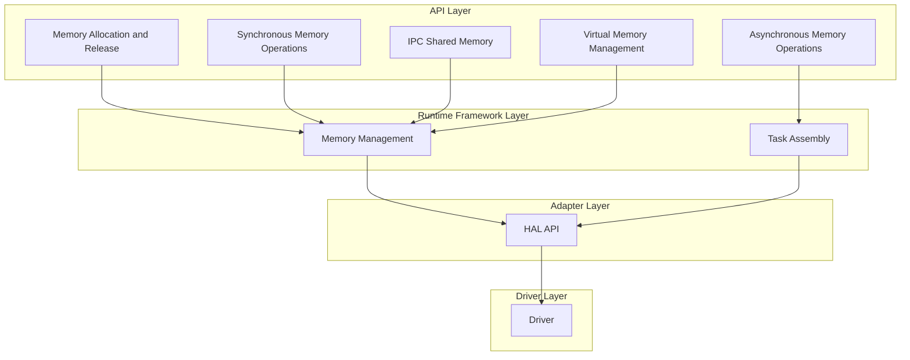
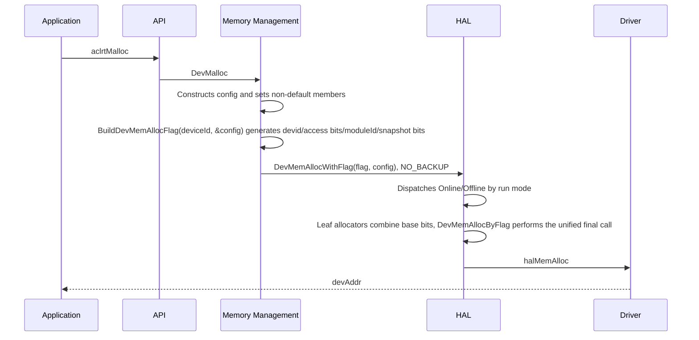
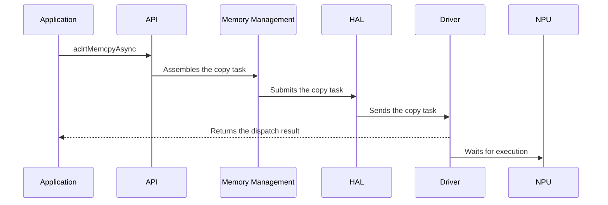
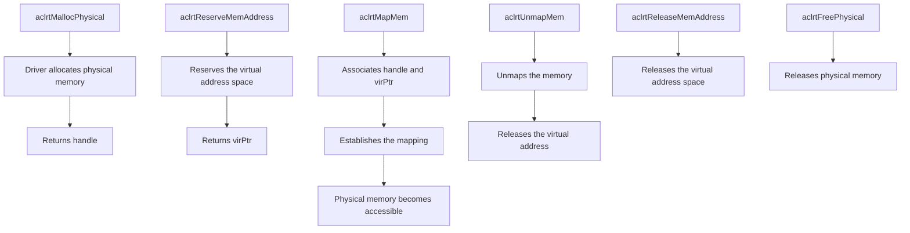
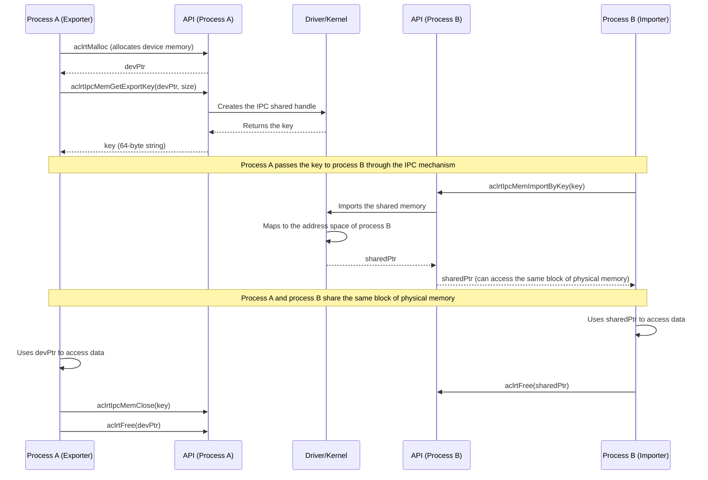

# Memory Module Architecture

## 1. Module Overview

- **Description**: The Memory module manages the allocation, operations, and release of device memory. It provides a set of memory management APIs. These APIs enable you to manage memory usage in applications efficiently and conveniently.
- **Design Objectives**:
  - Provide a unified memory management API
  - Support multiple memory types
  - Support efficient memory copies
  - Support inter-process memory sharing

## 2. Usage Scenarios and External APIs

### 2.1 Basic Usage Scenarios

- **Scenario 1**: Allocate device memory
  ```cpp
  void *devPtr;
  aclrtMalloc(&devPtr, size, ACL_MEM_MALLOC_HUGE_FIRST);
  ```

- **Scenario 2**: Allocate host memory
  ```cpp
  void *hostPtr;
  aclrtMallocHost(&hostPtr, size);
  ```

- **Scenario 3**: Synchronous memory copy
  ```cpp
  aclrtMemcpy(dstPtr, dstSize, srcPtr, srcSize, ACL_MEMCPY_HOST_TO_DEVICE);
  ```

- **Scenario 4**: Asynchronous memory copy
  ```cpp
  aclrtStream stream;
  aclrtCreateStream(&stream);
  // Asynchronous copy that does not block the host.
  aclrtMemcpyAsync(dstPtr, dstSize, srcPtr, srcSize, ACL_MEMCPY_HOST_TO_DEVICE, stream);
  ```

- **Scenario 5**: IPC memory sharing
  ```cpp
  // Process A: Exports the shared handle.
  void *ptr;
  aclrtMalloc(&ptr, size, ACL_MEM_MALLOC_HUGE_FIRST);  // Requests device memory in advance.
  char key[65];
  aclrtIpcMemGetExportKey(ptr, size, key, 65, ACL_RT_IPC_MEM_EXPORT_FLAG_DEFAULT);

  // Process B: Imports the shared memory.
  void *sharedPtr;
  aclrtIpcMemImportByKey(&sharedPtr, key, ACL_RT_IPC_MEM_IMPORT_FLAG_DEFAULT);

  // Closes the IPC memory after use.
  aclrtIpcMemClose(key);
  aclrtFree(ptr);  // Process A releases the original memory.
  ```

- **Scenario 6**: Physical memory management
  ```cpp
  aclrtDrvMemHandle handle;
  aclrtPhysicalMemProp prop = {...};
  aclrtMallocPhysical(&handle, size, &prop, 0);  // Allocates physical memory.
  void *virPtr;
  aclrtReserveMemAddress(&virPtr, size, 0, nullptr, 0);  // Reserves the virtual address space.
  aclrtMapMem(virPtr, size, 0, handle, 0);  // Maps physical memory to the virtual address.

  // Unmaps and releases the memory after use.
  aclrtUnmapMem(virPtr);  // Unmaps the memory.
  aclrtReleaseMemAddress(virPtr);  // Releases the virtual address space.
  aclrtFreePhysical(handle);  // Releases the physical memory.
  ```

### 2.2 External APIs

| API | Description |
|------|------|
| **Memory allocation/release** |
| `aclrtMalloc`/`aclrtMallocWithCfg` | Allocates device memory |
| `aclrtMallocHost`/`aclrtMallocHostWithCfg` | Allocates host memory |
| `aclrtFree` | Releases device memory |
| `aclrtFreeHost` | Releases host memory |
| **Memory copy** |
| `aclrtMemcpy`/`aclrtMemcpyAsync` | Synchronous/asynchronous memory copy |
| `aclrtMemcpy2d`/`aclrtMemcpy2dAsync` | 2D synchronous/asynchronous memory copy |
| `aclrtMemcpyBatch`/`aclrtMemcpyBatchAsync` | Batch synchronous/asynchronous memory copy |
| **Memory setting** |
| `aclrtMemset` | Memory setting |
| `aclrtMemsetAsync` | Asynchronous memory setting |
| **Physical memory management** |
| `aclrtMallocPhysical` | Allocates physical memory |
| `aclrtReserveMemAddress` | Reserves the virtual address space |
| `aclrtMapMem` | Maps physical memory to the virtual address |
| `aclrtUnmapMem` | Unmaps memory |
| `aclrtReleaseMemAddress` | Releases the virtual address space |
| `aclrtFreePhysical` | Releases physical memory |
| **Memory registration** |
| `aclrtHostRegister` | Registers host memory |
| `aclrtHostUnregister` | Cancels host memory registration |

### 2.3 Memory Copy Types

| Copy Type | Description |
|----------|------|
| `ACL_MEMCPY_HOST_TO_HOST` | Host to host |
| `ACL_MEMCPY_HOST_TO_DEVICE` | Host to device |
| `ACL_MEMCPY_DEVICE_TO_HOST` | Device to host |
| `ACL_MEMCPY_DEVICE_TO_DEVICE` | Device to device |
| `ACL_MEMCPY_DEFAULT` | Default copy type (the system automatically infers the direction) |
| `ACL_MEMCPY_HOST_TO_BUF_TO_DEVICE` | Host to device (the Runtime caches the data, and you can release the host memory after calling the API) |
| `ACL_MEMCPY_INNER_DEVICE_TO_DEVICE` | Copy within the same device |
| `ACL_MEMCPY_INTER_DEVICE_TO_DEVICE` | Cross-device copy |

## 3. Architecture Overview

### Architecture Layering Diagram




## 4. Detailed Design

### 4.1 Core Workflows

#### Memory Allocation Workflow
The API for allocating device memory is as follows:

```cpp
aclError aclrtMalloc(void **devPtr, size_t size, aclrtMemMallocPolicy policy);
```
- `devPtr`: A second-level pointer to the allocated memory address. After the function succeeds, `*devPtr` is the allocated device memory address;
- `size`: The requested memory size, in bytes;
- `policy`: The memory allocation policy. Based on the actual application scenario and requirements, you can specify the allocation policy. Normal small pages (4KB) save more resources. Huge pages (2MB) deliver better performance when you process massive amounts of data. The supported policies are described as follows:

| Policy | Description |
|------|------|
| `ACL_MEM_MALLOC_HUGE_FIRST` | Prefers huge page memory, and uses normal page memory when huge page memory is insufficient |
| `ACL_MEM_MALLOC_HUGE_ONLY` | Uses only huge page memory, and returns an error when huge page memory is insufficient |
| `ACL_MEM_MALLOC_NORMAL_ONLY` | Uses only normal page memory |
| `ACL_MEM_MALLOC_HUGE_FIRST_P2P` | Prefers huge page memory (P2P scenario) |
| `ACL_MEM_MALLOC_HUGE_ONLY_P2P` | Uses only huge page memory (P2P scenario) |
| `ACL_MEM_MALLOC_NORMAL_ONLY_P2P` | Uses only normal page memory (P2P scenario) |
| `ACL_MEM_MALLOC_HUGE1G_ONLY` | Uses only 1G huge page memory |
| `ACL_MEM_MALLOC_HUGE1G_ONLY_P2P` | Uses only 1G huge page memory (P2P scenario) |
| `ACL_MEM_TYPE_LOW_BAND_WIDTH` | Low-bandwidth memory type |
| `ACL_MEM_TYPE_HIGH_BAND_WIDTH` | High-bandwidth memory type |
| `ACL_MEM_ACCESS_USER_SPACE_READONLY` | User-space read-only access permission |

The detailed allocation flow is as follows:


The driver abstraction layer (`src/runtime/core/inc/drv/driver.hpp`) provides two device memory allocation entry points. You can choose one based on "whether config needs to be modified":

| Entry Point | Positioning | Usage |
|------|------|---------|
| `DevMemAllocWithBackupFlag` | **General fast path (backup label passed in explicitly)** | The backup label `type` is passed in explicitly through the fifth positional parameter (default `SNAPSHOT_REQUIRED_BACKUP`), and all other config members use default values |
| `DevMemAllocWithFlag` | **General method (when config needs to be modified)** | First constructs config and assigns values to non-default members, then generates `drvFlag` through `BuildDevMemAllocFlag(deviceId, &config)`, and finally calls with both |

**`DevMemAllocWithBackupFlag`: General fast API.** Use this six-parameter signature when all attributes use default values and only the backup type needs to be specified. The backup label is passed in explicitly through the `type` positional parameter: Runtime internal memory passes in required / optional based on snapshot requirements, and external user memory of aclrt-related APIs passes in `SNAPSHOT_NO_BACKUP`. The call site does not need to construct config. The implementation writes `type` into a local copy of config, and the variable at the call site is not affected.

**`DevMemAllocWithFlag`: General usage method when config needs to be modified.** When any config member needs to deviate from the default value (custom `moduleId`, `isLogError=false`, `readOnlyFlag` / `cpOnlyFlag` / `privateFlag`), follow these three standard steps:

```cpp
// 1. Constructs config and assigns values only to non-default members
DevMemAllocConfig allocConfig = {};
allocConfig.moduleId = moduleId;
allocConfig.isLogError = false;
// 2. Generates drvFlag from config (deviceId, moduleId, access bits, and backup label are encoded together)
const uint64_t drvFlag = NpuDriver::BuildDevMemAllocFlag(devId, &allocConfig);
// 3. Calls with drvFlag and config
rtError_t ret = driver->DevMemAllocWithFlag(devPtr, tmpSize, type, devId, &allocConfig, drvFlag);
```

`BuildDevMemAllocFlag` receives `deviceId` and `const DevMemAllocConfig* const config`, and reads `moduleId`, `readOnlyFlag`, `cpOnlyFlag`, `privateFlag`, and `type` from config in a unified manner. This avoids repeated passing of these attributes by the caller. `deviceId` is not part of config and is still passed in separately. The caller ensures that the config pointer is not empty, which is consistent with other device memory allocation entry points.

Both entry points eventually converge to the same dispatch chain: `DevMemAllocWithBackupFlag` builds the flag based on config through `BuildDevMemAllocFlag` internally and then delegates to `DevMemAllocWithFlag`. The latter dispatches to the Online/Offline leaf allocators by run mode (the offline path masks the access bits and keeps historical behavior), and finally performs the unified final call to `halMemAlloc` through `DevMemAllocByFlag`.

#### Memory Copy Workflow
Common memory copies are divided into synchronous copies and asynchronous copies:

**Synchronous copy (aclrtMemcpy):**
- The call blocks the host thread and returns only after the copy completes
- Applicable scenarios: the copy result is needed immediately, the data volume is small, and the data transfer is simple
- Advantages: simple to use and no need to consider stream synchronization
- Disadvantages: blocks the host and affects concurrent performance

**Asynchronous copy (aclrtMemcpyAsync):**
- Returns immediately after the call, does not block the host thread, and executes the copy task asynchronously on the specified Stream
- Applicable scenarios: large data volume, parallel execution with other compute tasks, and multi-stream concurrency
- Advantages: improves host-device parallelism and fully utilizes hardware performance
- Disadvantages: requires synchronization through Event or Stream to ensure that data is used only after the copy completes

The following is the main asynchronous copy flow:


#### Batch Memory Copy Workflow

Batch memory copy allows you to submit multiple memory copy tasks at one time. This reduces task submission overhead and improves overall copy efficiency. Synchronous batch copy (`aclrtMemcpyBatch`) and asynchronous batch copy (`aclrtMemcpyBatchAsync`) are supported. They are suitable for scenarios where multiple data blocks need to be transferred at the same time.

**API parameters:**
```cpp
aclError aclrtMemcpyBatch(void **dsts, size_t *destMaxs, void **srcs,
                          size_t *sizes, size_t numBatches,
                          aclrtMemcpyBatchAttr *attrs, size_t *attrsIndexes,
                          size_t numAttrs, size_t *failIdx);

aclError aclrtMemcpyBatchAsync(void **dsts, size_t *destMaxs, void **srcs,
                               size_t *sizes, size_t numBatches,
                               aclrtMemcpyBatchAttr *attrs, size_t *attrsIndexes,
                          size_t numAttrs, size_t *failIdx,
                               aclrtStream stream);
```

**Parameter descriptions:**
| Parameter | Type | Description |
|------|------|------|
| `dsts` | IN `void**` | Destination address array |
| `destMaxs` | IN `size_t*` | Maximum capacity array of destination addresses |
| `srcs` | IN `void**` | Source address array |
| `sizes` | IN `size_t*` | Copy size array |
| `numBatches` | IN `size_t` | Number of batch copy tasks |
| `attrs` | IN `aclrtMemcpyBatchAttr*` | Copy attribute array (you can specify the copy direction for each task) |
| `attrsIndexes` | IN `size_t*` | Starting task index of each item in the attribute array; the nth attribute applies to the [attrsIndexes[n], attrsIndexes[n+1]) interval, and the last item applies until numBatches ends |
| `numAttrs` | IN `size_t` | Number of elements in attrs and attrsIndexes |
| `failIdx` | OUT `size_t*` | Index of the failed task; SIZE_MAX if all tasks succeed or the error is unrelated to a single copy |
| `stream` | IN `aclrtStream` | Stream used for asynchronous copy |


#### Physical Memory Management Workflow

Physical memory management allows you to directly control the allocation and mapping of physical memory and provides more fine-grained memory management capabilities. It is mainly used for advanced scenarios that require cross-process memory sharing, large memory pool management, or specific memory attributes. Through physical memory management APIs, you can:
- Allocate physical memory independently and obtain a handle (`aclrtMallocPhysical`)
- Reserve the virtual address space (`aclrtReserveMemAddress`)
- Map physical memory to the virtual address space (`aclrtMapMem`)
- Unmap and release resources after use (`aclrtUnmapMem`, `aclrtReleaseMemAddress`, and `aclrtFreePhysical`)



#### IPC Memory Sharing

IPC (Inter-Process Communication) memory sharing allows different processes to share the same block of device memory, enabling efficient cross-process data transfer. Through the IPC mechanism, process A can export the allocated device memory as a shared key. Process B imports and accesses the same block of physical memory through this key. This avoids the data copy overhead.


| Core API | Description |
|------|------|
| `aclrtIpcMemGetExportKey` | Exports device memory as an IPC key for other processes to import |
| `aclrtIpcMemImportByKey` | Imports the shared memory into the current process through the key |
| `aclrtIpcMemClose` | Closes the IPC shared memory (called by the exporter) |
| `aclrtIpcMemSetImportPid` | Sets the PID whitelist of processes allowed to import |



### 4.2 Key File Index

| Functional Module | File Path | Core Content |
|------|----------|----------|
| ACL memory APIs | `include/external/acl/acl_rt.h` | External APIs such as aclrtMalloc, aclrtMemcpy, and aclrtIpcMem |
| Runtime API layer implementation | `src/runtime/api/api_c_memory.cc` | rtMem* internal API implementation |
| Memory tasks | `src/runtime/core/src/task/task_info/memory/memory_task.cc` | MemcpyAsyncTask and MemcpyBatchTask task implementations |
| Memory task header file | `src/runtime/core/src/task/inc/memory_task.h` | Memory task API definitions |
