# Model Module Architecture

## 1. Module Overview

- **Function Description**: The Model module manages the execution model of computation graphs, covering full lifecycle management including model creation, Stream binding, task loading, model execution, and destruction. It supports two types: the normal model (Normal Model) and the capture model (Capture Model), and implements task scheduling and execution through the SQ/CQ mechanism.
- **Design Objectives**:
  - Provide a unified model management API
  - Support binding and scheduling of multiple Streams
  - Implement batch submission and execution of Tasks
  - Support Label allocation and jump control
  - Provide synchronous/asynchronous model execution modes

## 2. Usage Scenarios and External APIs

### 2.1 Usage Scenarios

- **Scenario 1**: Create and execute a computation model (using ACL APIs)
  ```cpp
  aclmdlRI modelRI;
  aclmdlRIBuildBegin(&modelRI, 0);  // Start building the model
  aclmdlRIBindStream(modelRI, stream, ACL_MODEL_STREAM_FLAG_HEAD);  // Bind a Stream
  // Add tasks to the stream
  aclmdlRIEndTask(modelRI, stream);  // Mark the end of tasks
  aclmdlRIBuildEnd(modelRI, nullptr);  // End the building
  aclmdlRIExecute(modelRI, -1);  // Execute synchronously
  aclmdlRIDestroy(modelRI);  // Destroy the model
  ```

- **Scenario 2**: Execute a model asynchronously (using ACL APIs)
  ```cpp
  aclmdlRIExecuteAsync(modelRI, execStream);
  // Synchronize on the Stream to wait for execution completion
  aclrtSynchronizeStream(execStream);
  ```

### 2.2 External APIs

| ACL API | File Location | Description |
|----------|----------|------|
| `aclmdlRIBuildBegin()` | `include/external/acl/acl_rt.h`<br>`src/acl/aclrt_impl/model_ri.cpp` | Creates a model (starts building). |
| `aclmdlRIDestroy()` | `include/external/acl/acl_rt.h`<br>`src/acl/aclrt_impl/model_ri.cpp` | Destroys a model. |
| `aclmdlRIBindStream()` | `include/external/acl/acl_rt.h`<br>`src/acl/aclrt_impl/model_ri.cpp` | Binds a Stream to the model. |
| `aclmdlRIUnbindStream()` | `include/external/acl/acl_rt.h`<br>`src/acl/aclrt_impl/model_ri.cpp` | Unbinds a Stream. |
| `aclmdlRIExecute()` | `include/external/acl/acl_rt.h`<br>`src/acl/aclrt_impl/model_ri.cpp` | Executes a model synchronously. |
| `aclmdlRIExecuteAsync()` |`include/external/acl/acl_rt.h`<br>`src/acl/aclrt_impl/model_ri.cpp` | Executes a model asynchronously. |
| `aclmdlRIBuildEnd()` | `include/external/acl/acl_rt.h`<br>`src/acl/aclrt_impl/model_ri.cpp` | Completes model building (LoadComplete). |
| `aclmdlRIEndTask()` | `include/external/acl/acl_rt.h`<br>`src/acl/aclrt_impl/model_ri.cpp` | Marks the end of tasks. |
| `aclmdlRISetName()` | `include/external/acl/acl_rt.h`<br>`src/acl/aclrt_impl/model_ri.cpp` | Sets the model name. |
| `aclmdlRIAbort()` |`include/external/acl/acl_rt.h`<br>`src/acl/aclrt_impl/model_ri.cpp` | Aborts model execution. |

## 3. Architecture Overview

### 3.1 Overall Design Ideas

The Model adopts a two-layer inheritance structure: the base class Model provides the complete functions of a normal model. Each Model binds multiple Streams, submits execution tasks through ModelExecuteTask, and uses Notify to implement execution completion notification.

| Design Point | Description |
|--------|------|
| **Model as the task container** | Binds multiple Streams and manages SQE dispatching and execution in a unified manner. |
| **Stream as the task queue** | Each Stream maintains an SQ task sequence and supports task reclamation. |
| **Label implements control flow** | The Model allocates Label IDs, and Streams record jump points. |
| **headStreams mechanism** | Marks entry Streams, from which execution is activated during Execute. |
| **Execution flow mechanism** | Dispatches model execution tasks and activates model stream execution. |

### 3.2 Architecture Layering Diagram

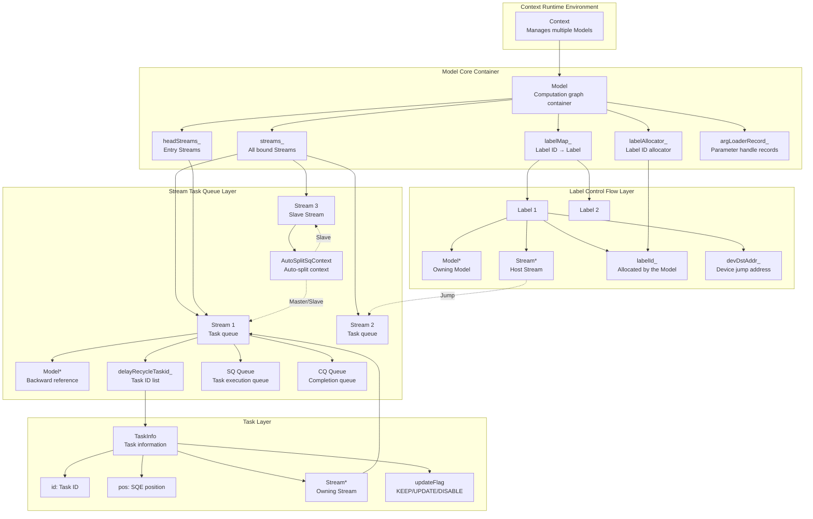

### 3.3 Model-Stream-Label Three-Layer Architecture Relationship

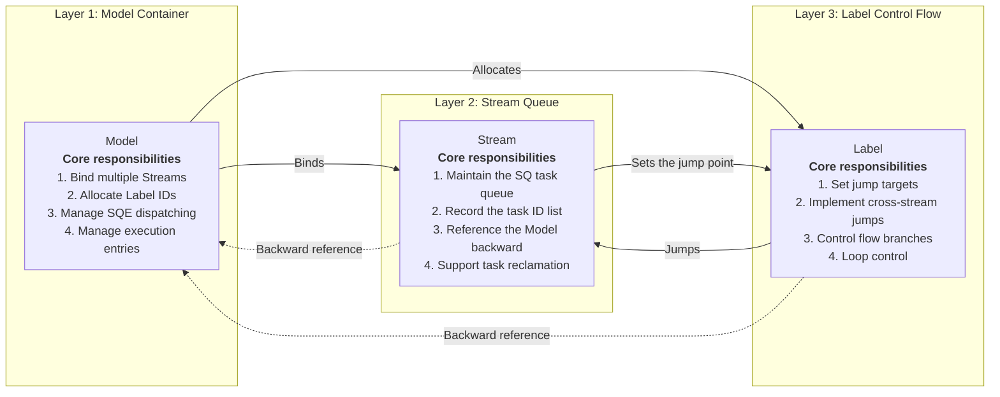

### 3.4 Interaction Diagrams of Core Modules (Including Hardware Interaction)

This section uses sequence diagrams to show the key differences between the AutoSplit and non-AutoSplit scenarios.

#### 3.4.1 Stream Binding Phase

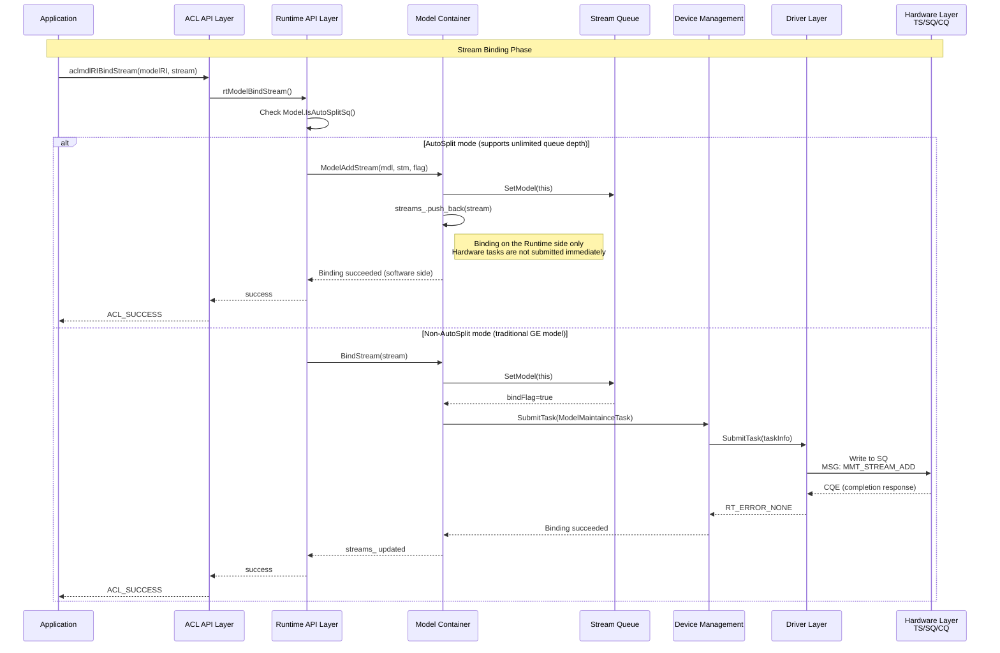

**Difference Description**:
| Comparison Item | AutoSplit Mode | Non-AutoSplit Mode |
|--------|----------------|-------------------|
| Binding timing | Software binding on the Runtime side only | Hardware binding tasks are submitted immediately |
| Hardware interaction | The hardware relationship is established at LoadComplete | SQ is written immediately at binding |
| Task queue | Host SQE buffer (expandable) | Fixed hardware SQ |

#### 3.4.2 Task Submission Phase

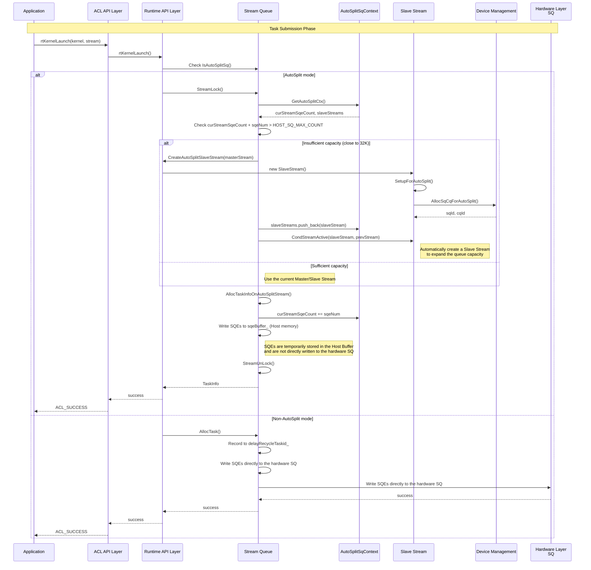

**Difference Description**:
| Comparison Item | AutoSplit Mode | Non-AutoSplit Mode |
|--------|----------------|-------------------|
| SQE storage location | Host sqeBuffer_ | Device SQ |
| Capacity limit | Unlimited (expanded by Slave Streams) | Fixed depth |
| Submission timing | Dispatched in batches at LoadComplete | Real-time submission |
| Slave Stream | Automatically created when tasks are close to 32K | Not supported |

#### 3.4.3 EndGraph Marking Phase

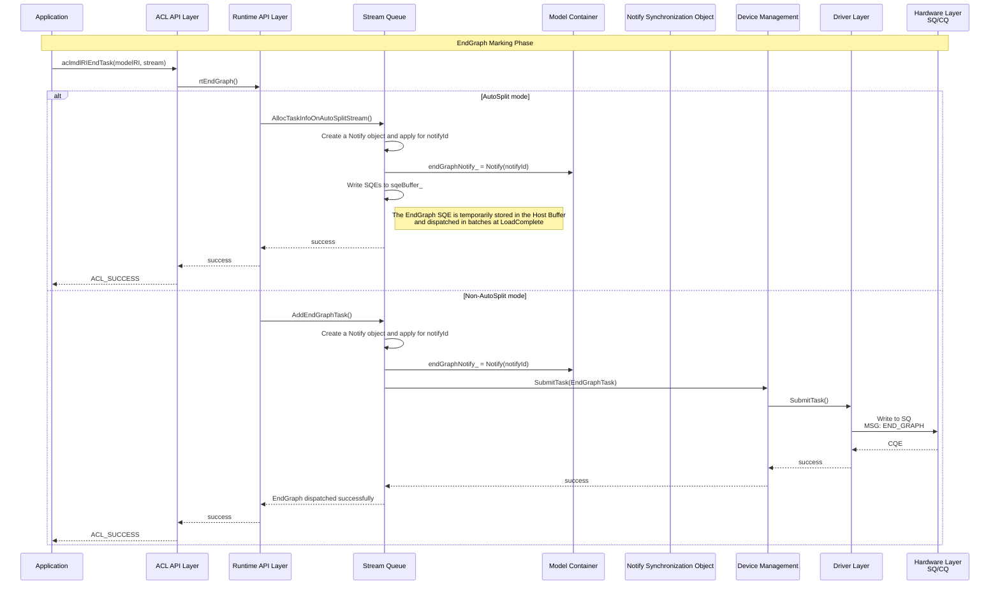

#### 3.4.4 LoadComplete Phase

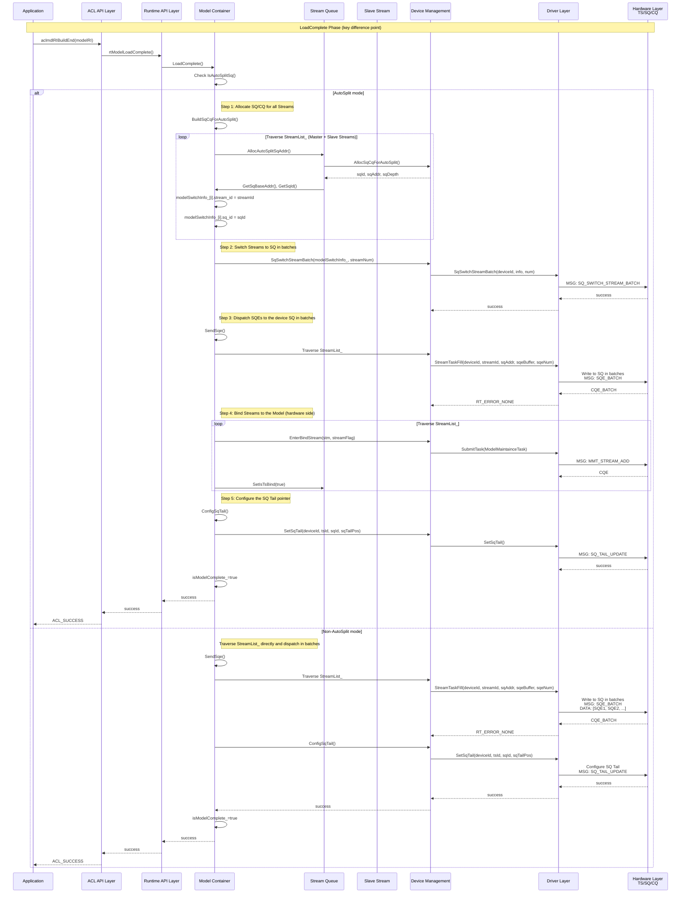

**Difference Description**:
| Comparison Item | AutoSplit Mode | Non-AutoSplit Mode |
|--------|----------------|-------------------|
| SQ/CQ allocation | Dynamically allocated at LoadComplete | Already allocated at Stream creation |
| Stream switching | Switched in batches by SqSwitchStreamBatch | No switching required |
| Hardware binding | The hardware relationship is established at LoadComplete | Already established at binding |
| Slave Stream | All Masters + Slaves need to be processed | Only bound Streams are processed |

#### 3.4.5 Model Execution Phase

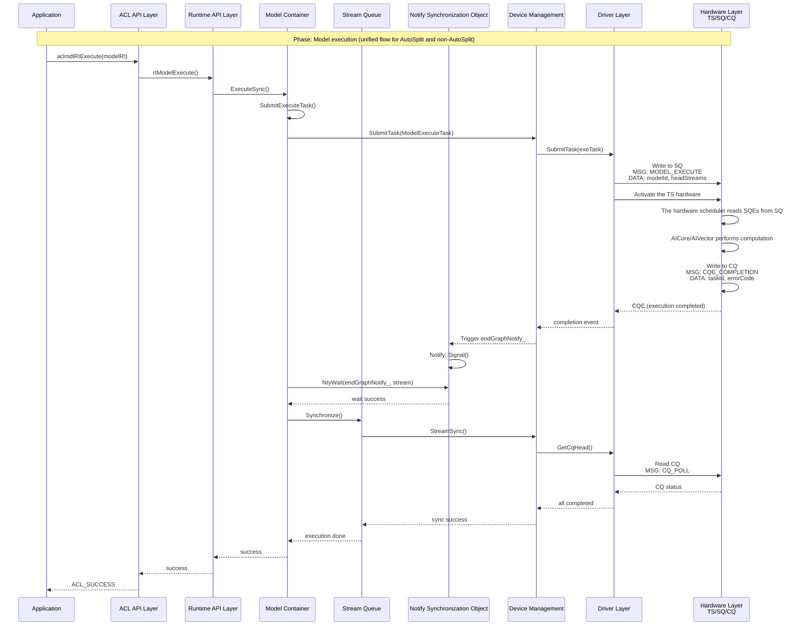

**Description**: In the model execution phase, the AutoSplit and non-AutoSplit flows are unified. The difference lies in the SQE source:
- AutoSplit: SQEs have been dispatched in batches from the Host Buffer to the device SQ at LoadComplete
- Non-AutoSplit: SQEs have been directly written to the device SQ at task submission

#### 3.4.6 Model Destruction Phase

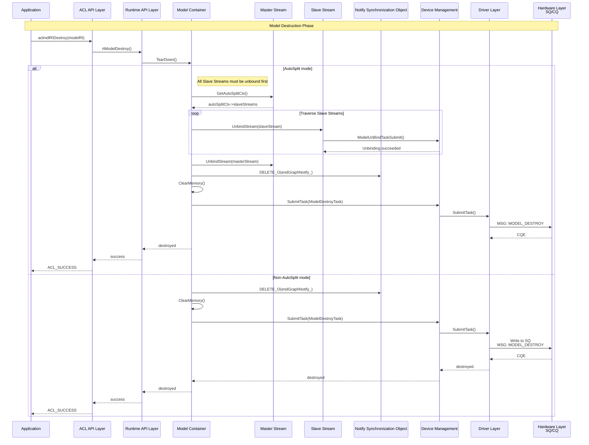

## 4. Detailed Design

### 4.1 Core Flows

#### Model Creation and Initialization Flow

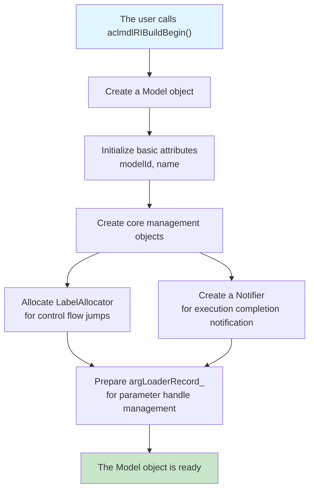

**Flow Description**:
1. The user initiates a model creation request through ACL APIs.
2. The Runtime creates the Model object and allocates a unique modelId.
3. The Runtime initializes the Label allocator to support subsequent branch jump control.
4. The Runtime creates the Notifier object for the notification mechanism after model execution completes.
5. The Runtime applies for device-side memory to store model metadata.
6. The Runtime prepares the parameter handle record table to manage task parameter memory.

#### Stream Binding Flow

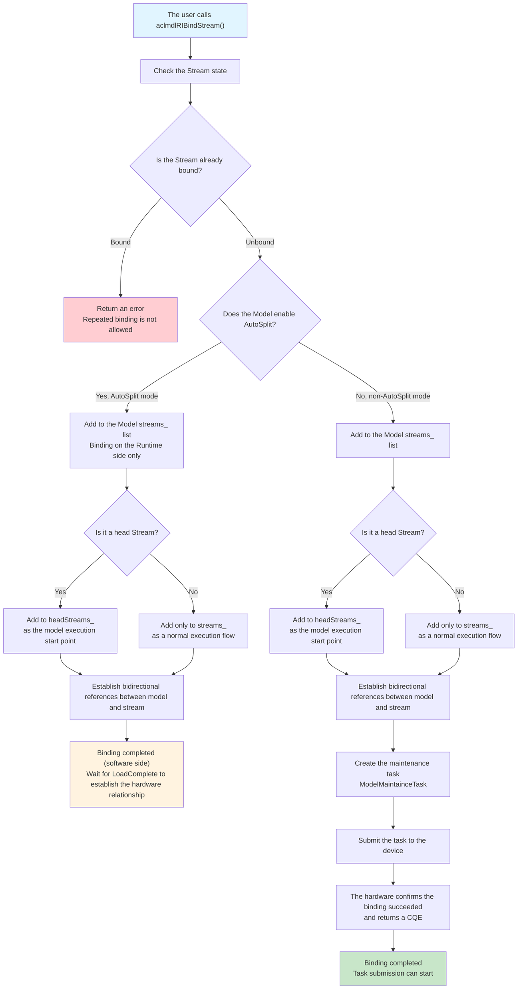

**Flow Description**:

| Step | AutoSplit Mode | Non-AutoSplit Mode |
|------|----------------|-------------------|
| 1 | The user requests binding a Stream to the Model | The user requests binding a Stream to the Model |
| 2 | Check the Stream state to prevent repeated binding | Check the Stream state to prevent repeated binding |
| 3 | Add to the streams_ list on the Runtime side only | Add to the streams_ list |
| 4 | Determine whether it is a head Stream | Determine whether it is a head Stream |
| 5 | Establish bidirectional references | Establish bidirectional references |
| 6 | **Hardware tasks are not submitted immediately** | Create the maintenance task and notify the hardware |
| 7 | **Wait for LoadComplete** | Submit the task to the device, and the hardware returns a CQE |
| 8 | Binding completed (software side) | Binding completed; task submission can start |

**Key Difference**: In AutoSplit mode, Stream binding only completes the software-side record, and hardware binding is deferred to the LoadComplete phase. This enables more flexible task queue management.

#### Task Submission Flow

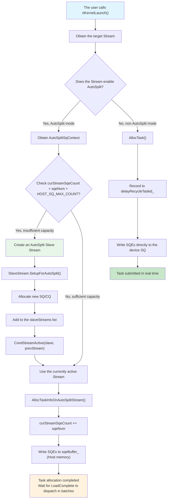

**Flow Description**:

| Comparison Item | AutoSplit Mode | Non-AutoSplit Mode |
|--------|----------------|-------------------|
| Capacity check | Check whether curStreamSqeCount is close to 32K | No capacity limit check |
| Slave creation | Automatically create Slave Streams to expand capacity | Not supported |
| SQE storage | Write to the Host sqeBuffer_ | Write directly to the device SQ |
| Submission timing | Dispatched in batches at LoadComplete | Real-time submission |

**Key Mechanisms**:
- `HOST_SQ_MAX_COUNT = 32K`: Maximum capacity of the Host SQE buffer
- `AutoSplitSqContext`: Maintains curStreamSqeCount and the slaveStreams list
- `Slave Stream`: Automatically created when the number of tasks is close to 32K, implementing unlimited queue depth

#### EndGraph Marking Flow

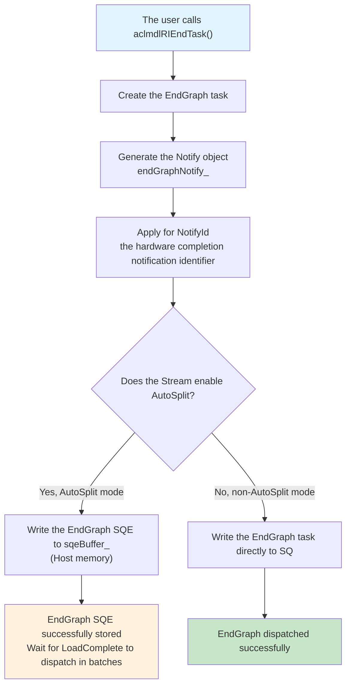

**Flow Description**:

| Step | AutoSplit Mode | Non-AutoSplit Mode |
|------|----------------|-------------------|
| 1 | The user marks the end of task dispatching | The user marks the end of task dispatching |
| 2 | Create the EndGraph task | Create the EndGraph task |
| 3 | Create the Notify object and apply for NotifyId | Create the Notify object and apply for NotifyId |
| 4 | **SQEs are written to the Host Buffer** | The EndGraph task is written to SQ |
| 5 | **Wait for LoadComplete to dispatch in batches** | Dispatched successfully immediately |
| 6 | The hardware triggers the Notify Signal during execution | The hardware triggers the Notify Signal during execution |

#### Model LoadComplete Flow

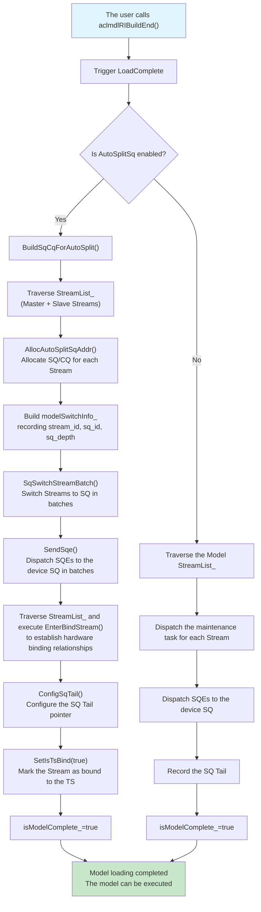

**Flow Description**:

| Step | AutoSplit Mode | Non-AutoSplit Mode |
|------|----------------|-------------------|
| 1 | BuildSqCqForAutoSplit() | Traverse StreamList_ directly |
| 2 | Allocate SQ/CQ for all Streams (including Slaves) | SQ/CQ was already allocated at creation |
| 3 | Build modelSwitchInfo_ | Not required |
| 4 | Switch in batches by SqSwitchStreamBatch | Not required |
| 5 | Dispatch SQEs in batches by SendSqe | Dispatch SQEs |
| 6 | **EnterBindStream establishes the hardware binding** | **The hardware binding is already established** |
| 7 | SQ Tail |Configure SQ Tail |
| 8 | SetIsTsBind(true) | Not required |
| 9 | isModelComplete_=true | isModelComplete_=true |

**Key Differences**: In AutoSplit mode, LoadComplete requires:
1. Dynamically allocating SQ/CQ resources
2. Switching Streams to SQ in batches
3. Establishing hardware binding relationships (EnterBindStream)
4. Marking Streams as bound to the TS (SetIsTsBind)

#### Model Execution Flow

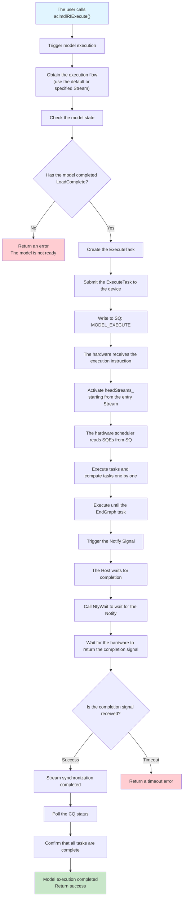

**Flow Description**:

| Step | Description | Difference Between AutoSplit and Non-AutoSplit |
|------|------|------------------------------|
| 1 | The user calls Execute to trigger model execution | None |
| 2 | Prepare the execution environment and obtain the execution Stream | None |
| 3 | Check the model state to ensure LoadComplete is complete | None |
| 4 | Create the ExecuteTask and set execution parameters | None |
| 5 | Submit the ExecuteTask to the device and write to SQ | None |
| 6 | The hardware TS receives the execution instruction and activates headStreams_ | None |
| 7 | **The TS reads SQEs from SQ** | **Difference in the SQE source** |
| 8 | AICore/AIVector executes computation tasks | None |
| 9 | Execute until the EndGraph task and trigger the Notify Signal | None |
| 10 | The Host waits for completion (NtyWait) | None |
| 11 | After the completion signal is received, poll the CQ status | None |
| 12 | Confirm that all tasks are complete and return success | None |

**SQE Source Difference Description**:
- **AutoSplit mode**: SQEs are dispatched in batches from the Host sqeBuffer_ to the device SQ during LoadComplete
  - Written to the Host Buffer at task submission (deferred submission)
  - All SQEs are dispatched in one batch at LoadComplete
  - Supports unlimited queue depth (expanded by Slave Streams)
  
- **Non-AutoSplit mode**: SQEs are directly written to the device SQ at task submission
  - Directly written to the device SQ at task submission (real-time submission)
  - Dispatched immediately when EndGraph is marked
  - Fixed queue depth

**Unified Execution Phase**: In either mode, all SQEs already reside in the device SQ at execution time. The hardware TS reads and executes them directly from SQ, so the flow is completely identical.

#### Label Control Flow Setting Flow

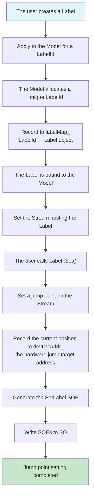

**Flow Description**:
1. The user creates a Label and applies to the Model for a unique LabelId.
2. The Model allocates the ID through LabelAllocator and records the mapping relationship.
3. The Label is bound to the Model and Stream.
4. The user calls Label::Set to set the jump target point on the Stream.
5. The current position is recorded to the device-side address (devDstAddr_).
6. The SetLabel SQE is generated and written to the Stream cache.
7. Jump point setting is complete, waiting for subsequent jumps.

#### Label Control Flow Jump Flow

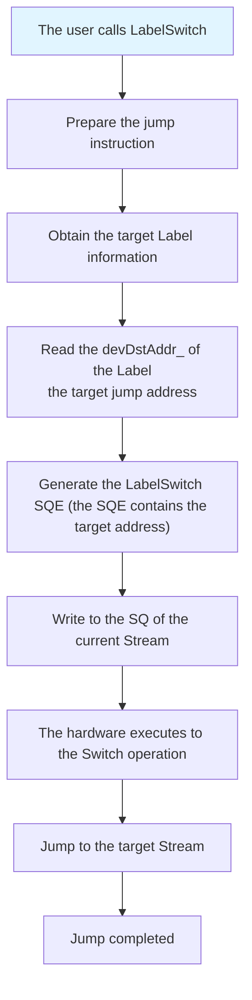

**Flow Description**:
1. The user calls the LabelSwitch API to initiate a jump instruction.
2. Obtain the device-side address of the target Label (devDstAddr_).
3. Generate the LabelSwitch SQE containing the target jump address.
4. Write it to the SQ of the current Stream.
5. The hardware TS executes to the Switch operation and jumps to the target position.

#### Model Destruction Flow

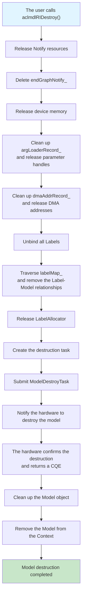

**Flow Description**:
1. The user calls Destroy to trigger model destruction.
2. Release Notify resources and delete endGraphNotify_.
3. Release device memory and clean up the parameter handle records.
4. Release the DMA address records.
5. Unbind all Labels and remove their relationships with the Model.
6. Release the LabelAllocator resources.
7. Create the destruction task and notify the hardware to destroy the model.
8. The hardware confirms the destruction and returns a CQE.
9. Clean up the Model object and remove it from the Context.
10. Model destruction is complete and all resources are released.

### 4.2 Details of Core Mechanisms

#### Model Container Management Mechanism

**Design Idea**: As the container of a computation graph, the Model manages all bound Streams and Labels in a unified manner, implementing batch task dispatching and execution entry control.

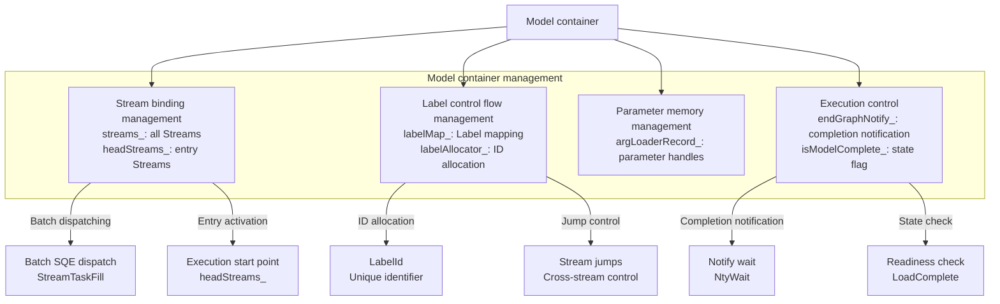

**Mechanism Description**:
- **Stream binding management**: Maintains the list of all Streams, with headStreams_ as the execution start point
- **Label control flow management**: Allocates Label IDs and manages jump relationships
- **Parameter memory management**: Records task parameter handles to avoid repeated allocation
- **Execution control**: The Notify mechanism implements asynchronous waiting, and state flags ensure the execution order

#### Stream Task Queue Mechanism

**Design Idea**: As the task queue, the Stream caches SQEs and supports task reclamation and automatic SQ splitting.

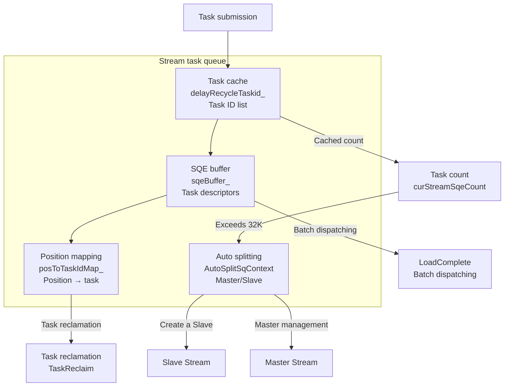

**Mechanism Description**:
- **Task cache**: delayRecycleTaskid_ records task IDs and waits for batch dispatching
- **SQE buffer**: sqeBuffer_ stores task descriptors, ready to be written to the hardware SQ
- **Position mapping**: posToTaskIdMap_ records the correspondence between SQE positions and tasks
- **Auto splitting**: When tasks exceed 32K, a Slave Stream is automatically created to expand capacity

#### Label Control Flow Jump Mechanism

**Design Idea**: The Label implements cross-Stream jumps and loop control, achieving hardware-level jumps through device-side addresses.

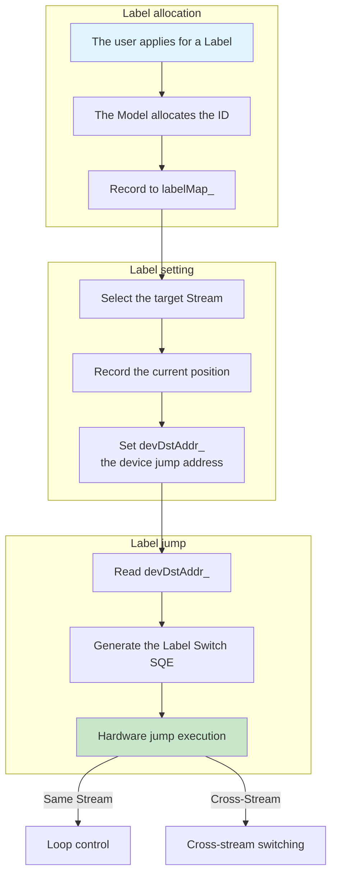

**Mechanism Description**:
- **Label allocation**: The Model allocates a unique ID through LabelAllocator
- **Label setting**: Records the jump position on the target Stream and sets the device-side address
- **Label jump**: Reads the device address, generates the jump SQE, and the hardware executes the jump
- **Control flow implementation**: Supports loops (same Stream) and cross-Stream task switching

#### Notify Completion Notification Mechanism

**Design Idea**: Notify implements hardware completion notification, and the Host obtains the execution result by waiting on the Notify.

```mermaid
sequenceDiagram
    participant Model as Model
    participant EndGraph as EndGraphTask
    participant Notify as endGraphNotify_
    participant Driver as Driver
    participant HW as Hardware TS
    
    %% EndGraph creates the Notify
    Model->>EndGraph: rtEndGraph(model, stream)
    EndGraph->>Notify: Create the Notify object
    Notify->>Driver: AllocNotifyId()
    Driver->>HW: Apply for notifyId
    HW-->>Driver: notifyId
    Driver-->>Notify: notifyId
    Notify-->>Model: endGraphNotify_
    
    %% Write the EndGraph task during execution
    Model->>EndGraph: Execute()
    EndGraph->>Driver: SubmitTask(EndGraphTask)
    Driver->>HW: SQE: END_GRAPH<br/>notifyId=notifyId_
    HW->>HW: Execute all preceding tasks
    HW->>HW: Execute the EndGraph task
    HW->>HW: Signal Notify<br/>notifyId ← value++
    
    %% The Host waits on the Notify
    Model->>Notify: NtyWait(endGraphNotify_, stream)
    Notify->>Driver: Notify::Wait()
    Driver->>HW: Poll Notify Value<br/>MSG: NOTIFY_POLL
    HW-->>Driver: notifyValue
    Driver-->>Notify: value matched
    Notify-->>Model: wait success
    Model->>Model: Execution completed
```

**Mechanism Description**:
- **Notify creation**: The EndGraph task applies for a NotifyId and binds it to the Model
- **Notify wait**: The Host polls the Notify value through NtyWait
- **Notify trigger**: When the hardware executes to the EndGraph, it signals the Notify and updates the value
- **Completion confirmation**: When the Host detects a value match, it confirms that execution is complete

### 4.3 Module Responsibility Division

The Model module is divided by function into sub-modules such as the core container, task management, API layer, and auxiliary tools. Each sub-module has clear responsibilities and collaborates to complete full lifecycle model management.

#### Core Container Modules

| Module Name | Core Responsibility | Code Location | Main Functions |
|----------|----------|----------|----------|
| **Model core class** | Computation graph container that manages Streams/Labels/Notifies in a unified manner | `src/runtime/core/inc/model/model.hpp`<br/>`src/runtime/feature/model/model.cc` | • Binds/unbinds Streams<br/>• Allocates/releases Labels<br/>• Executes models synchronously/asynchronously<br/>• Dispatches SQEs in batches<br/>• Manages argLoaderRecord |
| **Model C API** | External C-style API wrapper | `src/runtime/api/api_c_model.cc` | • rtModelCreate<br/>• rtModelDestroy<br/>• rtModelBindStream<br/>• rtModelExecute<br/>• rtEndGraph<br/>• rtModelLoadComplete |

#### Task Management Modules

| Task Type | Task Responsibility | Code Location | Trigger Timing |
|----------|----------|----------|----------|
| **ModelExecuteTask** | Triggers model execution and activates headStreams | `src/runtime/core/src/task/task_info/model/model_execute_task.cc`<br/>`src/runtime/core/src/task/task_info/model/model_execute_task_v100.cc`<br/>`src/runtime/core/src/task/task_info/model/model_execute_task_v200_base.cc` | When Execute/ExecuteAsync is called |
| **ModelMaintainceTask** | Maintains the relationship between Streams and the Model | `src/runtime/core/src/task/task_info/model/model_maintaince_task.cc`<br/>`src/runtime/core/src/task/task_info/model/model_maintaince_task_v100.cc`<br/>`src/runtime/core/src/task/task_info/model/model_maintaince_task_v200_base.cc` | BindStream/UnbindStream<br/>and at LoadComplete |
| **ModelGraphTask** | Marks EndGraph and creates the Notify | `src/runtime/core/src/task/task_info/model/model_graph_task.cc`<br/>`src/runtime/core/src/task/task_info/model/model_graph_task_v100.cc`<br/>`src/runtime/core/src/task/task_info/model/model_graph_task_v200_base.cc` | When rtEndGraph is called |

#### Auxiliary Tool Modules

| Tool Module | Auxiliary Responsibility | Code Location | Serves |
|----------|----------|----------|----------|
| **LabelAllocator** | Label ID allocator | `src/runtime/core/inc/launch/label.hpp` | Model Label management |
| **Notify** | Hardware completion notification object | `src/runtime/core/inc/notify/notify.hpp`<br/>`src/runtime/core/src/notify/notify.cc` | EndGraph Notify |

#### API Adaptation Layer

| Adaptation Layer | Adaptation Responsibility | Code Location | Serves |
|----------|----------|----------|----------|
| **ACL API wrapper** | ACL → RT API mapping | `src/acl/aclrt_impl/model_ri.cpp` | User calls to the aclmdlRI APIs |
| **API decorators** | API error handling decoration | `src/runtime/api/impl/api_decorator.cc`| ApiImpl call chain |


### 5 Key File Path Index

| Module Category | File Path | Core Content |
|----------|----------|----------|
| **Model header file** | `src/runtime/core/inc/model/model.hpp` | Model class definitions and data structures |
| **Model implementation** | `src/runtime/feature/model/model.cc` | Core Model implementation |
| **Model C API** | `src/runtime/feature/model/model_c.cc` | C-style API implementation |
| **Model Execute Task** | `src/runtime/core/src/task/task_info/model/model_execute_task.cc` | Execution task implementation |
| **Model Execute Task V100** | `src/runtime/core/src/task/task_info/model/model_execute_task_v100.cc` | V100 version adaptation |
| **Model Execute Task V200** | `src/runtime/core/src/task/task_info/model/model_execute_task_v200_base.cc` | V200 version adaptation |
| **Model Maintaince Task** | `src/runtime/core/src/task/task_info/model/model_maintaince_task.cc` | Maintenance task implementation |
| **ACL API header file** | `include/external/acl/acl_rt.h` | External ACL API definitions |
| **ACL API implementation** | `src/acl/aclrt_impl/model_ri.cpp` | ACL API implementation (aclmdlRI series) |
