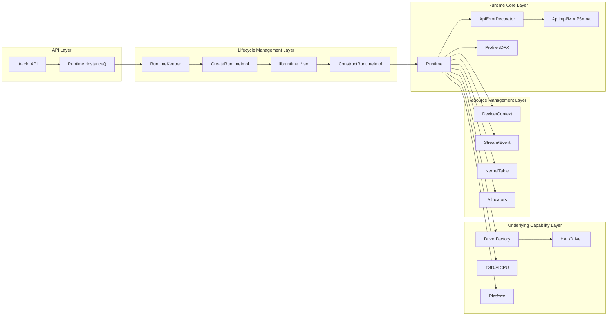
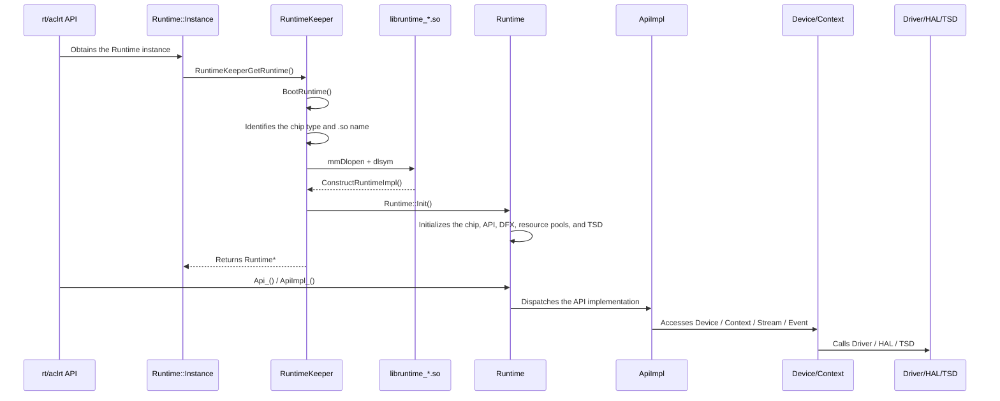
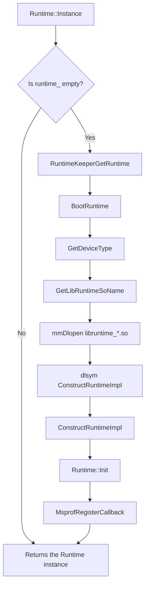
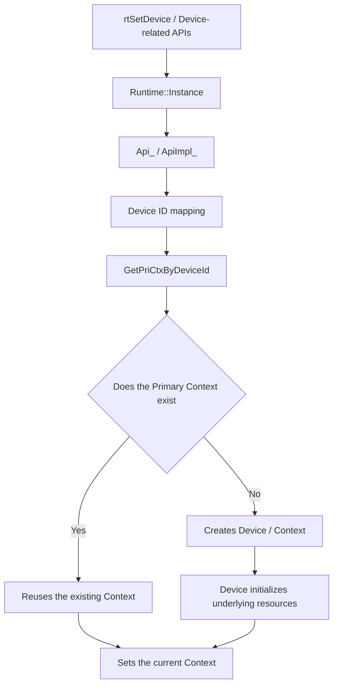
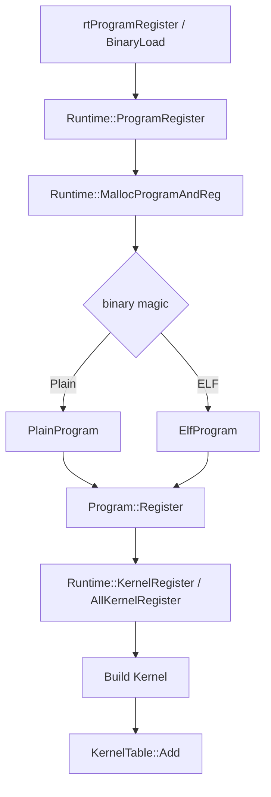

# Runtime Global Management Module Architecture

## 1. Module Overview

- **Description**: Runtime is the process-level global runtime instance inside the CANN Runtime component. It receives upper-layer Runtime API calls. It maintains global runtime states such as the device (Device), context (Context), stream (Stream), event (Event), program (Program), kernel (Kernel), Profiling, and error handling. It also completes Ascend NPU resource management and task execution through Driver, TSD, HAL, and platform capabilities.
- **Design Objectives**:
  - Provide the process-level unique Runtime access entry.
  - Aggregate the global states, resource tables, and underlying capability entries required by the Runtime API.
  - Shield differences in underlying capabilities across different chips, SoCs, and running modes.
  - Manage the lifecycle of core resources such as Device, Context, Program, and Kernel.
  - Maintain a unified dispatch link from the Runtime API to internal implementation modules.
  - Support DFX capabilities such as Profiling, error callbacks, Task Abort callbacks, and RAS reporting.

Runtime does not correspond to a single Device or a single Context. Instead, it is the unified scheduling center inside the Runtime component. Internal Runtime modules obtain the global Runtime instance of the current process through `Runtime::Instance()` and use this instance to access the API implementation, device resources, contexts, the Kernel registry, Profiling states, and global feature configurations.

This document focuses on the functions and design of the `Runtime` class itself. Objects such as `RuntimeKeeper`, plugin .so files, Driver, and TSD are described only as Runtime construction, initialization, and runtime dependencies. The Runtime class itself is the global state carrier, the API dispatch center, and the resource coordination entry.

## 2. Usage Scenarios and External APIs

### 2.1 Usage Scenarios

- **Scenario 1: Accessing the Runtime instance for the first time**

  ```cpp
  Runtime *rt = Runtime::Instance();
  // RuntimeKeeper creates the Runtime instance on the first access and calls Runtime::Init().
  ```

- **Scenario 2: Runtime API accessing the internal implementation**

  ```cpp
  Api *api = Runtime::Instance()->Api_();
  // External rt/aclrt APIs enter the specific implementation through ApiErrorDecorator and ApiImpl.
  ```

- **Scenario 3: Obtaining the current Context or primary Context**

  ```cpp
  Context *ctx = Runtime::Instance()->CurrentContext();
  Context *priCtx = Runtime::Instance()->GetPriCtxByDeviceId(deviceId, tsId);
  ```

- **Scenario 4: Program and Kernel registration**

  ```cpp
  Program *prog = nullptr;
  Runtime::Instance()->ProgramRegister(&bin, &prog);
  Runtime::Instance()->KernelRegister(prog, stubFunc, stubName, kernelInfoExt);
  const Kernel *kernel = Runtime::Instance()->KernelLookup(stubFunc);
  ```

- **Scenario 5: Profiling and error callback management**

  ```cpp
  Runtime::Instance()->ProfilerStart(profConfig, numsDev, deviceList, cacheFlag);
  Runtime::Instance()->SetExceptCallback(callback);
  ```

### 2.2 External APIs

Runtime itself is an internal C++ global management class. External APIs are usually provided by rt/aclrt C APIs and then enter the Runtime internal implementation through `Runtime::Instance()`. The main API relationships are as follows:

| API/Entry | File Location | Description |
|----------|----------|------|
| `Runtime::Instance()` | `src/runtime/core/inc/runtime.hpp` | Obtains the process-level Runtime singleton, and triggers the RuntimeKeeper startup flow on the first access |
| `RuntimeKeeperGetRuntime()` | `src/runtime/core/src/plugin_manage/runtime_keeper.cc` | Lazy-loading entry of the Runtime singleton |
| `RuntimeKeeper::BootRuntime()` | `src/runtime/core/src/plugin_manage/runtime_keeper.cc` | Creates Runtime, calls `Runtime::Init()`, and registers the Profiling callback |
| `Runtime::Init()` | `src/runtime/core/src/runtime.cc` | Core Runtime initialization flow |
| `Runtime::Api_()` | `src/runtime/core/inc/runtime.hpp` | Returns the API facade with error handling decoration capability |
| `Runtime::ApiImpl_()` | `src/runtime/core/inc/runtime.hpp` | Returns the underlying API implementation object |
| `Runtime::CurrentContext()` | `src/runtime/core/src/runtime.cc` | Obtains the Runtime Context of the current thread |
| `Runtime::GetPriCtxByDeviceId()` | `src/runtime/core/src/runtime.cc` | Obtains the primary context in the device dimension |
| `Runtime::ProgramRegister()` | `src/runtime/core/src/runtime.cc` | Registers a Runtime Program |
| `Runtime::KernelRegister()` | `src/runtime/core/src/runtime.cc` | Registers a Kernel to the Runtime KernelTable |
| `Runtime::KernelLookup()` | `src/runtime/core/src/runtime.cc` | Queries a Kernel by stub function |
| `Runtime::ProfilerStart()` / `Runtime::ProfilerStop()` | `src/runtime/core/src/runtime.cc` | Manages Runtime Profiling |

## 3. Architecture Overview

### 3.1 Overall Design Concept

The Runtime class adopts the design of "process-level singleton + global state aggregation + API facade + resource coordination + platform capability adaptation". `RuntimeKeeper` is responsible only for lifecycle actions before and after Runtime instance creation. After the Runtime instance is created, the Runtime class itself carries most of the runtime capabilities.

The overall link is as follows:

1. The upper-layer Runtime API calls internal Runtime capabilities.
2. Internal modules obtain the global Runtime instance through `Runtime::Instance()`.
3. On the first access, `Runtime::Instance()` calls `RuntimeKeeperGetRuntime()`.
4. `RuntimeKeeper` identifies the chip type, selects the corresponding `libruntime_*.so`, and completes Runtime instance construction.
5. `Runtime::Init()` initializes the global runtime environment such as chip capabilities, the API implementation, DFX, resource pools, and TSD.
6. Subsequent API calls complete specific operations through objects held by Runtime, such as Api, Device, Context, KernelTable, Driver, and TSD.

### Architecture Layering Diagram



### 3.2 Core Module Interaction Diagram



## 4. Detailed Design

### 4.1 Core Workflows

#### Initialization Workflow

Runtime initialization contains two layers: the startup flow of `RuntimeKeeper` and the internal initialization flow of `Runtime::Init()`.



`Runtime::Init()` mainly completes the following steps internally:

1. **Feature and Atrace initialization**: Initializes the TS version feature mapping and Atrace information.
2. **Chip and SoC initialization**: Calls `InitChipTypeAndSocVersion()` to obtain the chip type, SoC version, number of TSs, number of AICPUs, and chip properties.
3. **Device visibility initialization**: Reads the visible devices configuration and establishes the mapping between user device IDs and Runtime device IDs.
4. **API implementation initialization**: Creates `ApiImpl`, `ApiImplMbuf`, and `ApiImplSoma`.
5. **Log and DFX initialization**: Creates `Logger`, `Profiler`, and `ApiErrorDecorator`.
6. **Thread and execution observer initialization**: Creates `ThreadGuard` and `EngineStreamObserver`.
7. **AICPU Stream ID management initialization**: Creates the AICPU Stream ID bitmap.
8. **Callback subscribe initialization**: Creates the callback subscribe management object.
9. **Program/Label resource pool initialization**: Creates the Program allocator and Label allocator.
10. **Runtime version setting**: Sets the Runtime API version through HAL.
11. **TSD initialization**: Loads the TSD client and saves TSD-related function pointers.
12. **Task function registration**: Registers Runtime task handler functions.
13. **Execution mode configuration**: Initializes the stream sync mode, dcache lock auxiliary resources, and so on.

Key code locations:

```cpp
// src/runtime/core/src/runtime.cc
rtError_t Runtime::Init();

// src/runtime/core/src/plugin_manage/runtime_keeper.cc
Runtime *RuntimeKeeper::BootRuntime();
```

#### Device Acquisition Workflow

Runtime itself does not represent a specific device. Instead, it maintains the global access entry for devices and Contexts. Device-related APIs usually enter Runtime through `ApiImpl` and then access Device/Context.



Core relationships between devices and Contexts:

- Runtime maintains the primary context.
- Contexts are organized by device ID and TS ID.
- Device carries device-side resources.
- Stream, Event, and Notify usually attach to the current Context and Device.

### 4.2 Detailed Description of Core Mechanisms

#### Function Model of the Runtime Class

The Runtime class itself is the core carrier of runtime capabilities. Its functions can be summarized into six groups:

| Function Group | Responsibilities of the Runtime Class | Representative Members/APIs |
|--------|----------------------|---------------|
| API facade | Saves the API implementation object and decoration object, and provides the internal dispatch entry for rt/aclrt APIs | `Api_()`, `ApiImpl_()`, `api_`, `apiImpl_`, `apiError_` |
| Platform capability state | Saves the chip type, SoC version, number of TSs, chip properties, and visible device mapping | `chipType_`, `socVersion_`, `tsNum_`, `curChipProperties_`, `propertiesMap_` |
| Resource management | Maintains core resource entries such as Device, Context, Program, Kernel, and Label | `priCtxs_`, `programAllocator_`, `kernelTable_`, `labelAllocator_` |
| Execution coordination | Provides global execution configurations and shared objects for Stream, Event, Task, and Kernel Launch | `streamObserver_`, `cbSubscribe_`, `aicpuStreamIdBitmap_`, timeout configuration |
| Underlying capability access | Holds Driver, HAL, TSD, and AICPU related entries, and shields underlying differences for upper layers | `driverFactory_`, `facadeDriver_`, `tsdClientHandle_`, `tsdOpen_` |
| DFX capability | Manages diagnostic capabilities such as Profiling, exception callbacks, Task Abort, Snapshot, and RAS in a unified manner | `profiler_`, `excptCallBack_`, callback management object, RAS related states |

From the design perspective, the Runtime class is not a simple singleton wrapper. It is the "runtime context object" inside the Runtime component. It centralizes chip capabilities, the API implementation, resource tables, underlying driver entries, and DFX states in one process-level object. This ensures that all API calls see a consistent device view, context states, and capability configurations.

#### Singleton Pattern

The Runtime singleton is stored in `Runtime::runtime_` and accessed through `Runtime::Instance()`. On the first access, `Runtime::Instance()` calls `RuntimeKeeperGetRuntime()`, and the static global object `g_runtimeKeeper` completes the actual creation.

```cpp
static Runtime *Instance()
{
#if RUNTIME_API || STATIC_RT_LIB
    if (runtime_ == nullptr) {
        runtime_ = RuntimeKeeperGetRuntime();
    }
#endif
    return runtime_;
}
```

Singleton creation is not a simple `new Runtime()`. Instead, `RuntimeKeeper` manages it in a unified manner:

- `RuntimeKeeper` controls the startup state.
- In non-static linking scenarios, `libruntime_*.so` is dynamically loaded based on the chip type.
- The plugin library exports `ConstructRuntimeImpl()` to create the real Runtime instance.
- The plugin library exports `DestructorRuntimeImpl()` to destroy the Runtime instance.

#### Reference Count Management

Runtime manages multiple types of objects with lifecycles, including Context, Program, Kernel, and Device. Different objects are referenced in different ways:

- Program is managed through `ObjAllocator<RefObject<Program *>>`.
- Primary Context is managed through `RefObject<Context *>`.
- Kernel is linked with the Program lifecycle through `KernelTable`.
- Device/Context is released in a coordinated manner during the set device, retain/release, and destruction flows.

##### Core Reference Count Class

Reference relationships of Program and Context in Runtime mainly rely on `RefObject`:

```cpp
RefObject<Context *> priCtxs_[RT_MAX_DEV_NUM][RT_MAX_TS_NUM];
ObjAllocator<RefObject<Program *>> *programAllocator_;
```

`RefObject` stores object pointers and reference states, and supports operations such as increasing references, decreasing references, and resetting objects. Runtime uses it to prevent Program or Context from being released early while still in use.

##### Device Reference Count Management Timing

The Device lifecycle is usually driven by device enabling, context creation, device release, and Runtime destruction. Runtime is responsible for the following in device-related flows:

- Converts user device IDs to internal Runtime device IDs.
- Obtains or creates the primary context of the corresponding device.
- Initializes underlying resources through Device.
- Cleans up remaining device and context resources during Runtime destruction.

##### Context Reference Count Management Timing

Primary Context is the key object for Runtime to manage device contexts. Runtime stores primary contexts in the device and TS dimensions and maintains their reference relationships during acquisition, release, and destruction.

Key points of Context management:

- The current thread obtains the current Context through `Runtime::CurrentContext()`.
- In the device dimension, the primary context is obtained through `Runtime::GetPriCtxByDeviceId()`.
- During Runtime destruction, Runtime traverses the primary context table, executes `TearDown()` on Contexts no longer used externally, and releases them.

##### Device and Context Reference Count Coordination Mechanism

The relationship between Device and Context can be summarized as follows:

```text
Runtime
    -> Primary Context Table
        -> Context
            -> Device
                -> RawDevice / Driver
                -> Stream / Event / Notify
```

Context represents the context environment where Runtime APIs are executed, and Device carries actual device resources. Device switching, context creation, Stream/Event creation, and task dispatch all rely on the consistency between the current Context and Device.

##### Reference Count Management in Multi-Thread Scenarios

Runtime uses a global singleton to receive multi-thread API calls, and maintains state consistency in multi-thread scenarios through the following mechanisms:

- `RuntimeKeeper::bootStage_` ensures that the Runtime startup phase is executed only once.
- `ThreadGuard` manages thread-related protection logic.
- Objects such as `ThreadLocalContainer` and `InnerThreadLocal` store thread-local runtime states.
- Resources such as Context and Program protect their lifecycles through reference objects and locks.

The startup states of RuntimeKeeper include:

| State | Meaning |
|------|------|
| `BOOT_INIT` | Not started yet, or returns to the initial state after a startup failure |
| `BOOT_ON` | Runtime is starting |
| `BOOT_DONE` | Runtime has started successfully |

#### Kernel Registration and Lookup

Runtime maintains the global registration relationships of Program and Kernel. They are used to look up Kernel metadata by stub function, kernel name, or tiling key before Kernel Launch.

##### Kernel Registration Workflow



Runtime is responsible for the following during registration:

- Determines the Program type by binary magic.
- Determines Kernel attributes by chip capabilities.
- Creates and registers `PlainProgram` or `ElfProgram`.
- Constructs Kernel objects.
- Establishes lookup relationships among stub functions, kernel names, tiling keys, and Kernel objects.
- Maintains the Program reference count and lifecycle.

##### Kernel Lookup Workflow

Kernel lookup is mainly completed through the `KernelTable` held by Runtime:

```cpp
const Kernel *Runtime::KernelLookup(const void * const stub)
{
    return kernelTable_.Lookup(stub);
}

const void *Runtime::StubFuncLookup(const char_t * const name)
{
    return kernelTable_.InvLookup(name);
}
```

Typical lookup path:

```text
Kernel Launch API
    -> Runtime::Instance()
    -> KernelLookup(stubFunc)
    -> KernelTable
    -> Kernel metadata
    -> Device/Stream task dispatch
```

### 4.3 Module Responsibility Division

| Module | Responsibility |
|------|------|
| `RuntimeKeeper` | Manages the Runtime instance lifecycle, chip plugin loading, and Runtime construction and destruction |
| `Runtime` | Process-level global runtime instance that serves as the API facade, resource management center, platform capability state center, execution coordination center, and DFX management entry |
| `RuntimeIntf` | Runtime abstract API that defines the Runtime capabilities required by API calls |
| `ApiErrorDecorator` | Decoration layer for API error handling, parameter checks, and general log reporting |
| `ApiImpl` | Main internal implementation of the Runtime API |
| `Device` | Object that carries device-side resources |
| `Context` | Runtime context object that carries the current device and execution environment |
| `Stream/Event/Notify` | Asynchronous task, synchronization, notification, and event management |
| `Program/Kernel` | Binary, Kernel metadata, and registration lookup relationships |
| `DriverFactory/FacadeDriver` | Underlying Driver access entry |
| `TSD/AICPU` | AICPU scheduler, TSD connection, queue, and FlowGw management |
| `Profiler/DFX` | Diagnostic capabilities such as Profiling, error callbacks, RAS, Task Abort, and Snapshot |

### 4.4 Core Data Structures

| Data Structure/Member | Description |
|---------------|------|
| `Runtime::runtime_` | Global Runtime instance pointer |
| `RuntimeKeeper g_runtimeKeeper` | Static global object that manages the Runtime lifecycle |
| `RuntimeKeeper::bootStage_` | Runtime startup phase state |
| `RuntimeKeeper::soHandle_` | Handle of the dynamically loaded Runtime plugin library |
| `api_` | API facade, usually points to `ApiErrorDecorator` |
| `apiImpl_` | Main API implementation object |
| `apiImplMbuf_` | Mbuf API implementation object |
| `apiImplSoma_` | Soma API implementation object |
| `profiler_` | Runtime Profiling object |
| `threadGuard_` | Thread protection object |
| `streamObserver_` | Stream observer |
| `cbSubscribe_` | Callback subscribe management object |
| `aicpuStreamIdBitmap_` | AICPU Stream ID allocation bitmap |
| `programAllocator_` | Global Program allocator |
| `kernelTable_` | Global Kernel lookup table |
| `labelAllocator_` | Label allocator |
| `priCtxs_` | Primary context table |
| `chipType_` | Current chip type |
| `socVersion_` | Current SoC version |
| `tsNum_` | Current number of TSs |
| `curChipProperties_` | Current chip properties |
| `propertiesMap_` | Full chip property table |
| `driverFactory_` | Driver factory |
| `facadeDriver_` | Driver facade |
| `tsdClientHandle_` | Handle of the TSD client dynamic library |
| `tsdOpen_ / tsdClose_` | TSD open/close function pointers |

## 5. Key File Index

| File | Description |
|------|------|
| `src/runtime/core/inc/runtime.hpp` | Runtime class declaration that defines the Runtime global entry and core members |
| `src/runtime/core/inc/runtime_intf.hpp` | Runtime abstract API that declares the Runtime capabilities required by API calls |
| `src/runtime/core/src/runtime.cc` | Core implementations such as Runtime construction, initialization, chip capabilities, Program/Kernel, and Profiling |
| `src/runtime/core/src/plugin_manage/runtime_keeper.h` | RuntimeKeeper class declaration |
| `src/runtime/core/src/plugin_manage/runtime_keeper.cc` | RuntimeKeeper lifecycle management, chip identification, plugin loading, and Runtime startup and destruction |
| `src/runtime/core/src/plugin_manage/v100/plugin_old_arch.cc` | v100 plugin construction and destruction entries |
| `src/runtime/core/src/plugin_manage/v200/plugin_old_arch.cc` | v200 plugin construction and destruction entries |
| `src/runtime/core/src/runtime_v100/runtime_adapt.cc` | v100 platform Runtime destruction and adaptation logic |
| `src/runtime/core/src/runtime_v200/runtime_adapt.cc` | v200 platform Runtime destruction and adaptation logic |
| `src/runtime/api/impl/api_impl.cc` | Main internal implementation of the Runtime API, widely calls `Runtime::Instance()` |
| `src/runtime/core/src/device/device.cc` | Device management logic |
| `src/runtime/core/src/event/event.cc` | Event management logic |
| `src/runtime/core/src/launch/` | Launch implementations of various task types |
