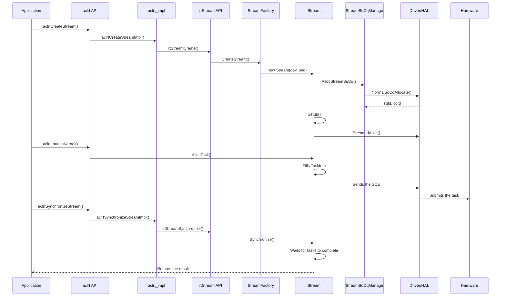
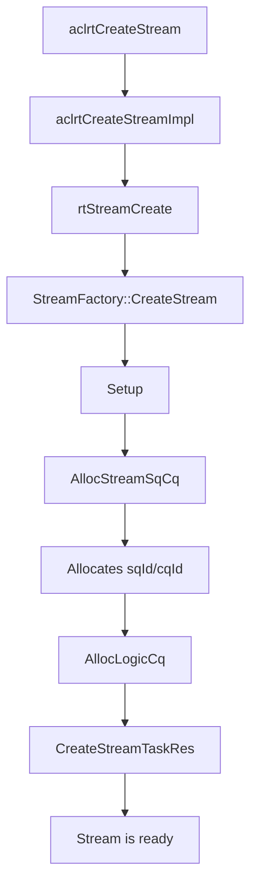
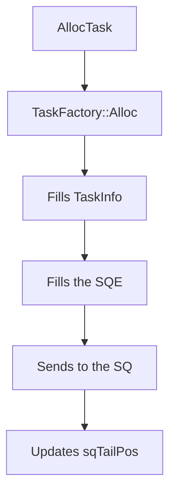
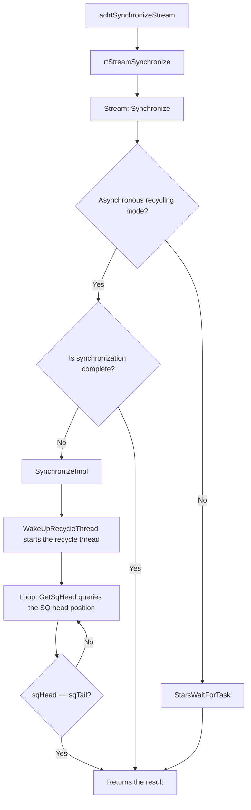
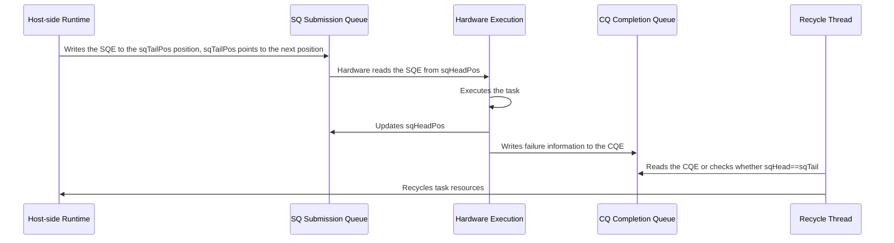
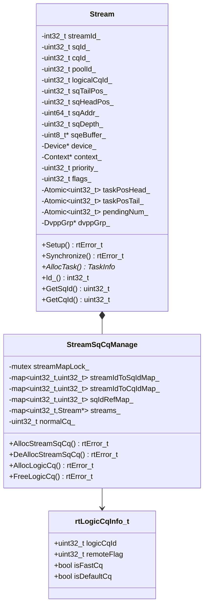

# Stream Module Architecture

## 1. Module Overview

- **Description**: The Stream module manages task queues and implements asynchronous execution and synchronization mechanisms. It interacts with hardware through the SQ (Submission Queue) and CQ (Completion Queue) mechanisms.
- **Design Objectives**:
  - Provide an efficient asynchronous task execution mechanism
  - Implement task queue management and synchronization mechanisms
  - Support SQ/CQ resource management and reuse

## 2. Usage Scenarios and External APIs

### 2.1 Usage Scenarios

- **Scenario 1**: Create a stream and submit tasks
  ```cpp
  aclrtStream stream;
  aclrtCreateStream(&stream);  // Creates the stream.
  aclrtLaunchKernel(stream, ...);  // Submits the kernel task.
  aclrtSynchronizeStream(stream);  // Waits for completion.
  ```

- **Scenario 2**: Execute tasks in parallel on multiple streams
  ```cpp
  aclrtStream stream1, stream2;
  aclrtCreateStream(&stream1);
  aclrtCreateStream(&stream2);
  // Executes tasks in parallel on different streams.
  aclrtLaunchKernel(stream1, kernel1, ...);
  aclrtLaunchKernel(stream2, kernel2, ...);
  ```

- **Scenario 3**: Create a stream with configuration
  ```cpp
  aclrtStream stream;
  aclrtCreateStreamWithConfig(&stream, 0, ACL_STREAM_FAST_SYNC);  // Creates a fast synchronization stream.
  ```

### 2.2 External APIs

#### Core APIs

| API | Description |
|------|------|
| `aclrtCreateStream()` | Creates a stream |
| `aclrtCreateStreamWithConfig()` | Creates a stream with a priority and flags |
| `aclrtDestroyStream()` | Destroys a stream |
| `aclrtDestroyStreamForce()` | Forcibly destroys a stream |
| `aclrtSynchronizeStream()` | Synchronizes a stream |
| `aclrtStreamQuery()` | Queries the stream status |

#### Extended APIs

| API | Description |
|------|------|
| `aclrtSynchronizeStreamWithTimeout()` | Synchronizes a stream with a timeout |
| `aclrtStreamGetPriority()` | Obtains the stream priority |
| `aclrtStreamGetFlags()` | Obtains the stream flags |
| `aclrtStreamAbort()` | Aborts stream execution |
| `aclrtStreamGetId()` | Obtains the stream ID |
| `aclrtGetStreamAvailableNum()` | Obtains the number of available streams |

#### Stream Attribute APIs

| API | Description |
|------|------|
| `aclrtSetStreamAttribute()` | Sets stream attributes |
| `aclrtGetStreamAttribute()` | Obtains stream attributes |
| `aclrtSetStreamFailureMode()` | Sets the stream failure mode |
| `aclrtSetStreamOverflowSwitch()` | Sets the stream overflow switch |
| `aclrtGetStreamOverflowSwitch()` | Obtains the stream overflow switch |

#### Stream Control APIs

| API | Description |
|------|------|
| `aclrtActiveStream()` | Activates a stream |
| `aclrtSwitchStream()` | Switches streams |
| `aclrtStreamStop()` | Stops a stream |
| `aclrtPersistentTaskClean()` | Cleans up persistent tasks |

#### Stream Configuration APIs

| API | Description |
|------|------|
| `aclrtCreateStreamConfigHandle()` | Creates a stream configuration handle |
| `aclrtDestroyStreamConfigHandle()` | Destroys a stream configuration handle |
| `aclrtSetStreamConfigOpt()` | Sets stream configuration options |
| `aclrtCreateStreamV2()` | Creates a stream with configuration |

## 3. Architecture Overview

### Overall Design Concept

Stream implements task execution through the SQ/CQ asynchronous mechanism: tasks are submitted to hardware through the SQ, and hardware returns results through the CQ after execution. Stream maintains the task queue (taskPosHead/taskPosTail) and supports task allocation, recycling, and synchronization. Stream inherits from the NoCopy base class to prevent copying.

### Core Module Interaction Diagram



## 4. Detailed Design

### 4.1 Core Workflows

#### Stream Creation Workflow



**Key code**:

```cpp
// File location: src/acl/aclrt_impl/stream.cpp:33-50
aclError aclrtCreateStreamImpl(aclrtStream *stream) {
    rtStream_t rtStream = nullptr;
    const rtError_t rtErr = rtStreamCreate(&rtStream, 
        static_cast<int32_t>(RT_STREAM_PRIORITY_DEFAULT));
    if (rtErr != RT_ERROR_NONE) {
        return ACL_GET_ERRCODE_RTS(rtErr);
    }
    *stream = static_cast<aclrtStream>(rtStream);
    return ACL_SUCCESS;
}

// File location: src/runtime/core/src/stream/stream.cc:606-788
rtError_t Stream::Setup() {
    // Sets the SQ depth.
    const uint32_t rtsqDepth = 
        (((flags_ & RT_STREAM_HUGE) != 0U) && 
         (device_->GetDevProperties().maxTaskNumPerHugeStream != 0)) ?
            device_->GetDevProperties().maxTaskNumPerHugeStream :
            device_->GetDevProperties().rtsqDepth;
    SetSqDepth(rtsqDepth);

    // Allocates the streamId.
    error = device_->Driver_()->StreamIdAlloc(&streamId_, device_->Id_(), 
                                               device_->DevGetTsId(), priority_);
    
    // Allocates the SQ/CQ.
    error = stmSqCqManage->AllocStreamSqCq(this, priority_, 0U, tmpSqId, tmpCqId);
    sqId_ = tmpSqId;
    cqId_ = tmpCqId;

    // Allocates the logical CQ.
    error = AllocLogicCq(isDisableThread, starsFlag, stmSqCqManage);
    
    // Creates the task resources.
    CreateStreamTaskRes();
    error = CreateStreamArgRes();
    
    return RT_ERROR_NONE;
}
```

#### Task Submission Workflow



**Key code**:

```cpp
// 1. Task allocation
// File location: src/runtime/core/src/stream/stream.cc:4937-4956
TaskInfo* Stream::AllocTask(
    TaskInfo* pTask, tsTaskType_t taskType, rtError_t& errorReason, uint32_t sqeNum,
    UpdateTaskFlag flag) {
    // TaskGroup update path
    if (IsTaskGroupUpdate() && flag != UpdateTaskFlag::NOT_SUPPORT_AND_SKIP) {
        return HandleTaskGroupUpdate(taskType, flag, errorReason);
    }
    // AutoSplit path
    if (IsAutoSplitSq()) {
        TaskInfo* task = nullptr;
        errorReason = AllocAutoSplitTaskInfo(&task, this, sqeNum);
        return task;
    }
    // Capture path
    if (GetCaptureStatus() != RT_STREAM_CAPTURE_STATUS_NONE) {
        return AllocCaptureTask(taskType, sqeNum, pTask, errorReason);
    }
    // Non-capture path
    return AllocNonCaptureTask(this, pTask, taskType, errorReason, sqeNum);
}

// 2. Fills TaskInfo (AICore task as an example)
// File location: src/runtime/core/src/task/task_info.hpp
TaskInfo* taskInfo = stream->AllocTask(nullptr, TS_TASK_TYPE_KERNEL_AICORE, error, 1U);
taskInfo->type = TS_TASK_TYPE_KERNEL_AICORE;
taskInfo->typeName = "AICoreKernel";
taskInfo->stream = stream;
taskInfo->sqeNum = 1;
// Fills the AICore kernel parameters.
taskInfo->u.aicoreKernel.kernel = kernel;         // Kernel object
taskInfo->u.aicoreKernel.args = args;             // Parameter address
taskInfo->u.aicoreKernel.blockDim = blockDim;     // Block dimension
taskInfo->u.aicoreKernel.smDesc = smDesc;         // Shared memory description

// 3. Fills the SQE
// File location: src/runtime/core/src/task/task_submit/v200/task_david.cc:497-589
rtError_t DavidSendTask(TaskInfo *taskInfo, Stream *stm) {
    const uint16_t pos = taskInfo->id;
    uint64_t sqBaseAddr = stm->GetSqBaseAddr();
    
    // Determines the SQE write target.
    rtDavidSqe_t *sqeAddr = nullptr;
    if (sqBaseAddr != 0ULL) {
        // Hardware SQ mode: writes directly to the device SQ memory.
        sqeAddr = RtPtrToPtr<rtDavidSqe_t*>(sqBaseAddr + (pos << SHIFT_SIX_SIZE));
    }
    
    // Builds the SQE content.
    TaskSqeInfo sqeInfo = {sqBaseAddr, 0ULL};
    ToConstructSqe(taskInfo, static_cast<void *>(sqeAddr), sqeInfo);
    SetExpectedTaskReportNum(taskInfo, taskInfo->sqeNum);
}

// 4. Sends to the SQ
// File location: src/runtime/core/src/task/task_submit/v200/task_david.cc
struct halTaskSendInfo sendInfo = {0};
sendInfo.sqId = stm->GetSqId();
sendInfo.cqId = stm->GetCqId();
sendInfo.sqeAddr = sqeAddr;
sendInfo.sqeNum = taskInfo->sqeNum;

drvError_t drvRet = halSqTaskSend(devId, &sendInfo);  // DRV layer submits to the hardware SQ
if (drvRet != DRV_ERROR_NONE) {
    return RT_ERROR_DRV_INNER_ERROR;
}

// Updates the SQ tail position.
stm->UpdateSqTailPos(taskInfo->sqeNum);
```

`sqeNum` indicates the actual number of sent SQEs and is used for queue management and recycling after sending. `expectPackage` indicates the number of reports
to wait for before the task completes. The two have different meanings. The report number should be set according to platform rules after SQE construction.

#### Stream Synchronization Workflow



**Key code**:

```cpp
// File location: src/runtime/core/src/stream/stream.cc:1868-1913
rtError_t Stream::SynchronizeExecutedTask(const uint32_t taskId, const mmTimespec &beginTime, int32_t timeout) {
    uint16_t sqHead = static_cast<uint16_t>(MAX_UINT16_NUM);
    while (true) {
        // Checks whether the task execution is complete.
        if (sqHead == GetTaskPosTail()) {
            return RT_ERROR_NONE;
        }
        // Starts the recycle thread (called only once).
        if (!device_->GetIsDoingRecycling()) {
            device_->WakeUpRecycleThread();
        }
        // Obtains the SQ head position and waits in a loop.
        error = device_->Driver_()->GetSqHead(Device_()->Id_(), Device_()->DevGetTsId(), sqId_, sqHead);
        if (IsTaskExcuted(finishedId, taskId)) {
            return RT_ERROR_NONE;
        }
    }
}

// File location: src/runtime/core/src/stream/stream.cc:1941-1959
rtError_t Stream::SynchronizeImpl(const uint32_t syncTaskId, const uint16_t concernedTaskId, int32_t timeout) {
    const mmTimespec beginTime = mmGetTickCount();
    error = SynchronizeExecutedTask(syncTaskId, beginTime, timeout);  // Waits in a loop until the task execution completes
    StreamSyncFinishReport();
    if (concernedTaskId == MAX_UINT16_NUM) {
        device_->WakeUpRecycleThread();  // Wakes up the recycle thread to handle subsequent recycling
        return error;
    }
    error = WaitConcernedTaskRecycled(concernedTaskId, beginTime, timeout);
    return error;
}
```

### 4.2 Detailed Description of Core Mechanisms

#### SQ/CQ Asynchronous Mechanism

**Design concept**: Asynchronous task execution is implemented through the SQ (submission queue) and CQ (completion queue). Tasks are submitted to the SQ in the form of SQEs (Submission Queue Entry). After hardware execution completes, results are returned through CQEs (Completion Queue Entry). In general, a CQE is returned only when a task fails, and normal tasks do not return CQEs.

**Task execution flow**:



**Key points**:

- **Task submission**: The host writes the SQE to the sqTail position, and sqTailPos points to the next available position
- **Hardware execution**: The hardware reads the SQE from the sqHeadPos position and updates sqHeadPos after executing the task
- **Completion check**: The recycle thread reads the CQE to obtain the result, or checks that sqHead == sqTail to confirm task execution completion

```cpp
// File location: src/runtime/core/src/stream/stream.hpp
class Stream : public NoCopy {
protected:
    uint32_t sqId_;                     // SQ ID
    uint32_t cqId_;                     // CQ ID
    uint32_t sqTailPos_;                // SQ tail position (host submission position)
    uint32_t sqHeadPos_;                // SQ head position (hardware processing position)
    uint64_t sqRegVirtualAddr_;         // SQ register virtual address
private:
    uint64_t sqAddr_;                   // SQ base address (max 2M)
    uint32_t sqDepth_;                  // SQ depth
    uint8_t* sqeBuffer_;                // SQE buffer pointer
    Atomic<uint32_t> taskPosHead_;      // Task position head (Stars)
    Atomic<uint32_t> taskPosTail_;      // Task position tail (Stars)
};
```

### 4.3 Module Responsibility Division

| Module | Responsibility | Location |
|------|------|------|
| aclrt API | External ACL APIs | `include/external/acl/acl_rt.h` |
| aclrt_impl | ACL API implementation | `src/acl/aclrt_impl/stream.cpp` |
| rt API | Internal RT APIs | `src/runtime/api/api_c_stream.cc` |
| Stream | Core stream management class, inherits from NoCopy | `stream/stream.hpp` |
| StreamFactory | Static stream creation factory, version dispatch | `stream/stream_factory.hpp` |
| StreamSqCqManage | SQ/CQ ID management and reuse | `stream/stream_sqcq_manage.hpp` |
| TaskAllocator | Task object allocator | `core/src/pool/task_allocator.hpp` |
| TaskResManage | Task resource management | `task/task_res_manage/` |
| EngineStreamObserver | Stream status observer | `stream/engine_stream_observer.hpp` |

### 4.4 Core Data Structures



## 5. Performance Optimization Strategies

- **Task pre-allocation**: TaskAllocator pre-allocates task objects to reduce allocation overhead
- **Asynchronous recycling**: Supports asynchronous task recycling without blocking task submission
- **Fast synchronization mode**: The ACL_STREAM_FAST_SYNC flag supports fast synchronization

_This module documentation is based on source code analysis. All ACL APIs have been verified to come from `include/external/acl/acl_rt.h`, and the implementation comes from `src/acl/aclrt_impl/stream.cpp`._
