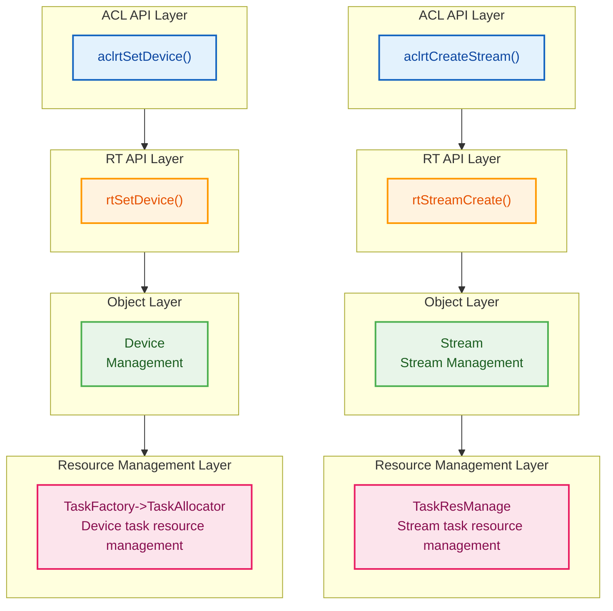
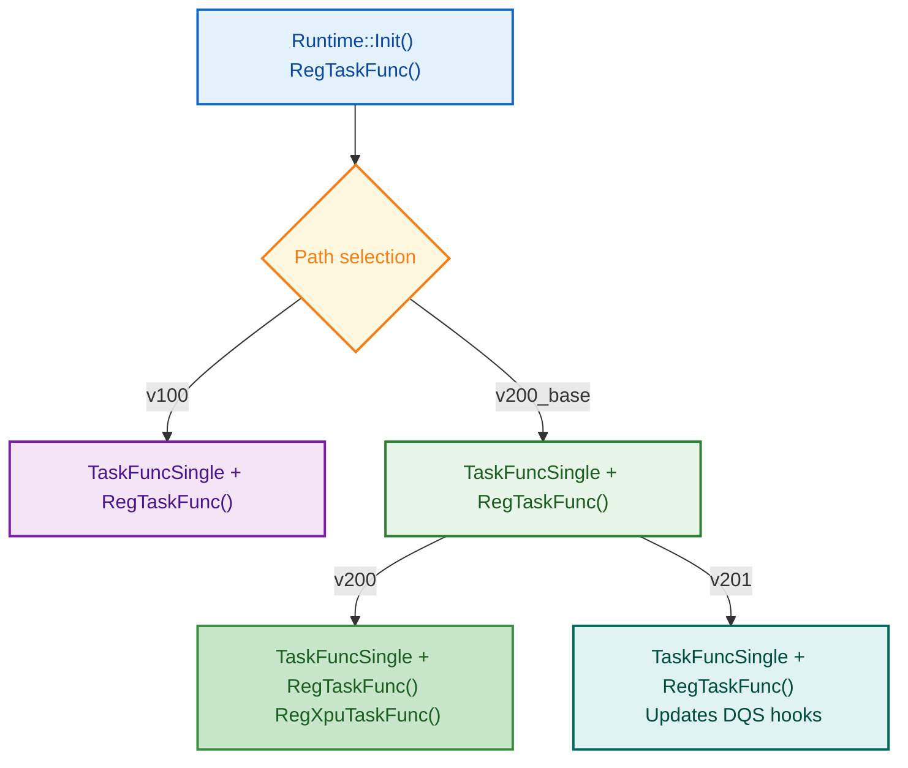
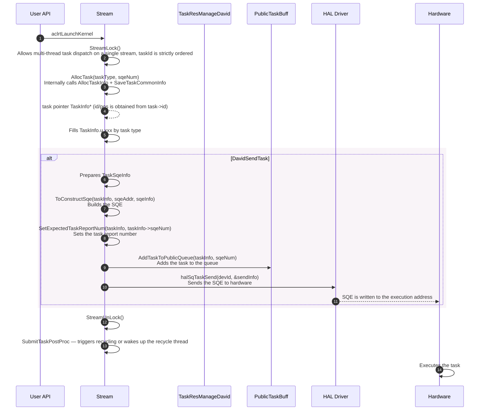
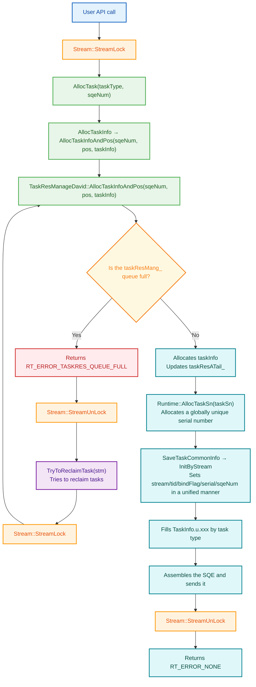
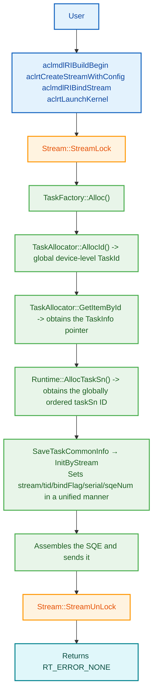
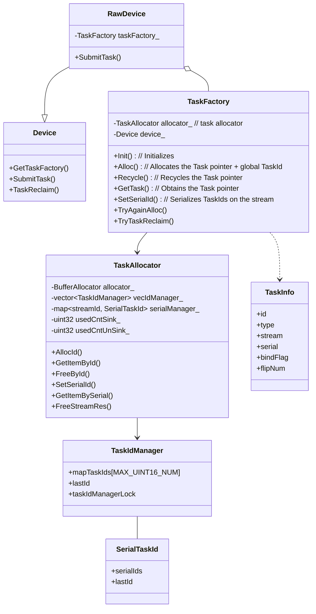
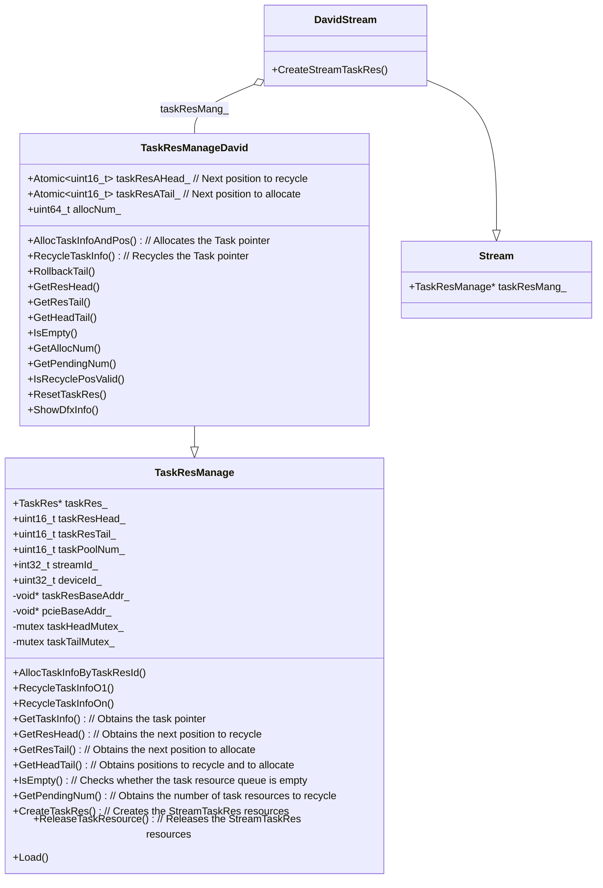

# Task Module Architecture

## 1. Module Overview

- **Description**: The Task module manages the creation, execution, and recycling of various tasks. It supports multiple task types (kernel execution, memory operations, event synchronization, model execution, and so on) and carries task information through the TaskInfo structure. Stream::taskResMang_ and TaskFactory jointly manage task object allocation and recycling.
- **Design Objectives**:
  - Provide a unified task management API
  - Support extensions of multiple task types
  - Implement an efficient task allocation and recycling mechanism
  - Support task state management and error handling

## 2. Usage Scenarios and External APIs

### 2.1 Usage Scenario Examples

- **Scenario 1**: Kernel execution task
  ```cpp
    // Dispatches a single-operator task.
    aclrtLaunchKernel(funcHandle, numBlocks, argsData, argsSize, stream);
    aclrtLaunchKernelXXX();
  ```

- **Scenario 2**: Event synchronization task
  ```cpp
  // Dispatches an event synchronization task and synchronizes the stream for the result.
  aclrtRecordEvent(event, stream1);  // Records the event on stream1.
  aclrtStreamWaitEvent(stream2, event);  // stream2 waits for the event.
  aclrtSynchronizeStream(stream1);  // Synchronizes stream1, triggering recycling.
  aclrtSynchronizeStream(stream2);  // Synchronizes stream2, triggering recycling.
  ```

### 2.2 Task Types
| Task Category | Task Type | Header File | Description |
|---------|---------|--------|------|
| Compute tasks | `TS_TASK_TYPE_KERNEL_AICORE` <br> `TS_TASK_TYPE_KERNEL_AICPU` <br> `TS_TASK_TYPE_KERNEL_AIVEC` | `davinci_kernel_task.h` | Operator core execution |
| Memory tasks | `TS_TASK_TYPE_MEMCPY` | `memory_task.h` | Executes asynchronous copy tasks such as H2D, D2D, and D2H |
| Event synchronization tasks | `TS_TASK_TYPE_EVENT_RECORD` <br> `TS_TASK_TYPE_STREAM_WAIT_EVENT` <br> `TS_TASK_TYPE_NOTIFY_RECORD` <br> `TS_TASK_TYPE_NOTIFY_WAIT` <br> `TS_TASK_TYPE_DAVID_EVENT_*` <br> `TS_TASK_TYPE_MEM_WRITE/WAIT_VALUE` | `event_task.h` <br> `notify_task.h` <br> `common_task.h` |Event waits for execution, such as inter-stream synchronization and inter-device synchronization|
| Condition tasks | `TS_TASK_TYPE_LABEL_*` <br> `TS_TASK_TYPE_STREAM_SWITCH` <br> `TS_TASK_TYPE_STREAM_ACTIVE` | `cond_op_label_task.h` | Label control |
| Management tasks | `TS_TASK_TYPE_MAINTENANCE` <br> `TS_TASK_TYPE_MODEL_MAINTAINCE` <br> `TS_TASK_TYPE_MODEL_EXECUTE`| `maintenance_task.h` <br>  `model_maintaince_task.h` <br> `model_execute_task.h` | Maintenance operations (stream/event destruction) <br> Model binds/unbinds streams <br> Model execution |

## 3. Architecture Overview

**Overall Design Concept**
**Task management is divided into three parts:**
- **Task resource management:** Task resources are divided into two parts: Device-granularity task resources and Stream-granularity resources.
- **Task processing functions:** Task processing functions perform unified registration management for flows such as task initialization, SQE encapsulation, post-task-recycling processing, and post-task-exception processing of different task types.
- **Task dispatch flow:** Together with APIs, the task dispatch flow completes runtime scheduling through the combination of task resource application, task assembly, and task dispatch APIs.


### 3.1 Task Resource Management Architecture



### 3.2 Task Processing Function Registration Architecture



All platforms register `TaskFuncSingle::toSqeFunc` through `RegTaskFunc`, and the functions are called through the unified `ToConstructSqe` entry.

### 3.3 David Task Dispatch Flow



## 4. Detailed Design

### 4.1 Core Workflows

#### 4.1.1 Task Resource Application and Dispatch Flow on a Single-Operator Stream



#### 4.1.2 Model Stream Task Resource Application and Dispatch Flow



### 4.2 Detailed Description of Core Mechanisms

#### 4.2.1 TaskInfo Structure Design

**Design concept**: TaskInfo is the unified carrier of tasks. It contains the task type, parameters, states, bitfield flags, and other information. Dedicated information structures of different task types are stored through the union.

```cpp
// File location: core/inc/task/task_info.hpp
typedef struct tagTaskInfoStru {
    Stream *stream;              // Owning stream
    tsTaskType_t type;           // Task type enumeration
    uint32_t errorCode;          // Error code
    uint32_t taskSn;             // Serial number (for profiling)
    uint32_t pos;                // SQ position (for David)
    uint16_t id;                 // Task ID
    uint16_t flipNum;            // Flip count (taskId rollover)
    uint8_t profEn;              // Profiling enable flag
    ...
    uint8_t serial : 1;          // Serial ID mode
    uint8_t bindFlag : 1;        // Model-bound stream flag
    uint8_t isCqeNeedConcern : 1; // CQE needs attention
    uint8_t isNeedStreamSync : 1; // Needs stream synchronization
    uint8_t sqeNum : 7;           // Number of actually sent SQEs, kept until task recycling
    ...
    union {
        AicTaskInfo aicTaskInfo;
        AicpuTaskInfo aicpuTaskInfo;
        DavinciMultiTaskInfo davinciMultiTaskInfo;
        MemcpyAsyncTaskInfo memcpyAsyncTaskInfo;
        ...
    } u;   // Dedicated information of each task type
    ...
} TaskInfo;
```

`sqeNum` is the number of actually sent SQEs, and `expectPackage` is the number of task reports to wait for before completion judgment. The two are not necessarily equal.
The task report number is set by `SetExpectedTaskReportNum` according to platform rules after SQE construction.

#### 4.2.2 TaskRes Resource Allocation Core Logic

**TaskResManageDavid core allocation code**: The TaskId on a stream must be strictly ordered. From TaskInfo pointer application to SQE assembly and dispatch to hardware, the entire process must be consistent with TaskId behavior. Therefore, StreamLock controls the entire process.

**Multi-SQE design**: A task may occupy multiple SQEs (for example, `sqeNum=2`). All `taskInfo.id` values point to the first position `pos`. During recycling, `taskResAHead_` is refreshed by `sqeNum`.

```cpp
// task_res_da.cc
rtError_t TaskResManageDavid::AllocTaskInfoAndPos(uint32_t sqeNum, uint32_t &pos, TaskInfo **task, bool needLog) {
    const uint16_t head = taskResAHead_.Value();
    uint16_t tail = taskResATail_.Value();
    const uint32_t taskDesTailIdx = (tail + sqeNum) % taskPoolNum_;
    
    // Full check: considers circular queue rollover
    if (((tail < head) && ((tail + sqeNum) >= head)) ||
        ((tail > head) && ((tail + sqeNum) >= taskPoolNum_) && (taskDesTailIdx >= head))) {
        return RT_ERROR_TASKRES_QUEUE_FULL;
    }
    
    pos = tail;
    *task = &taskRes_[pos].taskInfo;
    (void)memset_s(*task, sizeof(TaskInfo), 0, sizeof(TaskInfo));
    
    // Multi-SQE task: all sqeNums share the same id (= pos)
    while (tail != taskDesTailIdx) {
        taskRes_[tail].taskInfo.id = pos;
        tail = (tail + 1U) % taskPoolNum_;
    }
    
    taskResATail_.Set(tail);   // Updates tail
    allocNum_++;                // Cumulative allocation count (used to trigger periodic recycling)
    return RT_ERROR_NONE;
}
```

**Recycling retry when the queue is full**:

```cpp
// task_david.cc
static rtError_t AllocTaskInfo(TaskInfo** taskInfo, Stream* const stm, uint32_t& pos, uint32_t sqeNum) {
    TaskResManageDavid *taskResMang = ...;
    rtError_t error = taskResMang->AllocTaskInfoAndPos(sqeNum, pos, taskInfo);
    
    while (error == RT_ERROR_TASKRES_QUEUE_FULL) {
        // Releases StreamLock and tries recycling
        stm->StreamUnLock();
        TryToReclaimTask(stm, needLog);  // Calls TaskReclaimByStream or wakes up the recycle thread
        stm->StreamLock();
        // Retries allocation
        error = taskResMang->AllocTaskInfoAndPos(sqeNum, pos, taskInfo, needLog);
    }
    if (error == RT_ERROR_NONE) {
        Runtime::Instance()->AllocTaskSn((*taskInfo)->taskSn);
        SaveTaskCommonInfo(*taskInfo, stm, sqeNum);  // Internally calls InitByStream to set common header information in a unified manner
    }
    return error;
}
```

#### 4.2.3 Callback Framework of Task Processing Functions

**1. TaskFuncSingle structure** <br/>
The task callback function structure for different TASK_TYPEs. Each CHIP_TYPE and taskType is handled separately. The function void RegTaskFunc(rtChipType_t chipType, tsTaskType_t taskType, const TaskFuncSingle& funcs) is called for global registration.

```cpp
// src/runtime/core/src/task/inc/runtime_task_manager.h
using PfnTaskToSqe = void (*)(TaskInfo* taskInfo, void* const sqe, const TaskSqeInfo& sqeInfo);

struct TaskFuncSingle {
    PfnTaskToCmd toCommandFunc;
    PfnTaskToSqe toSqeFunc;
    PfnDoCompleteSucc doCompleteSuccFunc;
    PfnTaskUnInit taskUnInitFunc;
    PfnWaitAsyncCpCompleteFunc waitAsyncCpCompleteFunc;
    PfnPrintErrorInfo printErrorInfoFunc;
    PfnTaskSetResult setResultFunc;
    PfnTaskSetStarsResult setStarsResultFunc;
};

void ToConstructSqe(TaskInfo* taskInfo, void* const sqe, const TaskSqeInfo& sqeInfo);
```

**2. TaskFuncArrays structure** <br/>
TaskFuncArrays g_taskFuncArrays[CHIP_END] saves the corresponding TaskFunc by CHIP_TYPE during runtime initialization.

```cpp
// src/runtime/core/src/task/inc/runtime_task_manager.h
struct TaskFuncArrays {
    PfnTaskToCmd toCommandFunc[TS_TASK_TYPE_RESERVED];           // [0] TaskCommand construction
    PfnTaskToSqe toSqeFunc[TS_TASK_TYPE_RESERVED];               // [1] SQE construction
    PfnDoCompleteSucc doCompleteSuccFunc[TS_TASK_TYPE_RESERVED];  // [2] Post-task-completion processing
    PfnTaskUnInit taskUnInitFunc[TS_TASK_TYPE_RESERVED];          // [3] Task pointer clearing
    PfnWaitAsyncCpCompleteFunc waitAsyncCpCompleteFunc[TS_TASK_TYPE_RESERVED]; // [4] Asynchronous waiting
    PfnPrintErrorInfo printErrorInfoFunc[TS_TASK_TYPE_RESERVED];  // [5] Error printing
    PfnTaskSetResult setResultFunc[TS_TASK_TYPE_RESERVED];        // [6] Task exception result setting (v100)
    PfnTaskSetStarsResult setStarsResultFunc[TS_TASK_TYPE_RESERVED]; // [7] Task exception result setting (v100)
    PfnTaskSqeHeaderPostProc sqeHeaderPostProcFunc;
};
```
**3. Global variables used during task processing**  <br/>
Business code calls back and processes taskType through g_XXX.
```cpp
static PfnTaskToCmd *g_toCommandFunc = g_taskFuncArrays[CHIP_BEGIN].toCommandFunc;
static PfnTaskToSqe *g_toSqeFunc = g_taskFuncArrays[CHIP_BEGIN].toSqeFunc;
static PfnDoCompleteSucc *g_doCompleteSuccFunc = g_taskFuncArrays[CHIP_BEGIN].doCompleteSuccFunc;
static PfnWaitAsyncCpCompleteFunc *g_waitAsyncCpCompleteFunc = g_taskFuncArrays[CHIP_BEGIN].waitAsyncCpCompleteFunc;
static PfnPrintErrorInfo *g_printErrorInfoFunc = g_taskFuncArrays[CHIP_BEGIN].printErrorInfoFunc;
static PfnTaskSetResult *g_setResultFunc = g_taskFuncArrays[CHIP_BEGIN].setResultFunc;
static PfnTaskSetStarsResult *g_setStarsResultFunc = g_taskFuncArrays[CHIP_BEGIN].setStarsResultFunc;
PfnTaskUnInit *g_taskUnInitFunc = g_taskFuncArrays[CHIP_BEGIN].taskUnInitFunc;
PfnTaskSqeHeaderPostProc g_taskSqeHeaderPostProcRunningFunc =
    g_taskFuncArrays[CHIP_BEGIN].sqeHeaderPostProcFunc;

```

### 4.2.4 Task Recycling Flow
#### 4.2.4.1 David Task Recycling Trigger Timing

| Trigger Condition | Invocation Method | Description |
|----------|---------|------|
| After every 64 dispatched tasks | `WakeUpRecycleThread` | Periodic recycling, triggered when `allocNum_ % 64 == 0` |
| Dispatch task queue is full | `TryToReclaimTask` | Triggers active recycling when the allocation queue is full |
| Stream synchronization (Synchronize) | `WakeUpRecycleThread` | Triggers the recycle thread and waits for all tasks to complete |
| Stream destruction (TearDown) | `TaskReclaimByStream` | Clears all tasks |
| Independent recycle thread | `RecycleThreadDoForStarsV2` | `IsSeparateSendAndRecycle()` mode |

#### 4.2.4.2 Independent Recycle Thread

```cpp
// task_recycle.cc:310-341
void RecycleThreadDoForStarsV2(Device *deviceInfo) {
    // Traverses all streams on the device
    for (const auto &id : streamIdList) {
        stream->StreamRecycleLock();
        stream->ProcArgRecycleList();     // Processes the arg recycle list
        
        // Skips empty queues / DVPP binding / non-separate recycling mode
        if (taskResMang->IsEmpty() || stream->IsBindDvppGrp() || !stream->IsSeparateSendAndRecycle()) {
            continue;
        }
        
        TaskReclaimForSeparatedStm(stream);
        //   → ProcLogicCqUntilEmpty(stm)  // Collects CQEs first
        //   → RecycleTaskBySqHeadForRecycleThread(stm)  // Then recycles by drv sqHead
        
        stream->StreamRecycleUnlock();
    }
}
```

### 4.3 Module Responsibility Division
 | Module | Responsibility | Location | 
 |------|------|------| 
 | TaskInfo | Task information structure | `core/inc/task/task_info.hpp` |
 | TaskFactory | Task object factory class, held by the Device object, allocates and recycles Task objects | `core/inc/task/task.hpp` |
 | TaskAllocator | Task object allocator, manages the task pool, belongs to TaskFactory | `core/src/pool/task_allocator.hpp` |
 | TaskResManage | Task resource management, held by Stream | `task/task_res_manage/` | 
 | DavidSendTask <br/> SubmitTask | Task submission module | `task/task_submit/v200/task_david.cc` <br/> `engine/engine.cc`|
 | RecycleThreadDoForStarsV2 | Task recycling module | `task/task_recycle/` <br/> `stars_engine.cc`| 

### 4.4 Core Data Structures

#### 4.4.1 Device TaskFactory Class Diagram



#### 4.4.2 Stream TaskRes Class Diagram



## 5. Key File Index

| Functional Module | File Path | Core Content |
|----------|---------|---------|
| Stream declaration | `core/src/stream/stream.hpp` | `taskResMang_` field |
| DavidStream | `core/src/stream/stream_david.cc` | CreateStreamTaskRes<br>TearDown |
| TaskInfo definition | `core/inc/task/task_info.hpp` | TaskInfo structure |
| TaskRes base class | `core/inc/task/task_res.hpp` | TaskRes structure <br> TaskResManage class declaration |
| TaskResManageDavid | `core/inc/task/task_res_da.hpp` | Atomic head/tail<br> AllocTaskInfoAndPos |
| TaskResManage implementation | `core/src/task/task_res_manage/task_res.cc` | v100 allocation/recycling/Load |
| TaskResManageDavid implementation | `core/src/task/task_res_manage/v200/task_res_da.cc` | David allocation/recycling/rollback |
| David task dispatch | `core/src/task/task_submit/v200/task_david.cc` | AllocTask (unified entry)<br>AllocTaskInfo <br> SaveTaskCommonInfo <br> DavidSendTask |
| David task recycling | `core/src/task/task_recycle/v200/task_recycle.cc` | TryRecycleTask <br> Recycle thread |
| Common recycling logic | `core/src/task/task_recycle/v200/task_recycle_common_base.cc` | TaskReclaimForSeparatedStm <br> CQE recycling and Task recycling |
---

_This module documentation is based on analysis of the source code `src/runtime/core/src/task/`._
